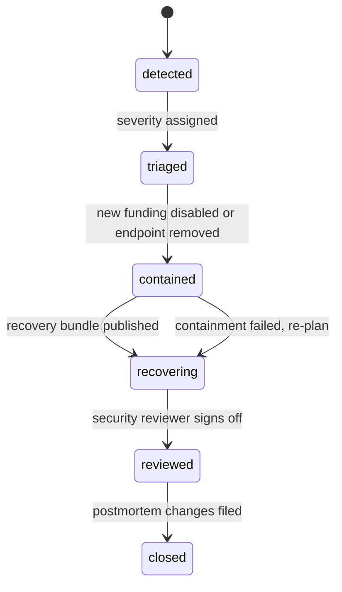

# G26 incident response and redacted diagnostics

## 1. Metadata and status

Owner: p2p-offramp maintainers; security reviewer approves security gates.

Version: 1.1 operator runbook, 2026-10-24 (supersedes the 1.0 design baseline of 2026-10-22).

Delivery: M2C.

Status: operator runbook design baseline; implementation, interoperability evidence and independent review pending. This document does not certify a deployed or audited product. No incident has been exercised, no security contact channel has been verified, and no drill has been recorded by this document. DEVELOPMENT_ROADMAP.md controls milestone order.

## 2. Objective and scope

Triage failures while keeping private trade content local by default and preserving existing escrow exits. No analytics backend, automatic report upload or remote kill switch is required or introduced. Maintainers cannot reverse basic escrow settlement or repair fiat loss; the runbook says so to users rather than implying otherwise.

In scope: severity classification, triage, containment through signed advisories, local redacted diagnostics, user export, and fund-recovery communication.

Out of scope: operating a support backend, collecting telemetry, and any claim that redaction is complete.

Applicability: no ZK circuit applies to G26. No smart contract is introduced or modified by this specification. It relies on the escrow exits fixed by G17/G18 and the deployment identities recorded under G25.

## 3. Architecture and data contracts

IncidentRecord: `{incidentId, severity, reportedAt, affectedManifestDigests[], affectedDeploymentIds[], impact, hypothesis, containment, recovery, reviewer, status, advisoryDigest}`

- `status` is exactly one of `detected`, `triaged`, `contained`, `recovering`, `reviewed`, `closed`.
- `affectedManifestDigests` and `affectedDeploymentIds` use the digests from G25. Free text does not replace them.
- `incidentId` is a random identifier. It is not derived from a user, wallet or trade.

Local DiagnosticEvent allowlist (the only fields a diagnostic event may contain):

`{v, timeBucket, releaseId, module, errorCode, operation, routeState, chainNamespace, storageSchema}`

- `v` is the event format version.
- `timeBucket` is coarsened to the hour in UTC. It is not an exact timestamp.
- `module`, `operation`, `routeState`, `chainNamespace` and `errorCode` take values from fixed enumerations in the typed error catalog (G13).
- `releaseId` and `storageSchema` are the values from the signed manifest in use.

Storage limits: at most 500 events or 1 MiB, whichever is reached first, retained for 7 days in local browser storage. Older events and events beyond the cap are discarded. Diagnostics are not a durable audit ledger.

Excluded from every diagnostic event, without exception: wallet and trade identifiers, escrow addresses, RPC query parameters, endpoint credentials, balances, bank details, chat content and evidence, key material and seeds, exact location, clipboard content, provider message bodies, stack traces and free-text error strings.

## 4. Algorithms and lifecycle

### 4.1 Severity levels

| Severity | Definition | Examples | Initial response |
|---|---|---|---|
| critical | Loss of funds, key compromise, or a defect that lets an attacker move escrowed funds | Signing key compromise; malicious release that alters settlement; escrow defect | Freeze new funding in an advisory immediately; open recovery package; notify security reviewer |
| high | Broad disclosure of user data, or a malicious endpoint or dependency served to users, without confirmed fund loss | Diagnostic leak; compromised RPC or relay endpoint returning altered data | Remove endpoint from future releases; advisory with affected hashes; notify reviewer |
| medium | Trade cannot complete through the normal path, funds are not at risk, a workaround exists | Gateway outage with a working origin; one module failing on one storage schema | Publish safe workaround; fix in next signed release |
| low | Cosmetic or single-user availability problem with an alternative route | Display fault; one locale string missing | Fix through normal release |

Classification rule: when in doubt between two levels, use the higher level and downgrade after triage. Do not wait for perfect attribution before publishing a scoped advisory.

### 4.2 Triage without collecting trade content

Triage starts from the report, not from the user's data. The intake form asks only for:

1. Release identifier and manifest sequence, read from the app's about screen.
2. Module name, error code and operation, from the diagnostic preview.
3. Chain namespace (EVM or Solana) and storage schema.
4. Approximate UTC time of first occurrence.
5. Whether funds are at risk, answered yes, no or unsure.

Operators do not ask for, and do not record: seed phrases, private keys, passphrases, wallet addresses, trade IDs, amounts, bank details, chat messages, screenshots of trade screens, or receipts. If a reporter sends any of these unprompted, the operator deletes the copy, does not quote it in the incident record, and replies with the rule above. Support never requests a seed, private key or passphrase.

Triage steps:

1. Confirm severity from section 4.1 using the reported facts. Record uncertainty as uncertainty.
2. Reproduce on a test network with the same `releaseId` where possible.
3. Decide whether the release, the endpoint or the origin is the affected component.
4. For critical or high incidents, move the incident to `triaged` and notify the security reviewer.

### 4.3 Containment and recovery

Containment, in order of preference:

1. Publish a new signed advisory release with a higher manifest `sequence` that disables new funding in the UI and removes any unsafe endpoint or dependency from the registry (G11).
2. Keep the existing escrow exits working. On-chain settlement is immutable and cannot be paused by maintainers.
3. Publish the independent recovery bundle and the verified deployment identities (G25 section 4.6) at a static origin and on IPFS. Do not remove or overwrite old artifacts.
4. Only a rollback to a previously reviewed source is allowed as a fix, and only with a higher sequence (G25 section 4.5).

Signing-key compromise requires an out-of-band trust re-bootstrap, not a same-origin unsigned replacement key. The maintainers announce the new trust root on at least one channel that is independent of the compromised origin, and clients refuse manifests signed only by the old key after the announced cut-over sequence.

### 4.4 Advisories

An advisory contains:

- affected manifest digests and deployment identifiers;
- observed facts, separated from hypotheses;
- stated uncertainty;
- safe recovery steps that work without the frontend;
- the signed publication sequence number and the advisory digest recorded in the IncidentRecord.

An advisory never contains user data, a claim that funds are safe when this is unverified, or an invented contact address.

### 4.5 Diagnostics: collection, preview and export

- `collectDiagnostics()` returns only allowlisted fields from section 3. It reads no raw error object.
- Error mapping drops provider message bodies and strips the query string and fragment from every URL before it is stored.
- Events are written to local storage only. Nothing is sent automatically.
- `previewExport()` shows the exact final bytes as field-by-field rows and lists any warning, such as a field that was truncated to fit the cap.
- The user explicitly selects which events to include. The export is capped at 1 MiB and downloaded to the user's device.
- Sharing the downloaded file is a separate action the user takes outside the app.
- `clearDiagnostics()` erases the local ring. It works while the vault is locked and does not require the passphrase or any secret.

No redaction claim is made as mathematically complete. The redaction is an allowlist, which is tested (section 7) and reviewed, not a proof.

### 4.6 Fund-recovery communication

Users are told the following, in plain language, through the verified channel only:

1. What is affected, in terms of release and network, without user-specific details.
2. That existing escrows settle on-chain and that the maintainers cannot reverse a completed settlement or repair fiat loss.
3. How to recover using the recovery bundle and section 4 of G25, with no frontend required.
4. How to confirm they are using the correct network and the expected code hash before signing.
5. That support will never ask for a seed phrase, private key or passphrase.

Templates must not promise a timeline, compensation or a specific outcome that the maintainers have not verified.

Security contact: instructions must name a real, maintained channel before any release. If no such channel exists, the release is blocked. No placeholder or invented address is published.

## 5. Interfaces and integration

Diagnostics interface:

- `collectDiagnostics(): DiagnosticEvent[]` returns at most 500 allowlisted events.
- `previewExport(selection): { bytes: Uint8Array, rows: { field: string, value: string }[], warnings: string[] }` returns the final bytes shown to the user.
- `clearDiagnostics(): void` erases the local ring without unlocking the vault.

Error mapping: `mapError(raw): TypedError` keeps only the typed error code and the module. It never copies `raw.message`, `raw.stack`, or any URL query or fragment.

Failure codes:

- `REDACTION_FAILED`: export is blocked. Escrow recovery is not affected.
- `REPORT_TOO_LARGE`: the user must reduce the selection. Nothing is uploaded.

Advisory interface: a signed JSON document carrying the fields in section 4.4, verified by the same trust root as the release manifest (G15).

## 6. Errors, abuse and residual threats

- Browser storage can be evicted at any time. Diagnostics may be lost; this is acceptable because they are not an audit record.
- Timing, module and error combinations can fingerprint a user even after redaction. The export preview shows the combination so the user can decide.
- Malware or same-origin XSS can bypass diagnostics controls entirely. The runbook does not claim otherwise.
- Clock rollback can distort `timeBucket`. Buckets are advisory, not evidence.
- A social-engineering attacker may impersonate support. The fixed rule that support never requests secrets is the control; users are told to verify the channel.
- Maintainers cannot reverse basic escrow settlement or repair fiat loss. This is stated in every user-facing recovery message.

## 7. Verification and primary references

Tests and drills required before a release is accepted:

1. Inject known secret strings (seed-like values, a fake private key, a bank-like account number, a wallet address, a URL query token) into every raw error field, then assert none appear in the export bytes.
2. Locked-vault erase: lock the vault, call `clearDiagnostics()`, and confirm the ring is empty without a passphrase.
3. Capacity and age: write 501 events and events older than 7 days; confirm the cap and expiry.
4. Corrupt event storage: write invalid JSON and an out-of-range event to the ring; confirm both are discarded and the app still starts.
5. Clock rollback: move the clock backwards; confirm no crash and no negative age retention.
6. Offline advisory and recovery: confirm the recovery bundle and advisory load from the static origin and from IPFS with no network to the RPC.
7. `REDACTION_FAILED` and `REPORT_TOO_LARGE`: confirm export is blocked and escrow recovery still works.

Drill on test networks, separately: bad release, compromised endpoint, signing-key incident and lost origin. Record recovery evidence and postmortem changes without personal data. Each drill is recorded with the exact revisions tested.

Operational ownership, implementation and independent rehearsal remain pending. No drill in this document has been performed.

Primary references (exact implementation revisions must be pinned in the evidence record): [OWASP logging guidance](https://cheatsheetseries.owasp.org/cheatsheets/Logging_Cheat_Sheet.html); [NIST incident response](https://csrc.nist.gov/pubs/sp/800/61/r3/final).
