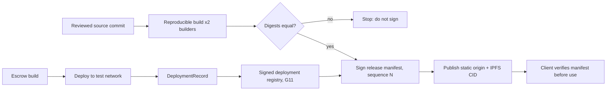

# G25 deployment, rollback and independent recovery

## 1. Metadata and status

Owner: p2p-offramp maintainers; security reviewer approves security gates.

Version: 1.1 operator runbook, 2026-10-24 (supersedes the 1.0 design baseline of 2026-10-22).

Delivery: M2C.

Status: operator runbook design baseline; implementation, interoperability evidence and independent review pending. This document does not certify a deployed or audited product. No testnet deployment, mainnet deployment, signed release or recovery rehearsal recorded in this repository has been performed by this document. DEVELOPMENT_ROADMAP.md controls milestone order.

## 2. Objective and scope

Deploy one reviewed static release and separately verified EVM and Solana escrows to a selected test network; support frontend rollback without pretending immutable funded terms or public artifacts can be rolled back; and give an operator a procedure to recover funds directly from chain state when the frontend, origin or gateway is unavailable.

In scope: reproducible build of the static client, escrow deployment to local or test networks, release manifest signing, static and IPFS publication, frontend rollback, and direct-contract fund recovery.

Out of scope: mainnet promotion, real-funds enablement (`RELEASE_ENABLED` stays 0), fiat recovery, arbitration-enabled escrow (Phase 6), and any claim of independent audit. Testnet deployment precedes independent real-funds release review; this runbook does not replace that review.

Applicability: no ZK circuit applies to G25. Smart contract and program deployment applies: the EVM escrow (G17/G18, H2) and the Solana escrow program (H3). This document authors no contract source; it defines how already-reviewed artifacts are deployed, recorded and used for recovery.

## 3. Architecture and data contracts

Two release sequences run independently. The frontend sequence is a series of signed static manifests. The chain sequence is a set of deployment records, one per network and escrow identity. A frontend change never redeploys or re-keys an escrow.

DeploymentRecord (one per network and escrow instance):

`{releaseManifestDigest, chainId, genesisIdentity, contractOrProgramId, codeDigest, initializationTx, authorityModel, assetAllowlistDigest, rpcPolicyDigest, explorerTemplate, reviewEvidenceDigest}`

- `chainId` and `genesisIdentity` are read from the node, never from configuration alone.
- `codeDigest` is the EVM runtime code hash or the Solana program data hash, read from chain state after deployment.
- `authorityModel` is one of `immutable` (EVM, no admin functions) or `upgradeable(authority)` (Solana). A record with an unknown or hidden authority is invalid.
- `assetAllowlistDigest` covers the native asset and the allowlisted ERC-20 or SPL/Token-2022 mints only.

ReleaseManifest (signed, monotonic `sequence`):

`{sequence, releaseId, sourceCommit, builderDigests[], files[{path, sha256, bytes}], storageSchema, deploymentRegistryDigest, minReaderSchema, advisory?}`

Storage compatibility: `storageSchema` must be readable by the client that receives the manifest. A client that sees a schema newer than it supports refuses to write and offers read-only export (`SCHEMA_TOO_NEW`).

Recovery package (published with every release, usable without the frontend): ABI (EVM) and IDL (Solana), addresses and code hashes per network, exact release and refund parameter encoding, chain-time instructions, and the receipt and journal formats. The package contains no wallet private keys, seeds or passphrases.

## 4. Algorithms and lifecycle

### 4.1 Reproducible build

1. Check out the reviewed commit by full SHA. Record `sourceCommit`.
2. Install from the lockfile only: `npm ci --ignore-scripts`. The Node major is 24 (`engines.node` in `package.json`). Record the exact Node and npm versions.
3. Run `npm test`, `npm run typecheck`, `npm run check:specs` and `npm run test:browser`. A failure stops the release.
4. Build the static client with a fixed environment. No build-time network access is used except the pinned dependency fetch in step 2.
5. Two independent builders (different machines or operators) produce the artifact. Compare SHA-256 of every file. Any difference stops signing. Record both builder digests.
6. Generate `files[]` with sha256 and byte counts. The archive order is sorted by path.

Primary reference for the static output layout: [Vite static deployment](https://vite.dev/guide/static-deploy).

### 4.2 Contract and program deployment (test network only)

Preconditions: G17/G18 (EVM) or H3 (Solana) reviewed artifacts exist for the exact `codeDigest` being deployed. Evidence of the reviewed revision is recorded in `reviewEvidenceDigest`.

EVM steps:

1. Confirm `eth_chainId` and the genesis block hash of the target test network match the registry entry.
2. Deploy the reviewed bytecode. Record the deployment transaction hash and the contract address.
3. After finality, read the deployed runtime code with `eth_getCode` and compare its hash with `codeDigest`. A mismatch stops use of the address.
4. Read the initialization state (asset allowlist, deadline parameters) and compare with `assetAllowlistDigest`.
5. Confirm there is no owner, pauser or upgrade entry point that can alter settlement. If one exists, the record is invalid for release.

Solana steps:

1. Confirm the cluster genesis hash matches the registry entry.
2. Deploy the program with the reviewed build. Record the program ID and the program data account.
3. Read the program data account and compare its hash with `codeDigest`.
4. Read the upgrade authority. Record `authorityModel` as `immutable` when the authority is revoked, or as `upgradeable(<authority pubkey>)` otherwise. A test-network upgradeable deployment is allowed only with the authority recorded and an explicit note that it is not a release property.
5. Initialize the mint allowlist and compare with `assetAllowlistDigest`.

Required exercise before the record is accepted: a full release, a full refund after the deadline, and a crash between transaction broadcast and confirmation followed by reconciliation through the transaction journal (G12).

Primary references: [Solana program deployment](https://solana.com/docs/programs/deploying); [Ethereum JSON-RPC](https://ethereum.org/en/developers/apis/json-rpc/).

### 4.3 Manifest signing

- The release key is held offline or in a hardware-backed signer controlled by the maintainers. It is never stored in the repository, CI logs or the build output.
- Sign the canonical JSON of the manifest. The signature covers `sequence`, all file digests, `storageSchema` and `deploymentRegistryDigest`.
- A client accepts a manifest only if `sequence` is strictly greater than the last accepted sequence, the signature verifies against the trust root bundled in the release, and every fetched file matches its digest.
- The first release after any key compromise uses an out-of-band trust re-bootstrap (see G26). A same-origin unsigned replacement key is never accepted.

### 4.4 Publication

1. Upload the verified files to the static origin. Record origin URL and upload time (UTC).
2. Pin the same files to IPFS. Record the root CID and confirm that a second gateway returns identical bytes for each path.
3. Publish the manifest and recovery package beside the files, and record both digests in the release log.
4. Smoke-test from a clean profile: load the origin, verify the manifest signature, and confirm the displayed `releaseId`.

Old immutable artifacts and old CIDs are never overwritten or removed by the release process.

### 4.5 Frontend promotion and rollback

Promotion happens only after G24 end-to-end evidence and G15 manifest checks pass for the new `sequence`.

Rollback means publishing a new manifest with a higher `sequence` built from a previously reviewed `sourceCommit`. It does not reuse the old sequence number and does not edit any published file. The rollback manifest must:

- carry a `storageSchema` the current clients can read (storage downgrade is forbidden);
- reference the current `deploymentRegistryDigest` (escrow addresses and deadlines are unchanged by rollback);
- disable new funding in an advisory where needed (see G26).

Clients on an incompatible newer schema keep their data and offer read-only export. Existing escrow addresses and deadlines stay unchanged. Maintainers can disable new funding in the UI but cannot pause immutable on-chain settlement.

### 4.6 Direct-contract fund recovery

This procedure works with no frontend, origin or gateway, using only the recovery package and an external wallet or CLI.

1. Obtain the recovery package from at least two independent locations and compare the code hashes and addresses.
2. Connect to the network, confirm `chainId` and genesis identity, and confirm the code hash at the escrow address against `codeDigest`.
3. Read the escrow state directly from chain. Record seller, buyer, asset, amount and deadline as stored on chain. Do not trust the receipt for these values.
4. Compare the deadline with chain time (the latest block timestamp), never the local clock.
5. If chain time is before the deadline and you are the seller: construct the release transaction from the recovery package and submit it through your wallet.
6. If chain time is at or after the deadline: anyone may construct the refund, which pays the seller only. Construct it and submit it.
7. Wait for finality, re-read the escrow state, and record the transaction hash and the final state.

Receipts are a discovery aid, not custody authority. A receipt that disagrees with chain state is wrong.

## 5. Interfaces and integration

Each operator action in this runbook produces an evidence entry with: operator identity, UTC timestamp, exact input digests, expected result, actual result, an independent witness, and actual chain evidence (transaction hash, block number, and read-back of the state). An entry without a witness is recorded as unwitnessed.

Recovery interface (client, when available): `recoverTrade(receipt)` verifies network and code hash, reads the authoritative escrow, shows the bound seller, buyer, asset and deadline, and constructs the release or refund for an external wallet to sign. The client does not hold keys. A seller can release only before expiry. Anyone can trigger a refund after expiry, and it pays only the seller.

Non-frontend interface: the recovery package provides explicit CLI or explorer instructions with the verified ABI or IDL and a privacy disclosure stating which public chain data the operator reads.

Error handling in the interface: `WRONG_NETWORK`, `CODE_MISMATCH`, `SCHEMA_TOO_NEW`, `RPC_UNAVAILABLE` and `STATE_UNCERTAIN` stop transaction construction until resolved.

## 6. Errors, abuse and residual threats

- `WRONG_NETWORK`: the wallet or RPC is on a different chain than the record. Stop; switch networks; do not sign.
- `CODE_MISMATCH`: the on-chain code hash differs from `codeDigest`. Stop; treat the address as unverified; escalate to G26.
- `SCHEMA_TOO_NEW`: the client cannot write the stored schema. Export read-only; do not downgrade.
- `RPC_UNAVAILABLE`: use an alternate endpoint from the signed registry only. Do not use an unlisted endpoint.
- `STATE_UNCERTAIN`: a broadcast whose outcome is unknown. Reconcile through the journal and chain before any retry. A second submission without reconciliation risks a duplicate economic action.

Residual threats that frontend rollback cannot address:

- It cannot reverse transactions, recover fiat, or remove old CIDs from IPFS gateways.
- An untrusted origin can serve a dishonest recovery page. The recovery package and section 4.6 must remain usable without it.
- A compromised release key can sign a malicious manifest until the trust re-bootstrap completes (G26).
- Seller-side loss of the wallet before expiry leaves the escrow for refund after deadline only.

## 7. Verification and primary references

Rehearsals required before any test-network record is accepted:

1. Gateway outage: the origin serves the release and IPFS is unreachable. Clients load from origin.
2. Bad frontend promotion: publish a deliberately broken sequence on a test origin, then roll back with a higher sequence. Confirm clients reject the broken build by digest and accept the rollback.
3. Schema-forward-only state: open a profile written by a newer schema and confirm read-only export and no write.
4. Lost origin: run section 4.6 with no frontend, using only the downloaded recovery package, on both chain families.
5. Unavailable primary RPC: confirm fallback to registry-listed endpoints and `RPC_UNAVAILABLE` when none respond.
6. Wallet account change mid-trade: confirm transaction construction stops and re-reads the escrow for the new account.

Execute section 4.6 from the downloaded independent bundle on both chain families using test funds only. Record measured recovery steps, elapsed time, finalized transactions and independent observer results. Record each rehearsal in the evidence record with exact revisions pinned.

Release remains blocked until independent security review and all chain-specific gates pass. No rehearsal in this document has been performed.

Primary references (exact implementation revisions must be pinned in the evidence record): [Vite deployment](https://vite.dev/guide/static-deploy); [Solana program deployment](https://solana.com/docs/programs/deploying); [Ethereum JSON-RPC](https://ethereum.org/en/developers/apis/json-rpc/).
