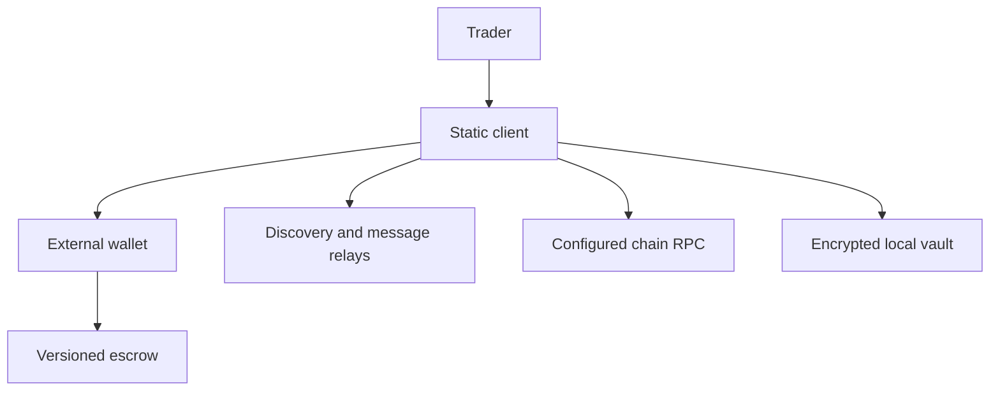

# System context and authority contract

## 1. Metadata

- **Specification ID:** CTX01
- **Version:** 1.0
- **Owner:** p2p-offramp maintainers
- **Status:** Expanded design baseline — implementation and independent review pending
- **Delivery phase:** 0
- **Reviewed source baseline:** docs/security-spec-expansion-20261021
- **Normative language:** MUST is a release gate; SHOULD deviations require a recorded reason.

## 2. Objective

Define which subsystem may establish each fact in the basic noncustodial trade. This contract governs the static off-ramp client. The separate `payments/` custodial ledger branch is not an off-ramp dependency and MUST NOT be wired into wallet balance or settlement authority. Server accounts, operator-held wallet keys, automated bank transfers, and privileged escrow release are outside the basic product.

## 3. Architecture and data flow



| Fact | Authority | Cached or untrusted input |
|---|---|---|
| Spending consent | External wallet for current account/network | Button click, local journal |
| Funded, released, refunded | Supported deployed escrow, reconciled through configured RPC and finality policy | Relay event, receipt screenshot |
| Offer intent | Validated signed advertisement, still revalidated before funding | Relay ordering and availability |
| Fiat receipt | Seller's manual attestation in basic mode | Buyer statement, chat, screenshot, proof-provider output |
| Local recovery material | Authenticated G02 vault snapshot | localStorage, imported filenames |
| Privacy coverage | Per-channel enforceable G05 routing evidence | A selected UI preset |

RPCs can lie or censor; finality here means the chain adapter's observed policy, not independently verified consensus. The UI MUST expose the RPC origin and unavailable/stale state. Independent proof or light-client verification is a separate capability.

## 4. Algorithms and invariants

1. Start in locked/watch-only mode. Load a validated network/deployment registry before wallet operations.
2. Treat every relay, RPC, wallet callback, backup, URL, and QR as untrusted input; validate at the boundary and enforce size limits before allocation or crypto.
3. Bind every economic command to `(chain family, network ID, deployment ID, trade ID, account generation)`; a mismatch invalidates the command before signing.
4. A wallet/network change cancels pending preparation and requires a new explicit confirmation. An already broadcast transaction remains in the journal for reconciliation under its original binding.
5. The basic escrow seller can release only before its immutable deadline; timeout returns crypto to seller. A fiat-paid assertion never grants release authority. No extension may change already-funded terms.
6. With advanced packages removed, the basic client MUST still reconcile, release, refund, and export recovery information. No chain or relay failure can be treated as proof that a transaction failed.

No cryptographic primitive or ZK circuit is defined by this boundary contract.

## 5. Interfaces and failure behavior

```typescript
type ChainFamily = "evm" | "solana";
interface TradeBinding {
  chain: ChainFamily;
  networkId: string; // exact registry key; not a display label
  deploymentId: string; // versioned registry entry
  tradeId: string; // chain adapter validates canonical encoding
}
interface AuthoritySnapshot {
  binding: TradeBinding;
  walletGeneration: number; // nonnegative safe integer
  observation: "unknown" | "pending" | "confirmed" | "finalized" | "reorged";
  source: "chain-rpc";
  observedAt: number; // local Unix milliseconds, informational only
}
```

All command constructors take a validated binding and generation. Missing deployment, unsupported chain, unavailable RPC, stale observation, and mismatched wallet return explicit refusal. A renderer may display cached data while offline but MUST disable economic actions until fresh chain reconciliation. Neither observedAt nor the local clock establishes escrow expiry; adapters use chain time.

## 6. Threat assessment

A malicious relay can advertise a fake escrow address: accept deployment identity only from the validated registry, never the ad. A compromised RPC can fabricate balances: show the trust boundary, use configured independent corroboration where supported, and refuse on observed disagreement. An XSS attacker can read unlocked state and alter signing requests: G04 rendering/CSP and wallet confirmation remain required. A dishonest seller can receive fiat and withhold release; the client must state this before payment. TLS, encrypted chat, and ZK receipt evidence do not solve that basic economic risk. Local backups cannot reverse chain outcomes or recover lost external-wallet spending keys.

## 7. Verification and references

Unit cases MUST cover each authority row, unknown chain/deployment, account/network changes before and after broadcast, and buyer fiat assertions with no authority. Integration cases MUST remove all optional packages and exercise complete basic release/refund recovery. Adversarial fixtures MUST include a validly signed ad with an unauthorized deployment, lying RPC responses, and stale local success after a simulated reorg. Test both chain families before claiming parity. No supported provider/browser/deployment matrix is approved by this spec alone.

Primary contracts: [development roadmap](../../../DEVELOPMENT_ROADMAP.md), [G02 vault](../../../05_ADVANCED_PRIVACY_INFRASTRUCTURE/feature_5.7_local_data_isolation/module_5.7.2_indexeddb_vault/spec-indexeddb-encrypted-records.md), [G05 transport](../../../05_ADVANCED_PRIVACY_INFRASTRUCTURE/feature_5.1_network_privacy/module_5.1.2_transport_policy/spec-transport-policy-enforcement.md).
