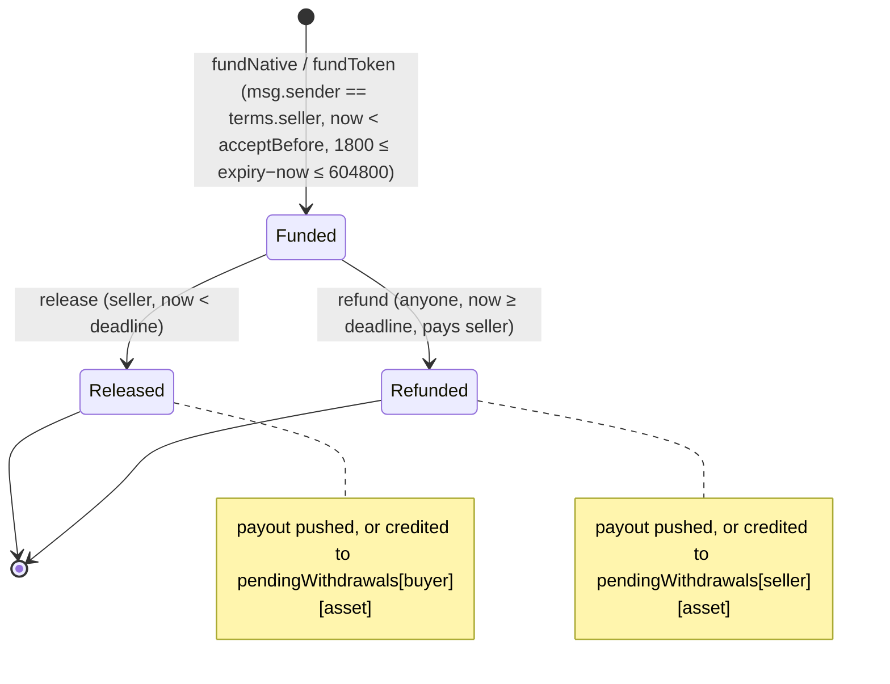

# Escrow contract interface — implementation and security specification

## 1. Metadata

- **Specification:** spec-escrow-contract-interface
- **Version:** 2.0 (Iteration 3; reflects `contracts/evm` BasicEscrow v1)
- **Owner:** p2p-offramp maintainers
- **Status:** Expanded design baseline — EVM test-network implementation present; independent review pending
- **Delivery phase:** 2 (G17/G18; work item H2)
- **Normative language:** MUST is a release gate; SHOULD deviations need a recorded reason.
- **Implementation:** [BasicEscrow.sol](../../../contracts/evm/src/BasicEscrow.sol), ABI [BasicEscrow.json](../../../contracts/evm/abi/BasicEscrow.json), notes [README](../../../contracts/evm/README.md) and [SECURITY-NOTES](../../../contracts/evm/SECURITY-NOTES.md). Solana is a separate program contract (H3) and is not covered by this implementation.

## 2. Objective and boundaries

Specify immutable basic custody: seller deposits, seller alone releases to buyer before deadline, and anyone may execute a refund to the seller at/after deadline. There is no buyer payment claim, juror, oracle, owner, admin, proxy, pause, upgrade, sweep or destination override (roadmap decision 2).

This contract consumes G16 public terms ([trade-terms.ts](../../../packages/domain/src/trade-terms.ts), [evm-terms.ts](../../../packages/wallet/src/evm-terms.ts)), CTX01 `TradeBinding`, CTX02 observations, G08 authority, G10 wallet sessions, G11 approved registry and G12 transaction intents. `CoreResult`/error codes follow G13. Native transactions/signatures retain their chain formats; local or relay observations never establish custody or fiat receipt.

Out of scope for basic v1: on-chain verification of acceptance signatures (EIP-712 ECDSA/EIP-1271), protocol fees, partial release, dispute paths and any extension that changes release/refund authority.

## 3. Architecture and data contracts



```solidity
struct TradeTerms { bytes32 orderId; uint64 revision; string networkId; string deploymentId;
  address seller; address buyer; uint8 assetKind; address asset; uint256 amountBaseUnits;
  bytes32 privateAgreementHash; bytes32 capabilitiesHash; bytes32 sellerNonce;
  uint64 acceptBeforeSeconds; uint64 escrowExpirySeconds; }        // v=1, mode=0 hashed as constants
struct Escrow { address seller; uint64 deadline; State state; address buyer; address token; uint256 amount; }
enum State { None, Funded, Released, Refunded }

constructor(address[] tokens)                          // fixed ERC-20 allowlist, ≤ 32, code, unique
fundNative(TradeTerms terms) payable returns (bytes32 tradeId)   // assetKind 0, asset 0, msg.value == amount
fundToken(TradeTerms terms) returns (bytes32 tradeId)            // assetKind 1, allowlisted asset, exact delta
release(bytes32 tradeId)                               // seller, block.timestamp < deadline
refund(bytes32 tradeId)                                // anyone, block.timestamp >= deadline, pays seller
withdraw(address recipient, address asset)             // anyone, pays deferred credit to recipient only
tradeIdOf(TradeTerms) view returns (bytes32)           // == evmTermsHash(domain, terms)
domainSeparator() view; getTrade(bytes32) view returns (Escrow)
pendingWithdrawals(address, address) view; sellerNonceUsed(address, bytes32) view
isAllowlisted(address) view; allowlistedTokens() view
// Events: Funded(id, seller, buyer, token, amount, deadline), Released(id, buyer, token, amount),
//         Refunded(id, seller, caller, token, amount), PayoutDeferred(id, recipient, token, amount),
//         Withdrawn(recipient, caller, token, amount)
```

`tradeId` is the G16 EVM `termsHash`: `keccak256(0x1901 ‖ domainSeparator ‖ hashStruct(TradeTerms))` with domain `EIP712Domain(name "P2POfframp", version "1", chainId = block.chainid, verifyingContract = escrow)`. It is computed on-chain from the supplied terms; callers cannot choose an id. Native asset uses `assetKind = 0` and the zero-address sentinel; never address guessing. The field-by-field mapping is recorded in the contract README.

Types containing native ABI/IDL declarations describe that chain interface, not a shared executable TypeScript module. Public strings/keys must use the selected chain/protocol canonical encoding; unknown fields and incompatible versions fail closed.

## 4. Algorithms and invariants

Funding MUST: require `terms.seller == msg.sender`; buyer nonzero, not the seller and not the escrow; `revision ≥ 1`; amount > 0; `block.timestamp < acceptBeforeSeconds`; `MIN_DURATION (1800) ≤ escrowExpirySeconds − block.timestamp ≤ MAX_DURATION (604800)`; compute `tradeId`; reject a used `tradeId` (forever, including after settlement) and a used `(seller, sellerNonce)`; store all terms and mark Funded before the asset transfer; for native require `msg.value == amount`; for ERC-20 require allowlisted asset, `SafeERC20.safeTransferFrom` and `balanceAfter − balanceBefore == amount` (fee-on-transfer reverts). Any failure reverts all effects including nonce consumption.

Release MUST require Funded, caller == seller and `block.timestamp < deadline`. Refund MUST require Funded and `block.timestamp ≥ deadline`, accept any caller and pay only the stored seller. Both set the terminal state and emit their event before any external call, under `ReentrancyGuard`.

Payout (normative change from v1.0 "revert restores FUNDED"): require `gasleft() ≥ MIN_PAYOUT_GAS (120000)`; native push uses `call` with a fixed `NATIVE_PUSH_GAS (50000)` stipend and copies no return data; ERC-20 push uses `trySafeTransfer`. If the push fails, credit `pendingWithdrawals[recipient][asset] += amount` and emit `PayoutDeferred`. `withdraw` zeroes the credit before transferring and reverts (restoring it) on failure. Rationale: a rejecting/gas-burning/blacklisted recipient can neither block a seller's final decision nor trap principal, and no path redirects funds.

Invariants (tested): per asset, escrow balance == Σ Funded principal + Σ pending credits (forced ETH excepted, which is unowned surplus); each trade reaches at most one terminal state; principal out equals funded principal exactly (zero protocol fee); no admin or sweep path exists.

All externally supplied records require exact schema/version validation and byte/count caps before cryptographic work. Decimal money is never a JavaScript float; strings are parsed to bounded integers and overflow is rejected. G13 read retries are bounded; economic commands have zero automatic resubmission.

## 5. Interfaces, errors and recovery

Custom errors: `InvalidTerms`, `Unauthorized(caller)`, `InvalidBuyer(buyer)`, `ZeroAmount`, `AcceptanceExpired(acceptBefore)`, `DeadlineOutOfRange(deadline, earliest, latest)`, `TradeIdUsed(id)`, `SellerNonceUsed(seller, nonce)`, `UnsupportedAsset(token)`, `IncorrectDeposit(expected, received)`, `InvalidState(id, state)`, `DeadlinePassed(deadline)`, `DeadlineNotReached(deadline)`, `InsufficientGas(available, required)`, `NothingToWithdraw`, `WithdrawalFailed`, `InvalidAllowlistEntry(token)`, `AllowlistTooLarge(length)`; OpenZeppelin `SafeERC20FailedOperation(token)` and `ReentrancyGuardReentrantCall` pass through. Clients map them to fixed G13 codes; repeated settlement reverts `InvalidState` and the UI rereads terminal state.

Recovery: expiry creates refund eligibility, not automatic execution; any account can submit `refund` directly against the ABI if the frontend disappears. A deferred payout is recovered with `withdraw(recipient, asset)` by any account once the recipient can accept; clients MUST surface `PayoutDeferred` and pending balances. G12 reconciles ambiguous broadcasts.

Boundary failures map to fixed G13 errors; raw provider exceptions, signed payloads, credentials and witness material MUST NOT enter diagnostics. Cancellation stops owned work and rejects late generation outputs, but cannot retract already transmitted data or transactions. Existing funded trade recovery retains its original deployment and authority.

## 6. Security and privacy assessment

| Attack | Mitigation | Evidence |
|---|---|---|
| Re-entrancy via receiver or token hook | CEI + `nonReentrant` on all mutators | attacker tests (push, withdraw, callback during fund and payout) |
| Reverting / gas-burning recipient blocks settlement | Bounded push + deferred credit | reverting buyer/seller, gas burner tests |
| Griefer under-supplies gas to force deferral | `MIN_PAYOUT_GAS` check | `test_insufficientGas_cannotForceDeferral` |
| Fee-on-transfer / short deposit | Exact balance delta | unit + fuzz |
| Rebasing / callback / upgradeable token | Allowlist policy (immutable) | policy, not code; per-token review required |
| Cross-chain / cross-deployment replay | EIP-712 domain binds chainId + escrow | `test_tradeId_isDeploymentAndChainBound` |
| Seller nonce reuse across orders | `sellerNonceUsed` | unit |
| Release vs refund race at deadline | Disjoint guards; inclusion order decides | both orders tested |
| Forced ETH | No liability created; no sweep | unit + invariant |

Seller can withhold after fiat arrives; explicit G17 acknowledgement is required. A malicious token or callback cannot access another trade or settle twice. Acceptance signatures are not verified on-chain in basic v1: the seller's funding transaction is its acceptance and the buyer's EIP-712 acceptance is verified off-chain before funding; a buyer who never accepted cannot lose funds. Public events expose participants, asset, amount, deadline and tradeId.

No basic escrow proof, chat assertion, reputation result or later-installed extension can authorize buyer release or change seller refund rights. Separate opt-in custody versions require explicit new terms and independent review. Verified cryptographic statements remain limited to their authenticated inputs and do not establish fiat irreversibility or physical human identity.

## 7. Verification, references and evidence gates

Recorded local evidence (Foundry v1.5.1, solc 0.8.30, `npm run test:evm`): unit tests for every policy row and custom error; fuzz tests (1024 runs default, 4096 in CI) over amounts up to `type(uint256).max`, deadline offsets, settlement time around the deadline, and arbitrary callers; invariant tests (128×64 default, 256×100 in CI) for conservation, closed-system no-double-payout and terminal finality; a cross-implementation test that reads `packages/domain/test/fixtures/local-evm-scenario/scenario.json` and asserts `tradeIdOf == expectedEvmTermsHash` for native and ERC-20 sets. CI (`.github/workflows/evm-escrow.yml`) builds, tests and fails on ABI drift. Slither 0.11.3 self-run: informational only (timestamp, assembly), dispositions in SECURITY-NOTES.

Still required and **not** claimed: independent audit; on-chain acceptance verification decision; EIP-1271 wallet compatibility; per-network token reviews; deployed bytecode/metadata identity in the G11 registry; the fixture is same-authorship and is not an independent golden vector.

Sources: [EIP-712](https://eips.ethereum.org/EIPS/eip-712), [EIP-150](https://eips.ethereum.org/EIPS/eip-150), [EIP-6780](https://eips.ethereum.org/EIPS/eip-6780), [Solidity security](https://docs.soliditylang.org/en/latest/security-considerations.html), [SafeERC20](https://github.com/OpenZeppelin/openzeppelin-contracts/blob/v5.4.0/contracts/token/ERC20/utils/SafeERC20.sol). G06 must record evaluated upstream source commit, dependency/toolchain lock, artifact/key hashes and reviewer disposition.

Freeze ABI, compiler/library lock and deployed runtime identity after review; no live deployment approved.
