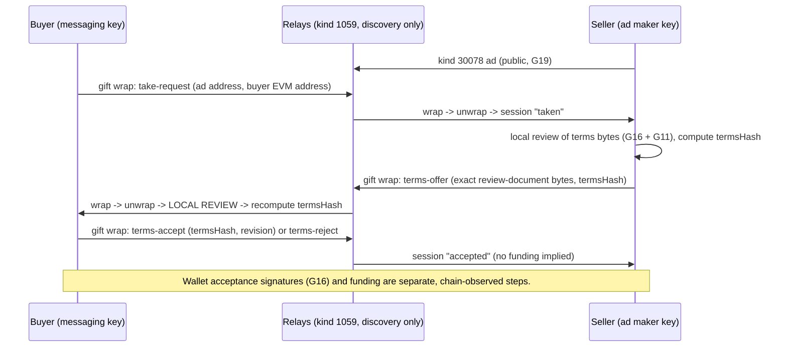

# Encrypted order envelope

## 1. Metadata

- **Specification:** spec-encrypted-order-envelope
- **Version:** 2.0 (Iteration 3; reflects the package-level terms exchange)
- **Owner:** p2p-offramp maintainers
- **Status:** Expanded design baseline — package-level encrypted terms exchange implemented and tested with real crypto (test-only, not wired into the app); app composition, release-enabled crypto dependency review, real-relay evidence and independent review pending
- **Delivery phase:** 2
- **Normative language:** MUST is a release gate; SHOULD deviations need a recorded reason.
- **Implementation:** [messages.ts](../../../packages/exchange/src/messages.ts) (schemas), [machine.ts](../../../packages/exchange/src/machine.ts) (state machine), [exchange.ts](../../../packages/exchange/src/exchange.ts) (wrap, unwrap, review, bindings), [relay-event-crypto.ts](../../../packages/nostr-crypto/src/relay-event-crypto.ts) (relay `EventCrypto` over nostr-crypto, owned by nostr-crypto), facade [index.ts](../../../packages/exchange/index.ts). Cryptography is [packages/nostr-crypto](../../../packages/nostr-crypto/index.ts) (NIP-01, NIP-44 v2, NIP-59, NIP-17). `apps/web/**` and the runtime/Worker do not call it yet.

## 2. Objective and boundaries

Separate public minimal advertisements from confidential peer terms using standard Nostr message layers, and let a buyer and seller agree the exact G16 terms bytes privately before any wallet signature or funding.

This contract uses CTX01 `TradeBinding`, CTX02 observations, G08 authority, G10 wallet sessions, G11 approved registry and G12 transaction intents. `CoreResult`/error codes follow G13. Native transactions/signatures retain their chain formats; local or relay observations never establish custody or fiat receipt. A session that reaches `accepted` is a negotiation record only: it is not funding, not a wallet signature and not escrow state. Chain observation (`packages/domain/src/authority.ts`) remains the sole source of funding and settlement.



## 3. Architecture and data contracts

Every message is the content of a NIP-17 kind-14 rumor, sealed (kind 13, NIP-44 v2 to the recipient) and gift-wrapped (kind 1059, one-time key, single `p` tag). Each send produces a recipient wrap and a self-copy wrap. Rumor tags are exactly `["p",recipient]`, `["a","30078:<sellerPubkey>:p2p-offramp:v1:<orderId>"]`, `["t","p2p-offramp-terms-v1"]` and, once terms exist, `["trade","<termsHash>"]`.

```typescript
interface ExchangeEnvelopeV1 {            // exact keys; UTF-8 JSON; <= 24576 bytes; rumor JSON <= 40960 bytes
  v: 1;
  type: "take-request" | "terms-offer" | "terms-accept" | "terms-reject" | "cancel";
  ad: string;                              // kind-30078 address of the advert
  orderId: string;                         // 64 hex, equals the address orderId
  sender: string; recipient: string;       // x-only Nostr keys, 64 lowercase hex, distinct; sender == authenticated seal author
  nonce: string;                           // 32 random bytes, hex
  expiresAtSeconds: string;                // <= receipt time + 3600 and > receipt time
  termsHash: string | null;                // G16 evmTermsHash (hex); null for take-request, optional for cancel, required otherwise
  body:
    | { buyerAddress: string; buyerMessagingKey: string }   // take-request: lowercase non-zero 0x EVM address; key == sender
    | { terms: string }                                     // terms-offer: the exact G16 review-document bytes as UTF-8, <= 16384 bytes
    | { revision: string }                                  // terms-accept: canonical u64 revision, must equal the reviewed revision
    | { reason: "declined" | "review-failed" | "expired" }  // terms-reject
    | { reason: "withdrawn" | "declined" | "expired" };     // cancel
}
type SessionState = "taken" | "offered" | "accepted" | "rejected" | "cancelled";   // per (ad address, buyer key)
```

State machine (sender role is derived from the ad, never from the message): `none -take-request(buyer)-> taken -terms-offer(seller)-> offered -terms-accept(buyer)-> accepted`; `offered -terms-reject(buyer)-> rejected`; `taken|offered -cancel(either)-> cancelled`. Every other combination is `OUT_OF_ORDER`. `accepted`, `rejected` and `cancelled` are terminal; a cancelled or rejected pair may start a fresh `take-request`.

Limits: 64 live sessions (new sessions are refused, nothing is evicted while live), 1024 remembered rumor ids (only expired ids are pruned, so a live replay is always recognised), message ttl 900 s by default and never beyond the ad expiry, 120 s future skew for the sender-claimed rumor time. Types containing native ABI/IDL declarations describe that chain interface, not a shared executable TypeScript module. Public strings/keys use the selected canonical encoding; unknown fields and incompatible versions fail closed.

## 4. Algorithms and invariants

**Send.** Validate the session and role, run local review where terms are involved, build the envelope, create the rumor with `createUnsignedEvent`, then seal and wrap it twice (recipient, self) with fresh one-time keys. The local state advances only after wrapping succeeds.

**Receive, cheapest check first.** (1) Unwrap and verify all three layers (`unwrapGiftWrap`: wrap and seal signatures and ids, `seal.pubkey == rumor.pubkey`, NIP-44 MACs); failures are `WRAP_INVALID`. (2) A rumor authored by ourselves is a self-copy and changes nothing. (3) Strict envelope parse (`MALFORMED`), `sender == rumor.pubkey`, `recipient == self` (`NOT_ADDRESSED`), tags exactly as derived from the envelope, lifetime bounds (`EXPIRED`, `MALFORMED`). (4) Dedupe by rumor id (`DUPLICATE`), before any state work; an id is recorded only when the message is applied, so a legitimately early message is not lost. (5) Authority: only the ad's seller key may send `terms-offer` and, towards a buyer, anything at all (`NOT_SELLER`); only the key that sent the `take-request` may accept or reject (`NOT_COUNTERPARTY`); a key with no session cannot do anything but take (`UNKNOWN_SESSION`). (6) The state machine (`OUT_OF_ORDER`). (7) Type-specific bindings below.

**Bindings.** `take-request` requires a live advert from `OrderBook.revalidate` whose author and `maker` are this key (`AD_UNAVAILABLE`, `AD_EXPIRED`); sessions carry the ad's expiry and refuse every step at or after it. `terms-offer` runs `reviewTermsBytes` against the injected G11 registry (`REVIEW_FAILED` with the domain rejection code), then requires: `orderId` equals the ad, `buyer` equals the take-request's address (`TERMS_MISMATCH`), the amount lies inside the ad range (`AD_MISMATCH`), `acceptBefore` is in the future (`EXPIRED`), and the injected `hashTerms` result (for EVM, `packages/wallet` `evmTermsHash`, the exact digest the escrow computes) equals the envelope `termsHash` (`HASH_MISMATCH`). `terms-accept` requires `termsHash` equal to the reviewed hash and `revision` equal to the reviewed revision (`HASH_MISMATCH`, `REVISION_MISMATCH`). The buyer's `accept()` takes the bytes the user was shown and refuses unless they equal, byte for byte, the bytes local review approved (`TERMS_MISMATCH`), before anything is signed or sent.

NIP-44 does not expose arbitrary AAD: trade, ad, order, revision, sender and recipient are bound inside the authenticated encrypted plaintext and verified after decrypt, not through an invented AAD parameter. The advertisement carries no decryption key. No custom cipher and no NIP-04 fallback exist (kind 4 is rejected by nostr-crypto).

All externally supplied records require exact schema/version validation and byte/count caps before cryptographic work. Decimal money is never a JavaScript float; strings are parsed to bounded integers and overflow is rejected. G13 read retries are bounded; economic commands have zero automatic resubmission.

## 5. Interfaces, errors and recovery

```typescript
createTermsExchange({ provider, selfPublicKey, ads: Pick<OrderBook,"revalidate">, registry: RegistryLookup,
                      hashTerms: (ReviewedEvmTerms) => string, now: () => number, maxSessions?, maxSeenMessages?, messageTtlSeconds? }): TermsExchange
take(adKey, buyerAddress, secret) / offer(sessionId, termsBytes, secret) / accept(sessionId, termsBytes, secret) /
reject(sessionId, reason, secret) / cancel(sessionId, reason, secret)  // -> { recipientWrap, selfWrap, state, rumorId } to publish via the relay pool
receive(giftWrap, secret) -> ReceivedMessage | { own: true }
session(id) -> SessionView | null;  close()
createRelayEventCrypto({ provider, secretKey }) -> relay EventCrypto (synchronous verify, provider-signed events, dispose())
```

Results are `{ok:true,value}` or `{ok:false,code}`; codes are fixed (`INVALID_INPUT`, `LIMIT_EXCEEDED`, `CLOSED`, `WRAP_INVALID`, `MALFORMED`, `NOT_ADDRESSED`, `EXPIRED`, `AD_UNAVAILABLE`, `AD_EXPIRED`, `AD_MISMATCH`, `DUPLICATE`, `UNKNOWN_SESSION`, `OUT_OF_ORDER`, `NOT_SELLER`, `NOT_COUNTERPARTY`, `REVIEW_FAILED`, `TERMS_MISMATCH`, `HASH_MISMATCH`, `REVISION_MISMATCH`, `WRONG_SIGNER`) and a review failure additionally carries the domain `TermsReviewRejection`. No relay- or sender-supplied string is ever returned. Wraps are delivered with a `kinds:[1059], #p:[self]` subscription; because NIP-59 randomizes wrap timestamps up to two days into the past, the pool allows wrap-only filters a three-day history window.

Expired plaintext is ignored for negotiation but may be retained encrypted as user evidence by the caller. Sessions and the replay memory are in memory only: after a restart the caller must restore encrypted history, reconcile the chain first, and treat replay of unexpired wraps as new until it re-ingests that history. Boundary failures map to fixed G13 errors; raw provider exceptions, signed payloads, credentials and witness material MUST NOT enter diagnostics. Cancellation stops owned work and rejects late generation outputs, but cannot retract already transmitted data or transactions. Existing funded trade recovery retains its original deployment and authority.

## 6. Security and privacy assessment

| Attack | Mitigation |
|---|---|
| Impostor offers terms to a buyer | Only the ad's seller key (the seal author, authenticated) may offer; an envelope `sender` that differs from the seal author is `MALFORMED`. |
| Replay or re-wrap of an old message | Dedupe by rumor id (a re-wrap under a new one-time key is the same rumor); messages expire within 3600 s and are refused after; live ids are never evicted. |
| Tampered terms | The buyer recomputes the G16 digest from locally reviewed bytes and compares it with the envelope hash; accept covers exactly the reviewed bytes. |
| Accept a different revision or different terms | Hash and revision are checked on the seller side; a different G16 trade has a different digest. |
| Third party injects a message | No session for that key (`UNKNOWN_SESSION`), or not the seller (`NOT_SELLER`); a take from a new key creates only a bounded, separate session. |
| Expired or stale ad | Sessions carry the ad expiry; every send and receive re-checks it. |
| Session or memory exhaustion | 64 sessions, 1024 ids, 16 KiB terms, 24 KiB envelope; refusal, not eviction. |
| Fake wallet identity | A messaging key proves control of an ad, not of the seller's wallet; the wallet binding exists only through the G16 acceptance signatures verified separately. |

Outer recipient/routing/timing and advertisement metadata remain visible; relays learn the recipient pubkey, wrap size and time window. Relay deletion is not confidentiality. A seller can offer terms to many takers; the escrow's seller nonce, not this protocol, limits funded fills. Private plaintext and local histories require G02 protection. The test provider is a local `@noble/curves` provider; the vendored ChaCha20 in nostr-crypto is pending review and the release is gated on it.

No basic escrow proof, chat assertion, reputation result or later-installed extension can authorize buyer release or change seller refund rights. Separate opt-in custody versions require explicit new terms and independent review. Verified cryptographic statements remain limited to their authenticated inputs and do not establish fiat irreversibility or physical human identity.

## 7. Verification, references and evidence gates

Recorded evidence (`npm test`): [exchange.test.mjs](../../../packages/exchange/test/exchange.test.mjs) runs the full flow ad -> take -> offer -> local review -> accept between two parties over the in-process fake relay with the real pool, real broker fixture, nostr-crypto and the local-evm-scenario registry, and asserts the accepted hash equals both the recorded `expectedEvmTermsHash` and `evmTermsHash(domain, terms)`, that the relay saw only the public ad and kind-1059 events, and that no terms or payment text appears on the wire. Negatives: impostor offer and claimed sender; replay, re-wrap under a new key, expired message, over-long lifetime, wrong recipient, tag and key tampering, session bound; tampered terms bytes (hash mismatch, review rejection, ad range, wrong buyer, accept with different bytes); acceptance of a different revision and of a different trade; expired ad on take, offer, accept and delivery; third-pubkey and wrong-side messages; out-of-order, duplicate offer, cancel after accept, re-take after cancel. [relay-event-crypto.test.mjs](../../../packages/nostr-crypto/test/relay-event-crypto.test.mjs) and [nostr-crypto-wiring.test.mjs](../../../packages/relay/test/nostr-crypto-wiring.test.mjs) cover the adapter and the relay pool against the fake relay with the real crypto. The nostr-crypto suites carry the official NIP-44 vectors.

Still required and **not** claimed: interop with real relays and other NIP-17 clients; a real verified-private route; app wiring and persistence of sessions and replay memory; reviewed release crypto dependency; wrong-recipient/ciphertext-tamper fuzzing at the exchange layer; independent review.

Sources: [NIP-01](https://github.com/nostr-protocol/nips/blob/master/01.md), [NIP-40](https://github.com/nostr-protocol/nips/blob/master/40.md), [NIP-17](https://github.com/nostr-protocol/nips/blob/master/17.md), [NIP-44 version 2](https://github.com/nostr-protocol/nips/blob/master/44.md), [NIP-59](https://github.com/nostr-protocol/nips/blob/master/59.md). Protocol identifiers above identify the design profile; mutable documentation URLs do not pin implementation. G06 must record evaluated upstream source commit, dependency/toolchain lock, artifact/key hashes, official vectors where available and independently generated integration fixtures. Record actual test commands/results, browser/chain matrix and reviewer disposition; this specification reports only the test evidence listed above.

Before enablement, supply exact deployment/provider configuration, cross-module compatibility fixtures and independent review evidence for the stated invariants. No production readiness follows from document structure or status.
