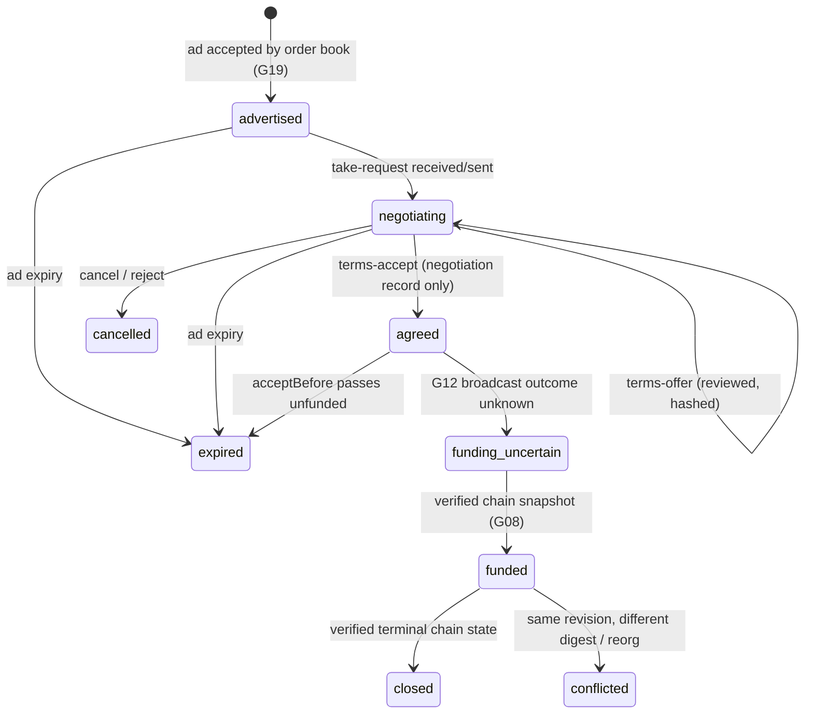

# Order lifecycle reconciliation

## 1. Metadata

- **Specification:** spec-order-lifecycle-reconciliation
- **Version:** 2.0 (Iteration 3; negotiation layer implemented, chain layers pending)
- **Owner:** p2p-offramp maintainers
- **Status:** Expanded design baseline — negotiation-session part implemented at package level (test-only, not wired into the app); order-revision monotonicity, funding-uncertain/funded/closed reconciliation in the app, and independent review pending
- **Delivery phase:** 2
- **Normative language:** MUST is a release gate; SHOULD deviations need a recorded reason.
- **Implementation:** negotiation states in [machine.ts](../../../packages/exchange/src/machine.ts) and [exchange.ts](../../../packages/exchange/src/exchange.ts); advert freshness, conflict and deletion in [ad.ts](../../../packages/relay/src/ad.ts); transaction recovery in [tx-lifecycle.ts](../../../packages/domain/src/tx-lifecycle.ts); authority in [authority.ts](../../../packages/domain/src/authority.ts).

## 2. Objective and boundaries

Reconcile signed advertisements, private negotiation and funded single-fill trades without granting relay messages custody authority.

This contract uses CTX01 `TradeBinding`, CTX02 observations, G08 authority, G10 wallet sessions, G11 approved registry and G12 transaction intents. `CoreResult`/error codes follow G13. Native transactions/signatures retain their chain formats; local or relay observations never establish custody or fiat receipt.



Only the transitions up to `agreed` are decided by relay messages, and only as local, non-authoritative records. `funded` and `closed` are decided exclusively by a verified chain snapshot.

## 3. Architecture and data contracts

```typescript
type OrderState="draft"|"advertised"|"negotiating"|"agreed"|
 "funding-uncertain"|"funded"|"closed"|"expired"|"cancelled"|"conflicted";
interface OrderRevision {v:1;maker:string;orderId:string;revision:number;
 previousTermsHash:string|null;termsHash:string;expiresAtSeconds:string;
 sellerNonce:string;state:OrderState;}
// A seller nonce is unique across all seller funded orders within deployment.
// Implemented negotiation session (packages/exchange), one per (ad address, buyer key):
type SessionState = "taken"|"offered"|"accepted"|"rejected"|"cancelled";   // maps to negotiating / agreed / cancelled above
// taken, offered -> negotiating;  accepted -> agreed (negotiation record, NOT funding);  rejected, cancelled -> cancelled
```

Types containing native ABI/IDL declarations describe that chain interface, not a shared executable TypeScript module. Public strings/keys must use the selected chain/protocol canonical encoding; unknown fields and incompatible versions fail closed.

## 4. Algorithms and invariants

Apply authenticated highest known monotonic revision per maker/order; reject lower revision for new acceptance and flag same revision/different digest. The order book already enforces this for adverts (`stale-revision`, `conflict`, and `revalidate` returning `conflict` that blocks new negotiation); the terms-level `OrderRevision` chain is pending. Negotiation is not reservation authority. Both G16 signatures create agreed terms; G12 uncertain broadcast becomes funding-uncertain. Only verified chain snapshot creates funded or terminal closed. Chain funding of seller nonce prevents multiple fills even if seller signs multiple buyers; contract must reject nonce reuse, not merely duplicate trade ID. A cancellation controls only unfilled local negotiation, cannot revoke funded custody. On startup restore encrypted terms/journal, reconcile chain first, then bounded relay revisions.

Implemented negotiation rules: the exchange accepts a session step only when the explicit state machine allows it, the sender is the ad's seller (offer) or the session's buyer (accept, reject), the message has not expired and is not a duplicate by rumor id, and the ad is not expired when the step runs. The accepted terms hash is the escrow's own G16 digest, recomputed locally from reviewed bytes. An accept is never reflected in `TradeView`, the authority reducer or any funding permission; `cancel` is refused after `accepted` and in no case reaches chain state. A seller may hold several concurrent `taken` sessions for one ad (bounded at 64); at most one can become funded because the escrow rejects the reused seller nonce.

All externally supplied records require exact schema/version validation and byte/count caps before cryptographic work. Decimal money is never a JavaScript float; strings are parsed to bounded integers and overflow is rejected. G13 read retries are bounded; economic commands have zero automatic resubmission.

## 5. Interfaces, errors and recovery

Missing relay revisions mark stale/unavailable; no assumption that silence means cancelled. A reorg rolls funded observation back to uncertain and rereads nonce/state, never blindly allows replacement. Conflict blocks new acceptance pending explicit new maker revision.

Exchange sessions are in memory and bounded; their loss never changes funds. After restart a session is rebuilt from the encrypted history only after chain state has been read; a terms offer or accept replayed after the message's own expiry (at most 3600 s) is refused, and a replay inside that window must be deduplicated against restored history by the caller. Expiry of the ad ends every negotiation step; expiry of the terms `acceptBefore` ends accept and funding eligibility through the G16 funding-window rule, not through a relay message.

Boundary failures map to fixed G13 errors; raw provider exceptions, signed payloads, credentials and witness material MUST NOT enter diagnostics. Cancellation stops owned work and rejects late generation outputs, but cannot retract already transmitted data or transactions. Existing funded trade recovery retains its original deployment and authority.

## 6. Security and privacy assessment

Maker can sell fake liquidity or sign conflicting buyers; single-fill contract nonce limits funded crypto but cannot prove availability at advertisement time. Relays can hide cancellations or newer versions, withhold a seller's offer, or delay a buyer's accept past expiry. A hostile taker can open sessions up to the bound and starve others of session slots for the lifetime of the ad; this is a known availability limit, not a custody risk. An accept received by the seller proves only that the holder of the buyer messaging key sent it.

| Attack | Result |
|---|---|
| Stale cancel after funding | Ignored: cancel is refused after accept and has no chain effect. |
| Same revision, different digest | Accept refused (`HASH_MISMATCH`); advert-level conflict blocks new takes. |
| Two buyers, one seller nonce | Two sessions may reach `accepted`; the escrow funds at most one. |
| Replay after expiry or restart | Refused by message expiry; inside the window requires restored history. |

No basic escrow proof, chat assertion, reputation result or later-installed extension can authorize buyer release or change seller refund rights. Separate opt-in custody versions require explicit new terms and independent review. Verified cryptographic statements remain limited to their authenticated inputs and do not establish fiat irreversibility or physical human identity.

## 7. Verification, references and evidence gates

Recorded evidence (`npm test`): [exchange.test.mjs](../../../packages/exchange/test/exchange.test.mjs) covers the implemented negotiation layer (two-party flow over the fake relay; impostor, replay, tamper, different revision, expired ad, third pubkey, out-of-order, cancel after accept, re-take after cancel, session bound) and asserts that the accepted hash equals the escrow's `evmTermsHash` for the local-evm-scenario fixtures. Advert conflict, stale revision, deletion and expiry are covered by [ad.test.mjs](../../../packages/relay/test/ad.test.mjs). Transaction recovery is covered by the G12 reconcile suites.

Still required and **not** claimed: concurrent accept to two buyers sharing a nonce -> at most one fund (the on-chain part is in the escrow suites, the end-to-end link is not exercised); new order same nonce; stale cancellation after funding at the app level; offline expiry; terms-level same-revision equivocation; relay gap; chain reorg handling in the app; duplicate events and backup recovery of sessions. Assert only chain state changes escrow.

Sources: [NIP-01](https://github.com/nostr-protocol/nips/blob/master/01.md), [NIP-40](https://github.com/nostr-protocol/nips/blob/master/40.md), [NIP-17](https://github.com/nostr-protocol/nips/blob/master/17.md), [NIP-44 version 2](https://github.com/nostr-protocol/nips/blob/master/44.md), [NIP-59](https://github.com/nostr-protocol/nips/blob/master/59.md), [EIP-712](https://eips.ethereum.org/EIPS/eip-712), [EIP-1271](https://eips.ethereum.org/EIPS/eip-1271), [Solidity security](https://docs.soliditylang.org/en/latest/security-considerations.html). Protocol identifiers above identify the design profile; mutable documentation URLs do not pin implementation. G06 must record evaluated upstream source commit, dependency/toolchain lock, artifact/key hashes, official vectors where available and independently generated integration fixtures. Record actual test commands/results, browser/chain matrix and reviewer disposition; this specification reports only the test evidence listed above.

Before enablement, supply exact deployment/provider configuration, cross-module compatibility fixtures and independent review evidence for the stated invariants. No production readiness follows from document structure or status.
