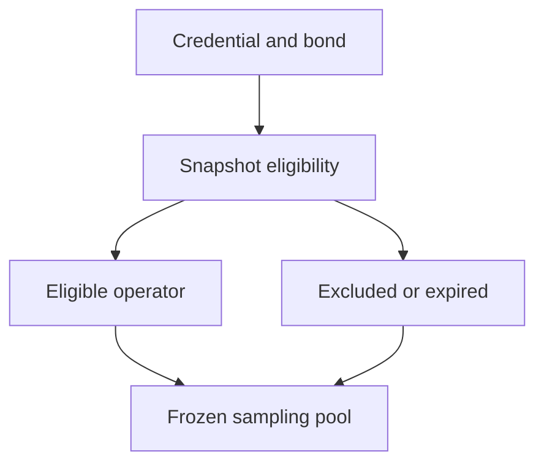

# Anonymous juror eligibility

## 1. Metadata

- **Specification ID:** ARB-ELIG
- **Version:** 1.0
- **Owner:** p2p-offramp maintainers
- **Status:** Expanded design baseline — implementation and independent review pending
- **Delivery phase:** 6, opt-in only
- **Module:** module_4.1.1_vrf_drafting
- **Normative language:** MUST is a release gate; SHOULD deviations require recorded rationale.

## 2. Objective

Define eligibility honestly without assuming one address is one independent human. This module participates only in new trades using G33's separately deployed opted-in escrow. It has no authority over already funded basic escrows. Basic manual release/refund and the core-only build MUST remain usable with this module absent. No specification statement is evidence of a deployed or audited tribunal.

## 3. Architecture and data contracts



The chain is authoritative for case stage, reservations, deadlines and final settlement; relay/indexer/local views are caches. Human/provider statements establish only their explicitly authenticated claims. G33 defines shared policy, G34 defines timing and fallback. All case records are additionally bound to chain, escrow deployment, tribunal deployment and immutable policy hash, whether inline or inherited from the case mapping. `Hex32` is exactly 32 bytes; JSON exports use lowercase 0x-prefixed hex and decimal strings for bigint, reject unknown versions/fields, and never coerce floating amounts.

```typescript
interface EligibilityV1 {
  jurorId: Hex32; payoutAddress: string; votingAddress: string;
  operatorGroup: Hex32; enrollmentEpoch: bigint; depositedAt: bigint;
  bondedUnits: bigint; credentialIssuer: Hex32; credentialExpiry: bigint;
  exclusionRoot: Hex32; policyHash: Hex32;
}
```

## 4. Algorithms and invariants

Baseline uses a permissioned, publicly pseudonymous juror registry with disclosed issuer due diligence; privacy-preserving eligibility proofs are deferred until a reviewed provider exists. Enrollment requires bonded funds aged at least seven days, credential valid through hardStop, signed conflict declaration and issuer-verified operator-group assignment. Registry snapshots use finalized chain state. These controls raise costs but cannot prove independence or exclude undisclosed affiliates.

Exclude buyer/seller/courier signing addresses, declared related operators, sanctioned-by-policy registry entries and prior seated appeal jurors before the pool freezes. Max one seat per operatorGroup in a panel; group aliases must be deduplicated before sampling. Revocation affects future snapshots. A proven compromised voting key before acceptance can decline/lose eligibility; after voting begins no governance substitution is allowed, and quorum/fallback handles unavailability.

Any later anonymous credential MUST bind policy, chain, deployment, case, round and one-use nullifier, with explicit issuer/root validity, verifier version and revocation rules. Until evaluated it returns UNSUPPORTED_PROVIDER; never ship an invented uniqueness proof. No ZK circuit is specified by this baseline.

## 5. Interfaces and failure recovery

`enroll(credential, declaration)`, `snapshot(epoch)`, `isEligible(jurorId, caseBinding)` and `revokeForFuture(jurorId, reasonHash)`. Private identity material remains with the disclosed issuer, never public events or app logs. Expired/unknown issuers fail closed. Economic actions MUST use chain reconciliation and G12 durable intent journaling before broadcast; unknown transaction state remains pending until reconciled. Retry only the same authorized operation, never manufacture a new case, seed, signature or outcome. Logs exclude secrets and plaintext evidence. Deadline checks use half-open stage intervals, authoritative chain time and G34's immutable hard stop.

## 6. Threat assessment and trust assumptions

Issuer dishonesty, deanonymization, borrowed capital, bribery, related entities and state coercion remain material. Registry governance can capture future pools; seven-day aging is anti-flash-loan friction, not a Sybil guarantee. Governance and issuer identities and retention policy are deployment gates. Anonymous/pseudonymous identities and stake do not eliminate Sybils, collusion or coercion. Fiat source authentication does not establish cash contents or payment irreversibility. These limitations must appear in pre-funding consent alongside the explicit seller-refund fallback, which can leave an honest fiat-paying buyer uncompensated.

## 7. Verification and references

Expired credentials, same group under different addresses, parties using fresh accounts, stale root, already-seated appeal juror and malformed credential. Adversarial review must model issuer capture and unobserved affiliates; no test may equate pseudonym count with independent-human count.

Required evidence is prospective: unit/boundary/property tests, supported provider/chain integration records, deployment identities, economic simulation and independent security review MUST be recorded before activation. No real-funds release, cryptographic audit, interoperability success or legal approval is claimed here. New policy activation also requires core-only regression proving this module cannot acquire basic escrow rights.

Primary project authorities: [roadmap](../../../DEVELOPMENT_ROADMAP.md), [system context](../../../00_PLANNING_AND_THREAT_MODELING/feature_0.4_architecture_planning/module_0.4.1_system_boundaries/spec-system-context-contract.md), [G14 extension boundary](../../../00_PLANNING_AND_THREAT_MODELING/feature_0.4_architecture_planning/module_0.4.6_extension_contract/spec-optional-module-interface.md). Arbitration policy and timing: [G33](../../feature_4.7_protocol_integration/module_4.7.1_arbitration_opt_in/spec-arbitration-version-binding.md), [G34](../../feature_4.7_protocol_integration/module_4.7.2_arbitration_liveness/spec-arbitration-outage-and-finality.md).
