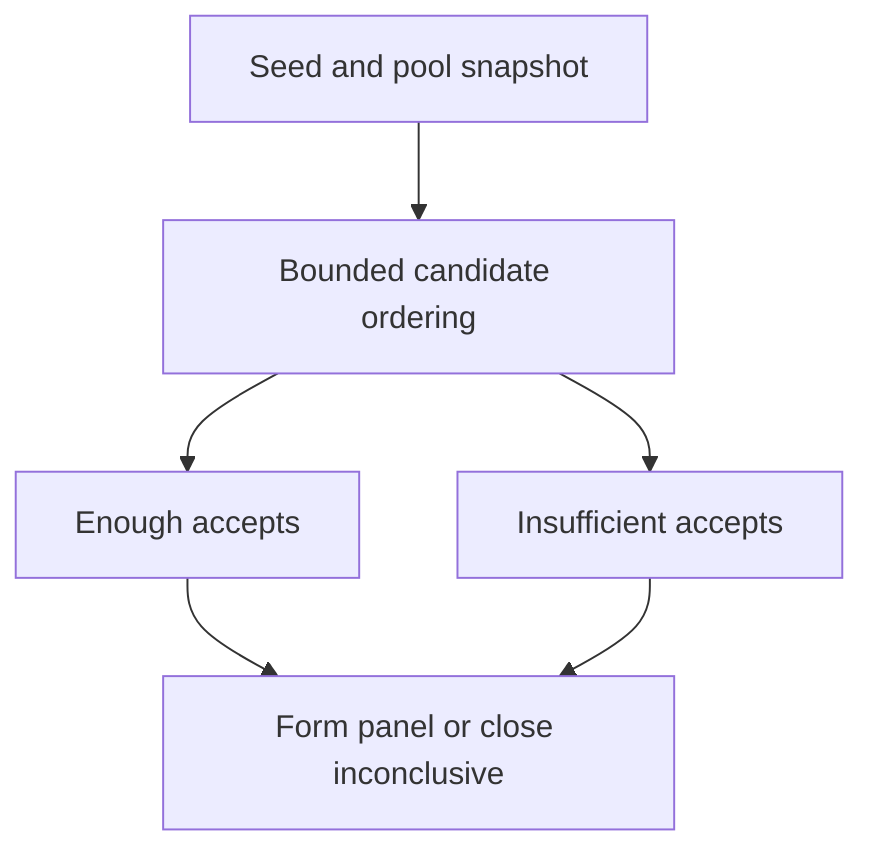

# Juror draft state machine

## 1. Metadata

- **Specification ID:** ARB-DRAFT
- **Version:** 1.0
- **Owner:** p2p-offramp maintainers
- **Status:** Expanded design baseline — implementation and independent review pending
- **Delivery phase:** 6, opt-in only
- **Module:** module_4.1.1_vrf_drafting
- **Normative language:** MUST is a release gate; SHOULD deviations require recorded rationale.

## 2. Objective

Produce bounded panels from the frozen pool with no selective redrafting. This module participates only in new trades using G33's separately deployed opted-in escrow. It has no authority over already funded basic escrows. Basic manual release/refund and the core-only build MUST remain usable with this module absent. No specification statement is evidence of a deployed or audited tribunal.

## 3. Architecture and data contracts



The chain is authoritative for case stage, reservations, deadlines and final settlement; relay/indexer/local views are caches. Human/provider statements establish only their explicitly authenticated claims. G33 defines shared policy, G34 defines timing and fallback. All case records are additionally bound to chain, escrow deployment, tribunal deployment and immutable policy hash, whether inline or inherited from the case mapping. `Hex32` is exactly 32 bytes; JSON exports use lowercase 0x-prefixed hex and decimal strings for bigint, reject unknown versions/fields, and never coerce floating amounts.

```typescript
interface PanelV1 {
  caseId: Hex32; round: 0 | 1; poolRoot: Hex32; seed: Hex32;
  targetSeats: 5 | 9; candidates: readonly Hex32[];
  accepted: readonly Hex32[]; acceptanceEnd: bigint;
  status: "offered" | "formed" | "inconclusive";
}
```

## 4. Algorithms and invariants

Initial pool is a frozen ordered on-chain array capped at 4096 entries; withdrawals cannot alter the snapshot or encumbered collateral. Draw 3N candidates without replacement for N=5 or N=9. For each swap position i in a deterministic partial Fisher-Yates permutation, hash abi.encode(domain, seed, caseId, round, counter); interpret as uint256 and accept x only below 2^256-(2^256 mod remaining), then index x mod remaining. At most 256 rejection attempts across the draw; exhaustion marks inconclusive rather than introducing biased fallback. Implementation gas benchmarks must fit a transaction budget or selection is persisted in bounded batches with cursor and immutable input.

Candidates accept once before acceptanceEnd and reserve their bond. At acceptanceEnd select the first N accepted candidates in frozen candidate order, irrespective of transaction ordering; other reservations unlock. Less than N is inconclusive. This fixed oversampling replaces iterative replacement requests, caps total candidates at 27 and keeps one seed. Evidence starts only after panel formation, at its originally scheduled boundary. Appeals use a distinct pool snapshot/seed and MUST exclude all prior-round seated jurors; if insufficient eligible members the appeal is inconclusive.

## 5. Interfaces and failure recovery

`prepareDraft`, `processDraft(maxSteps<=64)`, `acceptSeat(candidateId)` and `closeAcceptance` are permissionless except authenticated acceptance. INVALID_CANDIDATE, BOND_UNAVAILABLE, ALREADY_ACCEPTED, WINDOW_CLOSED refuse without changing order. Restart resumes cursor from chain, not local PRNG state. Economic actions MUST use chain reconciliation and G12 durable intent journaling before broadcast; unknown transaction state remains pending until reconciled. Retry only the same authorized operation, never manufacture a new case, seed, signature or outcome. Logs exclude secrets and plaintext evidence. Deadline checks use half-open stage intervals, authoritative chain time and G34's immutable hard stop.

## 6. Threat assessment and trust assumptions

Candidates can selectively decline after seeing a case; availability and conflicts remain pool assumptions. Public candidate lists expose participation. Fixed rank avoids gas-auction seat capture but does not stop multiple identities, coercion or correlated operators. Anonymous/pseudonymous identities and stake do not eliminate Sybils, collusion or coercion. Fiat source authentication does not establish cash contents or payment irreversibility. These limitations must appear in pre-funding consent alongside the explicit seller-refund fallback, which can leave an honest fiat-paying buyer uncompensated.

## 7. Verification and references

Known seed/pool test vectors across implementations; tiny pools, duplicate IDs, exclusion exhaustion, concurrent accepts, cursor replay, all declines and equal-deadline transactions. Fuzz uniqueness, deterministic order, bounded iterations and unchanged snapshot despite deposits/withdrawals.

Required evidence is prospective: unit/boundary/property tests, supported provider/chain integration records, deployment identities, economic simulation and independent security review MUST be recorded before activation. No real-funds release, cryptographic audit, interoperability success or legal approval is claimed here. New policy activation also requires core-only regression proving this module cannot acquire basic escrow rights.

Primary project authorities: [roadmap](../../../DEVELOPMENT_ROADMAP.md), [system context](../../../00_PLANNING_AND_THREAT_MODELING/feature_0.4_architecture_planning/module_0.4.1_system_boundaries/spec-system-context-contract.md), [G14 extension boundary](../../../00_PLANNING_AND_THREAT_MODELING/feature_0.4_architecture_planning/module_0.4.6_extension_contract/spec-optional-module-interface.md). Arbitration policy and timing: [G33](../../feature_4.7_protocol_integration/module_4.7.1_arbitration_opt_in/spec-arbitration-version-binding.md), [G34](../../feature_4.7_protocol_integration/module_4.7.2_arbitration_liveness/spec-arbitration-outage-and-finality.md).

Provider reference: [Chainlink VRF v2.5 security considerations](https://docs.chain.link/vrf/v2-5/security), reviewed 2026-10-22. Runtime package/coordinator pins, gas benchmarks and supported-chain attestations remain release artifacts; referencing the API family does not certify integration.
