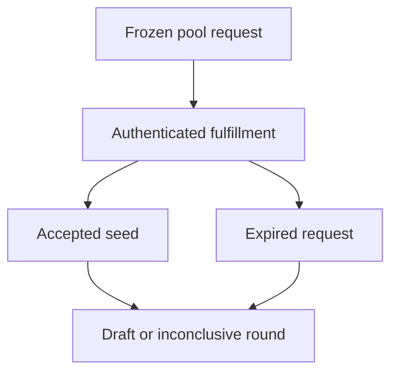

# Juror randomness interface

## 1. Metadata

- **Specification ID:** ARB-RNG
- **Version:** 1.0
- **Owner:** p2p-offramp maintainers
- **Status:** Expanded design baseline — implementation and independent review pending
- **Delivery phase:** 6, opt-in only
- **Module:** module_4.1.1_vrf_drafting
- **Normative language:** MUST is a release gate; SHOULD deviations require recorded rationale.

## 2. Objective

Freeze case inputs before accepting one verifiable randomness result. This module participates only in new trades using G33's separately deployed opted-in escrow. It has no authority over already funded basic escrows. Basic manual release/refund and the core-only build MUST remain usable with this module absent. No specification statement is evidence of a deployed or audited tribunal.

## 3. Architecture and data contracts



The chain is authoritative for case stage, reservations, deadlines and final settlement; relay/indexer/local views are caches. Human/provider statements establish only their explicitly authenticated claims. G33 defines shared policy, G34 defines timing and fallback. All case records are additionally bound to chain, escrow deployment, tribunal deployment and immutable policy hash, whether inline or inherited from the case mapping. `Hex32` is exactly 32 bytes; JSON exports use lowercase 0x-prefixed hex and decimal strings for bigint, reject unknown versions/fields, and never coerce floating amounts.

```typescript
interface DraftRequestV1 {
  caseId: Hex32; round: 0 | 1; policyHash: Hex32; poolRoot: Hex32;
  poolSize: number; providerId: Hex32; requestId: bigint; requestedAt: bigint;
  fulfillBefore: bigint; status: "requested" | "fulfilled" | "expired";
  seed?: Hex32;
}
```

## 4. Algorithms and invariants

Snapshot the ordered eligible pool and seat count before request submission. Each case/round has exactly one request; reserve its identifier atomically. Accept output only from the bound authenticated provider contract and the matching request, on the original chain/deployment. Freeze seed after first fulfillment. No participant input, pool mutation, redraw, blockhash fallback or retry with a fresh random request is permitted after submission. A failed submission not broadcast may be retried with the same intent after reconciliation; an uncertain broadcast must be looked up first.

At randomnessEnd the round becomes inconclusive under G34. A callback after expiry MUST NOT resurrect it. Derive deterministic candidate order with Keccak-256 domain-separated by policy, case, round, poolRoot and seed; modulo rejection sampling details are in draft state machine. Provider request ID is not itself random. Request confirmations are deployment-specific registry values based on reorg economics; no universal confirmation count is assumed.

## 5. Interfaces and failure recovery

`requestDraft(frozenRequest)` returns provider request ID; `recordRandomness(requestId, word)` performs only constant storage writes; `draft(caseId, round)` runs separately. Errors UNKNOWN_REQUEST, WRONG_PROVIDER, ALREADY_FULFILLED, ROUND_EXPIRED. Public events omit chat/evidence secrets. Economic actions MUST use chain reconciliation and G12 durable intent journaling before broadcast; unknown transaction state remains pending until reconciled. Retry only the same authorized operation, never manufacture a new case, seed, signature or outcome. Logs exclude secrets and plaintext evidence. Deadline checks use half-open stage intervals, authoritative chain time and G34's immutable hard stop.

## 6. Threat assessment and trust assumptions

Verifiability does not force delivery. Provider withholding and validator reorgs remain trust/liveness assumptions; no redraw prevents selective seed shopping but can force fallback. RPC display must distinguish callback observed from finalized. Provider version, coordinator and confirmations are release-pinned. Anonymous/pseudonymous identities and stake do not eliminate Sybils, collusion or coercion. Fiat source authentication does not establish cash contents or payment irreversibility. These limitations must appear in pre-funding consent alongside the explicit seller-refund fallback, which can leave an honest fiat-paying buyer uncompensated.

## 7. Verification and references

Duplicate, reordered and forged callbacks, changed pool after request, same request across rounds, callback at deadline, unknown request and reorg rollback. Verify zero alternate seed paths and exactly one accepted fulfillment; provider integration evidence remains pending.

Required evidence is prospective: unit/boundary/property tests, supported provider/chain integration records, deployment identities, economic simulation and independent security review MUST be recorded before activation. No real-funds release, cryptographic audit, interoperability success or legal approval is claimed here. New policy activation also requires core-only regression proving this module cannot acquire basic escrow rights.

Primary project authorities: [roadmap](../../../DEVELOPMENT_ROADMAP.md), [system context](../../../00_PLANNING_AND_THREAT_MODELING/feature_0.4_architecture_planning/module_0.4.1_system_boundaries/spec-system-context-contract.md), [G14 extension boundary](../../../00_PLANNING_AND_THREAT_MODELING/feature_0.4_architecture_planning/module_0.4.6_extension_contract/spec-optional-module-interface.md). Arbitration policy and timing: [G33](../../feature_4.7_protocol_integration/module_4.7.1_arbitration_opt_in/spec-arbitration-version-binding.md), [G34](../../feature_4.7_protocol_integration/module_4.7.2_arbitration_liveness/spec-arbitration-outage-and-finality.md).

Provider reference: [Chainlink VRF v2.5 security considerations](https://docs.chain.link/vrf/v2-5/security), reviewed 2026-10-22. Runtime package/coordinator pins, gas benchmarks and supported-chain attestations remain release artifacts; referencing the API family does not certify integration.
