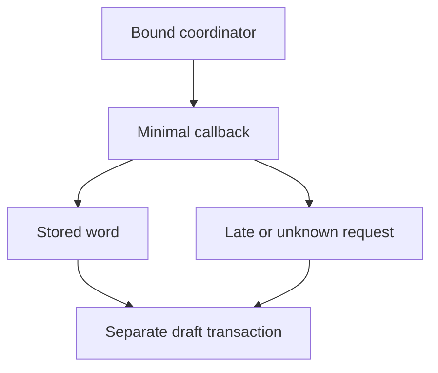

# Vrf chainlink juror selector

## 1. Metadata

- **Specification ID:** ARB-VRF
- **Version:** 1.0
- **Owner:** p2p-offramp maintainers
- **Status:** Expanded design baseline — implementation and independent review pending
- **Delivery phase:** 6, opt-in only
- **Module:** module_4.1.1_vrf_drafting
- **Normative language:** MUST is a release gate; SHOULD deviations require recorded rationale.

## 2. Objective

Adapt Chainlink VRF without making its service mandatory for basic trading. This module participates only in new trades using G33's separately deployed opted-in escrow. It has no authority over already funded basic escrows. Basic manual release/refund and the core-only build MUST remain usable with this module absent. No specification statement is evidence of a deployed or audited tribunal.

## 3. Architecture and data contracts



The chain is authoritative for case stage, reservations, deadlines and final settlement; relay/indexer/local views are caches. Human/provider statements establish only their explicitly authenticated claims. G33 defines shared policy, G34 defines timing and fallback. All case records are additionally bound to chain, escrow deployment, tribunal deployment and immutable policy hash, whether inline or inherited from the case mapping. `Hex32` is exactly 32 bytes; JSON exports use lowercase 0x-prefixed hex and decimal strings for bigint, reject unknown versions/fields, and never coerce floating amounts.

```typescript
interface ChainlinkAdapterConfigV1 {
  chainId: string; coordinator: string; consumer: string; keyHash: Hex32;
  subscriptionId: bigint; requestConfirmations: number; callbackGasLimit: number;
  numWords: 1; payment: "native" | "link"; packageDigest: Hex32;
}
```

## 4. Algorithms and invariants

Target the documented VRF v2.5 API family; exact package version, code hash, ABI, coordinator network address, subscription owner and fee settings MUST be pinned in the deployment manifest before implementation approval. Unsupported networks are rejected before offer signing. Do not infer support from a network name or reuse an address from a different chain.

Preflight subscription funding/consumer authorization before accepting new opted-in trades. Submit one request through the bound consumer. The authenticated coordinator callback stores its first random word and mapping status only; expensive juror selection runs in a subsequent permissionless transaction. Callback MUST be gas-bounded and designed not to revert for unknown/expired IDs: emit diagnostic or return without changing case state. It cannot release funds or call untrusted juror contracts. Insufficient provider funding after dispute opening triggers G34, not an admin seed.

Never cancel or re-request an active request to obtain a better draw. Coordinator migration can affect new policy versions only. Preserve callback compatibility for funded cases; disabling subscription funding is a disclosed denial-of-service risk.

## 5. Interfaces and failure recovery

`requestRandomWords` is called via the evaluated consumer interface; `fulfillRandomWords(requestId, words)` validates caller and exactly one word, then stores. Adapter exposes `health(): funded | unavailable | unsupported` as advisory preflight only. RPC failure cannot mark a submitted request absent. Economic actions MUST use chain reconciliation and G12 durable intent journaling before broadcast; unknown transaction state remains pending until reconciled. Retry only the same authorized operation, never manufacture a new case, seed, signature or outcome. Logs exclude secrets and plaintext evidence. Deadline checks use half-open stage intervals, authoritative chain time and G34's immutable hard stop.

## 6. Threat assessment and trust assumptions

Subscription operator can defund service; Chainlink/network availability and coordinator correctness remain assumptions. Confirmation depth must scale with value at risk and chain reorg characteristics. A uniform random draw does not make a compromised eligibility pool honest. Anonymous/pseudonymous identities and stake do not eliminate Sybils, collusion or coercion. Fiat source authentication does not establish cash contents or payment irreversibility. These limitations must appear in pre-funding consent alongside the explicit seller-refund fallback, which can leave an honest fiat-paying buyer uncompensated.

## 7. Verification and references

Run coordinator mock tests for unauthorized callbacks, out-of-order IDs, expired cases, zero/two words, callback gas limit and duplicate delivery. Before activation run live supported test-network requests, funding exhaustion and recovery; pin resulting transaction evidence and dependency audit. No live Chainlink compatibility is certified here.

Required evidence is prospective: unit/boundary/property tests, supported provider/chain integration records, deployment identities, economic simulation and independent security review MUST be recorded before activation. No real-funds release, cryptographic audit, interoperability success or legal approval is claimed here. New policy activation also requires core-only regression proving this module cannot acquire basic escrow rights.

Primary project authorities: [roadmap](../../../DEVELOPMENT_ROADMAP.md), [system context](../../../00_PLANNING_AND_THREAT_MODELING/feature_0.4_architecture_planning/module_0.4.1_system_boundaries/spec-system-context-contract.md), [G14 extension boundary](../../../00_PLANNING_AND_THREAT_MODELING/feature_0.4_architecture_planning/module_0.4.6_extension_contract/spec-optional-module-interface.md). Arbitration policy and timing: [G33](../../feature_4.7_protocol_integration/module_4.7.1_arbitration_opt_in/spec-arbitration-version-binding.md), [G34](../../feature_4.7_protocol_integration/module_4.7.2_arbitration_liveness/spec-arbitration-outage-and-finality.md).

Provider reference: [Chainlink VRF v2.5 security considerations](https://docs.chain.link/vrf/v2-5/security), reviewed 2026-10-22. Runtime package/coordinator pins, gas benchmarks and supported-chain attestations remain release artifacts; referencing the API family does not certify integration.
