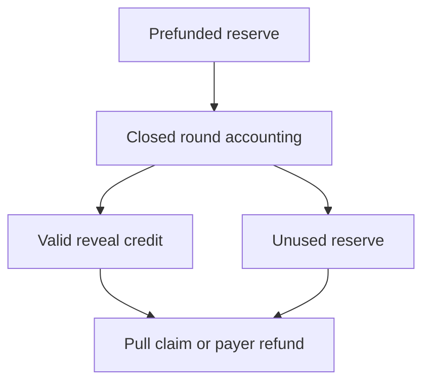

# Juror fee distribution

## 1. Metadata

- **Specification ID:** ARB-FEE
- **Version:** 1.0
- **Owner:** p2p-offramp maintainers
- **Status:** Expanded design baseline — implementation and independent review pending
- **Delivery phase:** 6, opt-in only
- **Module:** module_4.2.1_voting_stake_accounting
- **Normative language:** MUST is a release gate; SHOULD deviations require recorded rationale.

## 2. Objective

Pay for completed participation without treating majority alignment as truth. This module participates only in new trades using G33's separately deployed opted-in escrow. It has no authority over already funded basic escrows. Basic manual release/refund and the core-only build MUST remain usable with this module absent. No specification statement is evidence of a deployed or audited tribunal.

## 3. Architecture and data contracts



The chain is authoritative for case stage, reservations, deadlines and final settlement; relay/indexer/local views are caches. Human/provider statements establish only their explicitly authenticated claims. G33 defines shared policy, G34 defines timing and fallback. All case records are additionally bound to chain, escrow deployment, tribunal deployment and immutable policy hash, whether inline or inherited from the case mapping. `Hex32` is exactly 32 bytes; JSON exports use lowercase 0x-prefixed hex and decimal strings for bigint, reject unknown versions/fields, and never coerce floating amounts.

```typescript
interface RoundFeesV1 {
  caseId: Hex32; round: 0 | 1; asset: string; escrowed: bigint;
  feePerSeat: bigint; validRevealCount: number; providerSpent: bigint;
  executionSpent: bigint; executionCap: bigint; refunded: bigint;
  credited: bigint; claimed: bigint;
}
```

## 4. Algorithms and invariants

Before funding reserve fees for both panel sizes (5+9 seats), provider request quotes and a capped execution budget. The seller funds this separately from principal in baseline policy; both parties see and sign that cost. Appeal access never requires a new fee or top-up after funding; there is no fee auction. If the prefunded provider reserve becomes insufficient, round1 follows the already agreed outage policy rather than forcing a trader to contribute more.

Every valid timely reveal earns the same feePerSeat, including dissent and explicit abstain, regardless of majority outcome. No acceptance or missing/invalid reveal earns a fee. Fees accrue after the round closes even if quorum fails, compensating useful participation without claiming a correct verdict. Provider charges are reconciled only through the configured adapter accounting; arbitrary receipt claims are invalid. Execution reimbursements use a fixed terms-bound schedule/cap, not caller-provided gas prices. Unspent reserves refund to the original fee payer after finalization; principal never subsidizes a depleted reserve.

Write credits before external calls. Claim is a pull payment to the bound payout address; failed token transfer leaves the credit claimable and cannot block case finality. No loops over external recipients. Round close is idempotent and sums over at most nine seats.

## 5. Interfaces and failure recovery

`accrueRound(caseId, round)`, `claimFees(caseId, payoutAddress)`, `refundUnusedReserve(caseId)`. Wrong asset, duplicate accrual, premature claim or amount overflow refuse. Balance observations are not accounting authority; on-chain liabilities are. Economic actions MUST use chain reconciliation and G12 durable intent journaling before broadcast; unknown transaction state remains pending until reconciled. Retry only the same authorized operation, never manufacture a new case, seed, signature or outcome. Logs exclude secrets and plaintext evidence. Deadline checks use half-open stage intervals, authoritative chain time and G34's immutable hard stop.

## 6. Threat assessment and trust assumptions

Rewards for agreement create herding incentives, hence no majority reward/slash rule. Abstain compensation can still incentivize low effort; eligibility governance and economic review address it transparently. Malicious payout contracts must not reenter accounting or prevent others receiving credits. Anonymous/pseudonymous identities and stake do not eliminate Sybils, collusion or coercion. Fiat source authentication does not establish cash contents or payment irreversibility. These limitations must appear in pre-funding consent alongside the explicit seller-refund fallback, which can leave an honest fiat-paying buyer uncompensated.

## 7. Verification and references

All/none/one valid reveal, abstentions, overturned appeal and provider failure. Fuzz: reserve=providerSpent+executionSpent+credited+refunded and claimed<=credited; no claim twice, no negative reserve, rounding remainder returns to payer, transfer revert preserves claim.

Required evidence is prospective: unit/boundary/property tests, supported provider/chain integration records, deployment identities, economic simulation and independent security review MUST be recorded before activation. No real-funds release, cryptographic audit, interoperability success or legal approval is claimed here. New policy activation also requires core-only regression proving this module cannot acquire basic escrow rights.

Primary project authorities: [roadmap](../../../DEVELOPMENT_ROADMAP.md), [system context](../../../00_PLANNING_AND_THREAT_MODELING/feature_0.4_architecture_planning/module_0.4.1_system_boundaries/spec-system-context-contract.md), [G14 extension boundary](../../../00_PLANNING_AND_THREAT_MODELING/feature_0.4_architecture_planning/module_0.4.6_extension_contract/spec-optional-module-interface.md). Arbitration policy and timing: [G33](../../feature_4.7_protocol_integration/module_4.7.1_arbitration_opt_in/spec-arbitration-version-binding.md), [G34](../../feature_4.7_protocol_integration/module_4.7.2_arbitration_liveness/spec-arbitration-outage-and-finality.md).
