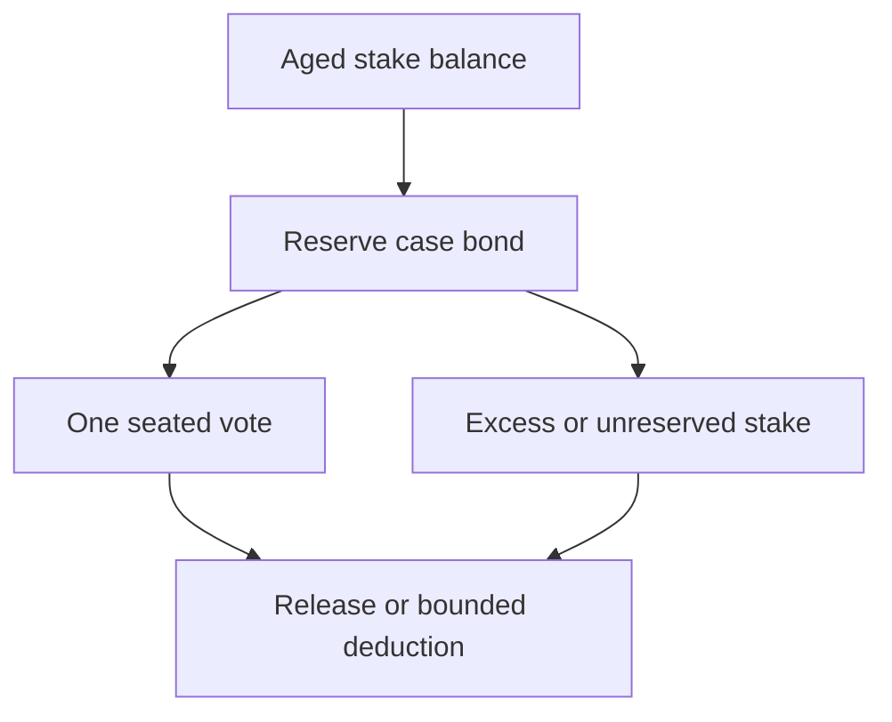

# Juror voting weight

## 1. Metadata

- **Specification ID:** ARB-WEIGHT
- **Version:** 1.0
- **Owner:** p2p-offramp maintainers
- **Status:** Expanded design baseline — implementation and independent review pending
- **Delivery phase:** 6, opt-in only
- **Module:** module_4.2.1_voting_stake_accounting
- **Normative language:** MUST is a release gate; SHOULD deviations require recorded rationale.

## 2. Objective

Keep panel decisions equal-seat while collateral provides only bounded accountability. This module participates only in new trades using G33's separately deployed opted-in escrow. It has no authority over already funded basic escrows. Basic manual release/refund and the core-only build MUST remain usable with this module absent. No specification statement is evidence of a deployed or audited tribunal.

## 3. Architecture and data contracts



The chain is authoritative for case stage, reservations, deadlines and final settlement; relay/indexer/local views are caches. Human/provider statements establish only their explicitly authenticated claims. G33 defines shared policy, G34 defines timing and fallback. All case records are additionally bound to chain, escrow deployment, tribunal deployment and immutable policy hash, whether inline or inherited from the case mapping. `Hex32` is exactly 32 bytes; JSON exports use lowercase 0x-prefixed hex and decimal strings for bigint, reject unknown versions/fields, and never coerce floating amounts.

```typescript
interface SeatStakeV1 {
  jurorId: Hex32; caseId: Hex32; round: 0 | 1;
  snapshotBalance: bigint; reservedBond: bigint; weight: 1;
  lockUntil: bigint; released: boolean;
}
```

## 4. Algorithms and invariants

Use one vote per seated eligible operator, not stake-proportional voting. BondPerSeat is an immutable quoted base-unit amount for the policy; the same amount applies to all seats. Reserve bonds atomically on acceptance and prohibit using the same balance in concurrent cases. Balance minus total reservations is the only withdrawable amount. No rehypothecated receipt or flash deposit can satisfy the seven-day age rule.

Reserve at most one bond per case/round/operator group; oversampled candidates who are not seated unlock at panel closure. Seated bonds stay locked through final case outcome/hard-stop accounting plus a fixed 24h accounting grace; expiration of grace permits permissionless deterministic reconciliation, never discretionary seizure. More stake confers no extra weight or appeal rights. A policy caps principal per trade at a published economic risk limit; selecting that limit requires market liquidity, stake concentration and bribery review rather than assuming bond value exceeds corruption profit.

## 5. Interfaces and failure recovery

`reserveBond`, `availableBalance`, `releaseReservation`, `reconcileAtHardStop` expose exact integer units. Stake tokens are allowlisted non-rebasing, non-fee-on-transfer assets; actual received balance is checked. OVERCOMMITTED, UNAGED_STAKE and TOKEN_UNSUPPORTED prevent acceptance. Economic actions MUST use chain reconciliation and G12 durable intent journaling before broadcast; unknown transaction state remains pending until reconciled. Retry only the same authorized operation, never manufacture a new case, seed, signature or outcome. Logs exclude secrets and plaintext evidence. Deadline checks use half-open stage intervals, authoritative chain time and G34's immutable hard stop.

## 6. Threat assessment and trust assumptions

One-seat rules do not stop hidden groups. Stake price collapse, borrowed long-duration stake and external bribes may overwhelm bonds. Do not infer dispute truth from wealth or slash a minority vote merely because it lost. Assets, economic caps and governance concentration require independent approval. Anonymous/pseudonymous identities and stake do not eliminate Sybils, collusion or coercion. Fiat source authentication does not establish cash contents or payment irreversibility. These limitations must appear in pre-funding consent alongside the explicit seller-refund fallback, which can leave an honest fiat-paying buyer uncompensated.

## 7. Verification and references

Simultaneous reservations, early withdrawal, appeal overlap, excess stake, group aliases and token transfer failure. Conservation fuzzing requires deposits=available+reserved+withdrawn+executed penalties; one panel member always has weight exactly one.

Required evidence is prospective: unit/boundary/property tests, supported provider/chain integration records, deployment identities, economic simulation and independent security review MUST be recorded before activation. No real-funds release, cryptographic audit, interoperability success or legal approval is claimed here. New policy activation also requires core-only regression proving this module cannot acquire basic escrow rights.

Primary project authorities: [roadmap](../../../DEVELOPMENT_ROADMAP.md), [system context](../../../00_PLANNING_AND_THREAT_MODELING/feature_0.4_architecture_planning/module_0.4.1_system_boundaries/spec-system-context-contract.md), [G14 extension boundary](../../../00_PLANNING_AND_THREAT_MODELING/feature_0.4_architecture_planning/module_0.4.6_extension_contract/spec-optional-module-interface.md). Arbitration policy and timing: [G33](../../feature_4.7_protocol_integration/module_4.7.1_arbitration_opt_in/spec-arbitration-version-binding.md), [G34](../../feature_4.7_protocol_integration/module_4.7.2_arbitration_liveness/spec-arbitration-outage-and-finality.md).
