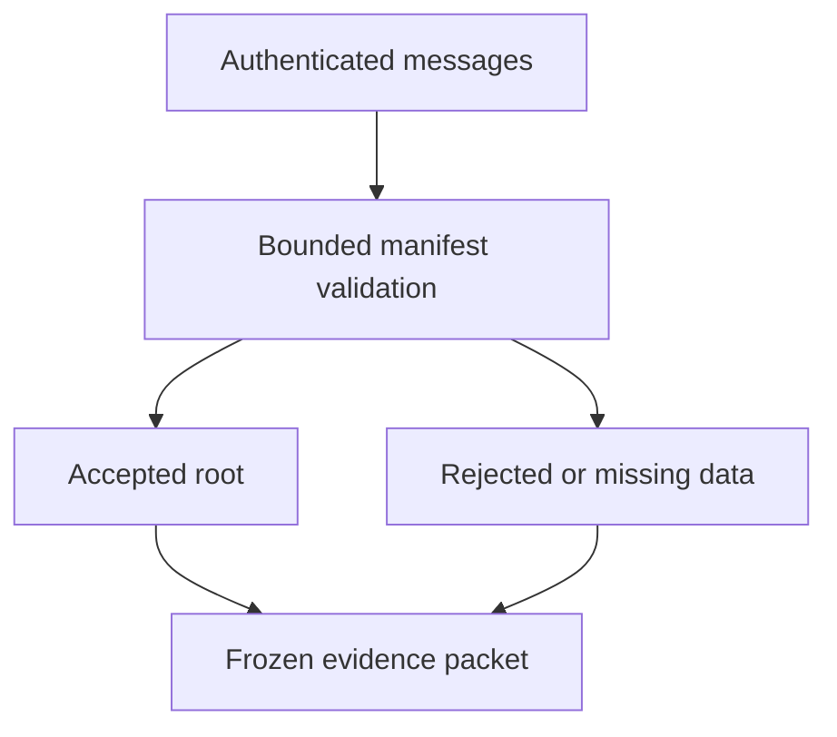

# Chat evidence commitment format

## 1. Metadata

- **Specification ID:** ARB-CHATROOT
- **Version:** 1.0
- **Owner:** p2p-offramp maintainers
- **Status:** Expanded design baseline — implementation and independent review pending
- **Delivery phase:** 6, opt-in only
- **Module:** module_4.3.1_chat_key_escrow
- **Normative language:** MUST is a release gate; SHOULD deviations require recorded rationale.

## 2. Objective

Commit authenticated chat evidence without claiming a complete or truthful narrative. This module participates only in new trades using G33's separately deployed opted-in escrow. It has no authority over already funded basic escrows. Basic manual release/refund and the core-only build MUST remain usable with this module absent. No specification statement is evidence of a deployed or audited tribunal.

## 3. Architecture and data contracts



The chain is authoritative for case stage, reservations, deadlines and final settlement; relay/indexer/local views are caches. Human/provider statements establish only their explicitly authenticated claims. G33 defines shared policy, G34 defines timing and fallback. All case records are additionally bound to chain, escrow deployment, tribunal deployment and immutable policy hash, whether inline or inherited from the case mapping. `Hex32` is exactly 32 bytes; JSON exports use lowercase 0x-prefixed hex and decimal strings for bigint, reject unknown versions/fields, and never coerce floating amounts.

```typescript
interface EvidenceManifestV1 {
  version: 1; caseId: Hex32; tradeId: Hex32; termsHash: Hex32;
  submitter: string; sequence: number; previousManifest: Hex32;
  entries: readonly {index: number; messageHash: Hex32; sender: string;
    sentAtClaim: bigint; contextBefore: Hex32; contextAfter: Hex32}[];
  manifestHash: Hex32; signature: string;
}
```

## 4. Algorithms and invariants

Maximum 256 entries per party, 64 KiB per authenticated message, 8 MiB aggregate decrypted material per case and 16 MiB encrypted download budget. Hash exact canonical message bytes, never renderer HTML. Manifest hash uses Keccak-256 of abi.encode with fixed type tag, chain, escrow, case and ordered entry hashes. Entries are sorted by claimed conversation sequence with unique index; previousManifest forms an append-only submission chain until evidenceEnd. Store only roots and byte counts on chain, never plaintext or decryption keys.

Verify original trade-message authentication and trade/terms bindings separately; relay wrapper signatures alone do not establish authorship of inner plaintext. Preserve original bytes and verification report. A manifest signature proves the submitter committed these entries, not that omitted messages do not exist or that claimed timestamps are trustworthy. Both parties may submit counter-context and disagreement markers within the fixed window. At evidenceEnd freeze roots for voting; late material is reserved for the one permitted appeal window and cannot silently change a voted root.

## 5. Interfaces and failure recovery

`validateManifest(bytes, caseBinding)`, `submitRoot(hash, byteCount)`, `fetchEncryptedEvidence(hash, budget, signal)`. Reject duplicate index, invalid sender, wrong trade, oversized content or hash mismatch. Missing content is unavailable, never assumed inculpatory; do not extend deadlines. Economic actions MUST use chain reconciliation and G12 durable intent journaling before broadcast; unknown transaction state remains pending until reconciled. Retry only the same authorized operation, never manufacture a new case, seed, signature or outcome. Logs exclude secrets and plaintext evidence. Deadline checks use half-open stage intervals, authoritative chain time and G34's immutable hard stop.

## 6. Threat assessment and trust assumptions

Selective omission, forged screenshots, reordered chat, replay across trades and adversarial attachments require byte authentication and explicit completeness warnings. Content hashes may leak known text and metadata; use encrypted storage, access control and no public raw message digests unless consented. Anonymous/pseudonymous identities and stake do not eliminate Sybils, collusion or coercion. Fiat source authentication does not establish cash contents or payment irreversibility. These limitations must appear in pre-funding consent alongside the explicit seller-refund fallback, which can leave an honest fiat-paying buyer uncompensated.

## 7. Verification and references

Canonical vectors for order/encoding; altered UTF-8, duplicate entry, mismatched signed payload, replayed manifest, missing neighbor context and oversized decompression. Render malicious content as text under G04. Integration must demonstrate attribution of actual NIP-17/44 messages rather than transport wrappers.

Required evidence is prospective: unit/boundary/property tests, supported provider/chain integration records, deployment identities, economic simulation and independent security review MUST be recorded before activation. No real-funds release, cryptographic audit, interoperability success or legal approval is claimed here. New policy activation also requires core-only regression proving this module cannot acquire basic escrow rights.

Primary project authorities: [roadmap](../../../DEVELOPMENT_ROADMAP.md), [system context](../../../00_PLANNING_AND_THREAT_MODELING/feature_0.4_architecture_planning/module_0.4.1_system_boundaries/spec-system-context-contract.md), [G14 extension boundary](../../../00_PLANNING_AND_THREAT_MODELING/feature_0.4_architecture_planning/module_0.4.6_extension_contract/spec-optional-module-interface.md). Arbitration policy and timing: [G33](../../feature_4.7_protocol_integration/module_4.7.1_arbitration_opt_in/spec-arbitration-version-binding.md), [G34](../../feature_4.7_protocol_integration/module_4.7.2_arbitration_liveness/spec-arbitration-outage-and-finality.md).
