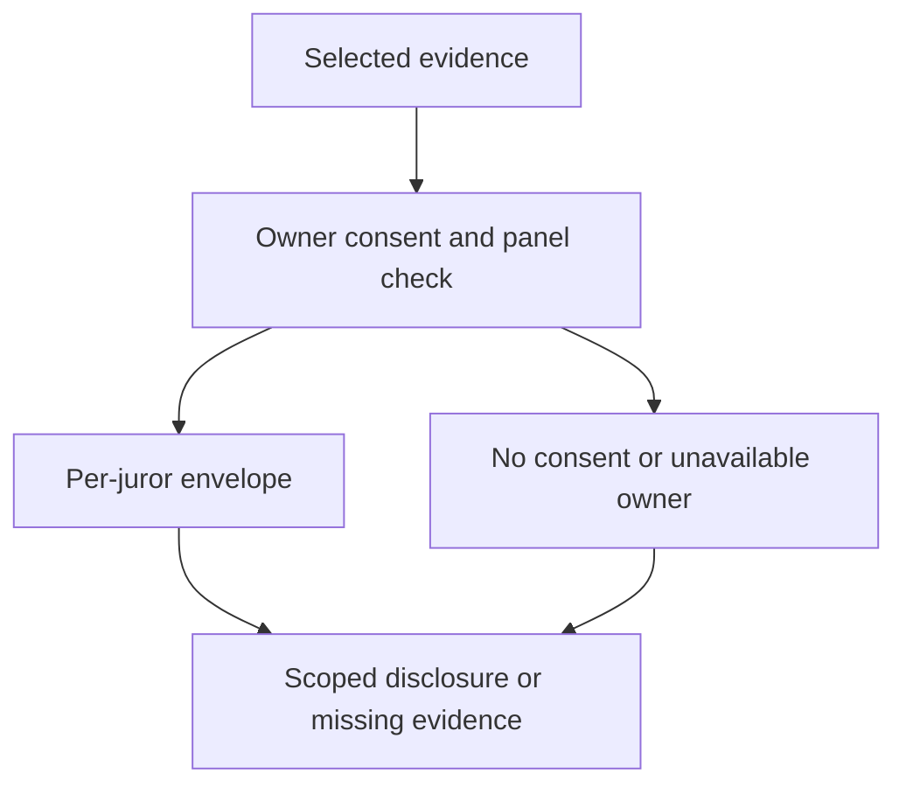

# Chat key release policy

## 1. Metadata

- **Specification ID:** ARB-KEY
- **Version:** 1.0
- **Owner:** p2p-offramp maintainers
- **Status:** Expanded design baseline — implementation and independent review pending
- **Delivery phase:** 6, opt-in only
- **Module:** module_4.3.1_chat_key_escrow
- **Normative language:** MUST is a release gate; SHOULD deviations require recorded rationale.

## 2. Objective

Disclose only explicitly selected evidence to a seated panel under informed consent. This module participates only in new trades using G33's separately deployed opted-in escrow. It has no authority over already funded basic escrows. Basic manual release/refund and the core-only build MUST remain usable with this module absent. No specification statement is evidence of a deployed or audited tribunal.

## 3. Architecture and data contracts



The chain is authoritative for case stage, reservations, deadlines and final settlement; relay/indexer/local views are caches. Human/provider statements establish only their explicitly authenticated claims. G33 defines shared policy, G34 defines timing and fallback. All case records are additionally bound to chain, escrow deployment, tribunal deployment and immutable policy hash, whether inline or inherited from the case mapping. `Hex32` is exactly 32 bytes; JSON exports use lowercase 0x-prefixed hex and decimal strings for bigint, reject unknown versions/fields, and never coerce floating amounts.

```typescript
interface EvidenceGrantV1 {
  caseId: Hex32; round: 0 | 1; evidenceRoot: Hex32; owner: string;
  recipientJurorId: Hex32; recipientKey: string; expiresAt: bigint;
  envelopeHash: Hex32; consentHash: Hex32; requestNonce: Hex32;
}
```

## 4. Algorithms and invariants

Baseline has no automatic escrow of master chat keys and no bespoke threshold decryption. Each owner exports selected authenticated messages into a separate case evidence bundle, encrypts with an independently generated 256-bit evidence key using the reviewed storage primitive, then wraps that key separately to each seated juror through the approved secure messaging adapter. G01 chat identity/vault/spending keys are never exported. A neutral key custodian or threshold scheme is unsupported until its protocol, provider and independent cryptographic review are recorded.

Grant requires explicit user confirmation of previewed fields, recipients and retention disclosure. Check finalized panel membership, matching evidence root, round and recipient key possession before transmission. Grant expiry equals that round's revealEnd; clients stop fresh downloads/unwrapping after expiry and delete local cached evidence at case hardStop+7 days unless user explicitly retains it. Cryptographic access already granted cannot be revoked from a recipient; backups, screenshots and coerced disclosure remain possible.

Appeal panel needs new grants; old jurors cannot reauthorize access. Offline owner, invalid recipient key or refusal yields unavailable evidence under G34 and evidence policy, without automatic release of private history. Withholding is not proof of wrongdoing.

## 5. Interfaces and failure recovery

`previewDisclosure`, `authorizeGrant(consent, panelProof)`, `deliverEnvelope(grant, signal)`, `eraseLocalEvidence(caseId)`. EXPIRED_GRANT, PANEL_MISMATCH, CONSENT_REQUIRED and UNSUPPORTED_CRYPTO preserve original encrypted chat and escrow deadlines. Envelopes are authenticated and bound to full case/recipient context. Economic actions MUST use chain reconciliation and G12 durable intent journaling before broadcast; unknown transaction state remains pending until reconciled. Retry only the same authorized operation, never manufacture a new case, seed, signature or outcome. Logs exclude secrets and plaintext evidence. Deadline checks use half-open stage intervals, authoritative chain time and G34's immutable hard stop.

## 6. Threat assessment and trust assumptions

Juror copying, key compromise and collusion are unavoidable after disclosure. Scope limits blast radius, not truth or erasure. Metadata and delivery endpoints reveal participation. No key appears on chain, URL, crash report or public relay event. Anonymous/pseudonymous identities and stake do not eliminate Sybils, collusion or coercion. Fiat source authentication does not establish cash contents or payment irreversibility. These limitations must appear in pre-funding consent alongside the explicit seller-refund fallback, which can leave an honest fiat-paying buyer uncompensated.

## 7. Verification and references

Attempt master-key export, changed juror key after preview, former panel member, cross-round envelope, missing consent, abort during delivery and expiry/reload. Demonstrate downloaded plaintext remains technically copyable; UI must not promise revocation. Review approved envelope cryptography before feature activation.

Required evidence is prospective: unit/boundary/property tests, supported provider/chain integration records, deployment identities, economic simulation and independent security review MUST be recorded before activation. No real-funds release, cryptographic audit, interoperability success or legal approval is claimed here. New policy activation also requires core-only regression proving this module cannot acquire basic escrow rights.

Primary project authorities: [roadmap](../../../DEVELOPMENT_ROADMAP.md), [system context](../../../00_PLANNING_AND_THREAT_MODELING/feature_0.4_architecture_planning/module_0.4.1_system_boundaries/spec-system-context-contract.md), [G14 extension boundary](../../../00_PLANNING_AND_THREAT_MODELING/feature_0.4_architecture_planning/module_0.4.6_extension_contract/spec-optional-module-interface.md). Arbitration policy and timing: [G33](../../feature_4.7_protocol_integration/module_4.7.1_arbitration_opt_in/spec-arbitration-version-binding.md), [G34](../../feature_4.7_protocol_integration/module_4.7.2_arbitration_liveness/spec-arbitration-outage-and-finality.md).
