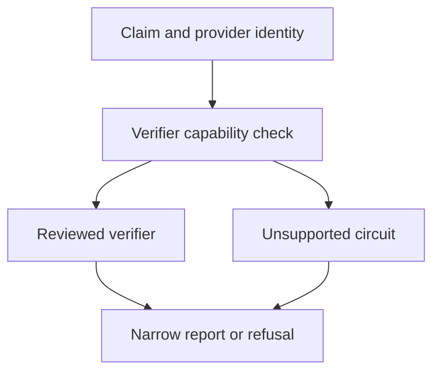

# Selective chat proof statement

## 1. Metadata

- **Specification ID:** ARB-CHATPROOF
- **Version:** 1.0
- **Owner:** p2p-offramp maintainers
- **Status:** Expanded design baseline — implementation and independent review pending
- **Delivery phase:** 6, opt-in only
- **Module:** module_4.3.1_chat_key_escrow
- **Normative language:** MUST is a release gate; SHOULD deviations require recorded rationale.

## 2. Objective

Constrain future selective evidence claims and refuse unsupported ZK verification. This module participates only in new trades using G33's separately deployed opted-in escrow. It has no authority over already funded basic escrows. Basic manual release/refund and the core-only build MUST remain usable with this module absent. No specification statement is evidence of a deployed or audited tribunal.

## 3. Architecture and data contracts



The chain is authoritative for case stage, reservations, deadlines and final settlement; relay/indexer/local views are caches. Human/provider statements establish only their explicitly authenticated claims. G33 defines shared policy, G34 defines timing and fallback. All case records are additionally bound to chain, escrow deployment, tribunal deployment and immutable policy hash, whether inline or inherited from the case mapping. `Hex32` is exactly 32 bytes; JSON exports use lowercase 0x-prefixed hex and decimal strings for bigint, reject unknown versions/fields, and never coerce floating amounts.

```typescript
interface ChatClaimV1 {
  providerId: Hex32; verifierVersion: number; circuitHash: Hex32;
  caseId: Hex32; tradeId: Hex32; termsHash: Hex32; evidenceRoot: Hex32;
  senderKey: string; predicateId: "authenticated-message-membership";
  disclosedMessageHash: Hex32; claimNullifier: Hex32; proofBytes: Uint8Array;
}
```

## 4. Algorithms and invariants

The baseline supports direct authentication of disclosed messages, not a deployed selective-chat ZK circuit. Capability negotiation MUST return unsupported for proof-required offers until provider selection, circuit, setup assumptions, verification keys, signature/hash compatibility and resource benchmarks receive review. Encrypted storage is not a zero-knowledge proof.

A future admissible narrow statement would prove possession of a valid signature from senderKey over canonical trade-bound message bytes and membership of that message hash in evidenceRoot, with public trade/case/terms binding. It cannot prove message truth, full transcript completeness, fiat receipt, absence of threats elsewhere, or payment irreversibility. No amount/recipient predicate may be inferred by parsing natural language.

Use existing reviewed proof systems and adapters only; do not create a circuit by translating unsupported Nostr signature primitives without feasibility work. Proof byte limit is 1 MiB, verification job wall budget 30s in a cancellable worker; timeout returns unverified. Each claim nullifier is case/round/predicate bound and deduplicated for presentation, not treated as globally unique human identity. Verification results freeze with evidence root before commit.

## 5. Interfaces and failure recovery

`verifyChatClaim(claim, AbortSignal): verified | invalid | unsupported | timeout`. Unknown verifier/version/hash, root mismatch or unsupported predicate returns refusal. Direct disclosed-message authentication has its own method and cannot be labeled a ZK result. Economic actions MUST use chain reconciliation and G12 durable intent journaling before broadcast; unknown transaction state remains pending until reconciled. Retry only the same authorized operation, never manufacture a new case, seed, signature or outcome. Logs exclude secrets and plaintext evidence. Deadline checks use half-open stage intervals, authoritative chain time and G34's immutable hard stop.

## 6. Threat assessment and trust assumptions

A valid proof can establish only its formal statement. Compromised verification key registry, hidden trusted setup and front-end label inflation are threats. Bind evaluated verifier identity into funded terms; unavailable proofs cannot silently become screenshot evidence with equal assurance. Anonymous/pseudonymous identities and stake do not eliminate Sybils, collusion or coercion. Fiat source authentication does not establish cash contents or payment irreversibility. These limitations must appear in pre-funding consent alongside the explicit seller-refund fallback, which can leave an honest fiat-paying buyer uncompensated.

## 7. Verification and references

Before enabling: positive/negative official vectors, mutated signature/public inputs, replay across case/round, unsupported circuit, worker termination and malformed huge proof. Independent statement/circuit audit and browser/provider interoperability are deployment blockers; no proof integration is complete in this design.

Required evidence is prospective: unit/boundary/property tests, supported provider/chain integration records, deployment identities, economic simulation and independent security review MUST be recorded before activation. No real-funds release, cryptographic audit, interoperability success or legal approval is claimed here. New policy activation also requires core-only regression proving this module cannot acquire basic escrow rights.

Primary project authorities: [roadmap](../../../DEVELOPMENT_ROADMAP.md), [system context](../../../00_PLANNING_AND_THREAT_MODELING/feature_0.4_architecture_planning/module_0.4.1_system_boundaries/spec-system-context-contract.md), [G14 extension boundary](../../../00_PLANNING_AND_THREAT_MODELING/feature_0.4_architecture_planning/module_0.4.6_extension_contract/spec-optional-module-interface.md). Arbitration policy and timing: [G33](../../feature_4.7_protocol_integration/module_4.7.1_arbitration_opt_in/spec-arbitration-version-binding.md), [G34](../../feature_4.7_protocol_integration/module_4.7.2_arbitration_liveness/spec-arbitration-outage-and-finality.md).
