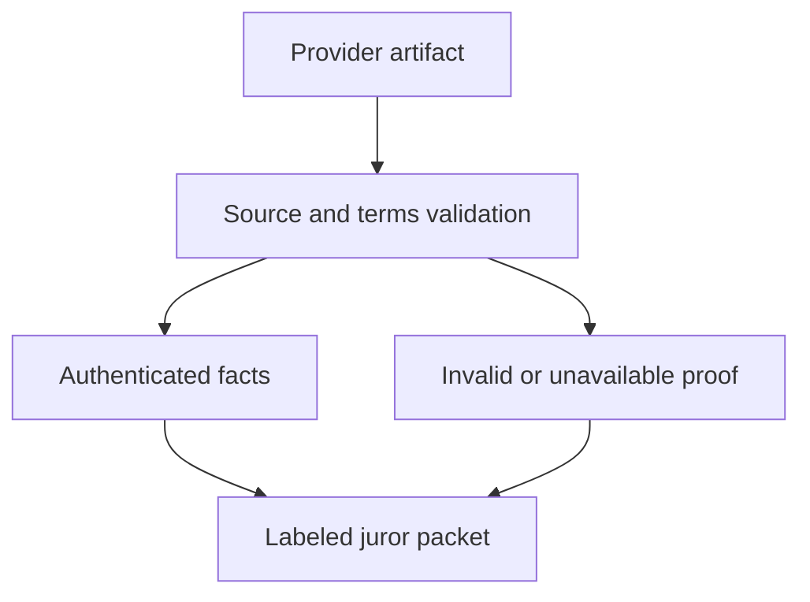

# Arbiter payment evidence interface

## 1. Metadata

- **Specification ID:** ARB-PAY
- **Version:** 1.0
- **Owner:** p2p-offramp maintainers
- **Status:** Expanded design baseline — implementation and independent review pending
- **Delivery phase:** 6, opt-in only
- **Module:** module_4.4.1_arbiter_payment_verifier
- **Normative language:** MUST is a release gate; SHOULD deviations require recorded rationale.

## 2. Objective

Normalize authenticated payment observations while preserving source and rail limitations. This module participates only in new trades using G33's separately deployed opted-in escrow. It has no authority over already funded basic escrows. Basic manual release/refund and the core-only build MUST remain usable with this module absent. No specification statement is evidence of a deployed or audited tribunal.

## 3. Architecture and data contracts



The chain is authoritative for case stage, reservations, deadlines and final settlement; relay/indexer/local views are caches. Human/provider statements establish only their explicitly authenticated claims. G33 defines shared policy, G34 defines timing and fallback. All case records are additionally bound to chain, escrow deployment, tribunal deployment and immutable policy hash, whether inline or inherited from the case mapping. `Hex32` is exactly 32 bytes; JSON exports use lowercase 0x-prefixed hex and decimal strings for bigint, reject unknown versions/fields, and never coerce floating amounts.

```typescript
interface PaymentEvidenceV1 {
  caseId: Hex32; tradeId: Hex32; termsHash: Hex32; evidenceId: Hex32;
  providerId: Hex32; verifierVersion: number; sourcePolicyHash: Hex32;
  amountMinor: bigint; currency: string; recipientCommitment: Hex32;
  paymentReferenceCommitment: Hex32; observedAt: bigint;
  status: "pending" | "posted" | "reversed" | "unknown";
  assurance: "authenticated-source" | "party-assertion";
  artifactHash: Hex32; verifierReportHash: Hex32;
}
```

## 4. Algorithms and invariants

Accept evidence only from the provider/source/rail versions in policy. Validate positive integer minor units, exact currency, recipient, case, terms and reference; no floating conversion or approximate recipient match. Limit 32 evidence records per party, 1 MiB proof bytes each and 8 MiB verified artifacts per case. A record larger than aggregate budget fails before processing.

Verify proof in bounded isolated workers under G29; preserve provider trust assumptions and authenticated observation time. Compare observation freshness to terms-bound payment interval with explicit rail policy; default advisory evidence maximum age is 24h at submission, not a guarantee of rail finality. Unknown source clock or ambiguous account/page state is unknown. Derive evidence ID from provider/source/artifact and case binding; deduplicate within case and maintain receipt-use registry where policy requires unique payment allocation. A source may legitimately describe the same payment twice; do not double-count.

Normalize verified content into juror-readable facts and uncertainty report. Neither posted status nor TLS-authenticated page proves irreversibility. Payment evidence does not directly invoke settlement; only this opted-in tribunal decision can authorize it. Screenshot/manual claims are labeled party-assertion and never upgraded by being hashed.

## 5. Interfaces and failure recovery

`assessPaymentEvidence(input, policy, signal)` returns accepted/report, invalid, unsupported, timeout or unavailable. `submitEvidenceRoot` freezes accepted reports before commit. Unavailable provider yields missing evidence, not automatic verdict; invalid records remain available as disputed submissions only with explicit invalid label. Economic actions MUST use chain reconciliation and G12 durable intent journaling before broadcast; unknown transaction state remains pending until reconciled. Retry only the same authorized operation, never manufacture a new case, seed, signature or outcome. Logs exclude secrets and plaintext evidence. Deadline checks use half-open stage intervals, authoritative chain time and G34's immutable hard stop.

## 6. Threat assessment and trust assumptions

Provider collusion, bank UI changes, chargebacks, mule accounts, duplicate allocations and manipulated timestamps require source-policy review. Fiat identifiers remain encrypted to panel; public commitments may leak if identifiers have low entropy, so use randomized commitments with reviewed formats. Anonymous/pseudonymous identities and stake do not eliminate Sybils, collusion or coercion. Fiat source authentication does not establish cash contents or payment irreversibility. These limitations must appear in pre-funding consent alongside the explicit seller-refund fallback, which can leave an honest fiat-paying buyer uncompensated.

## 7. Verification and references

Wrong amount scale, currency, recipient, case, reference, future/stale timestamp, pending/reversed receipt, duplicate bank transaction and provider outage. Integrate real evaluated bank/provider fixtures before advertising support; rail reversibility and legal assumptions require named review.

Required evidence is prospective: unit/boundary/property tests, supported provider/chain integration records, deployment identities, economic simulation and independent security review MUST be recorded before activation. No real-funds release, cryptographic audit, interoperability success or legal approval is claimed here. New policy activation also requires core-only regression proving this module cannot acquire basic escrow rights.

Primary project authorities: [roadmap](../../../DEVELOPMENT_ROADMAP.md), [system context](../../../00_PLANNING_AND_THREAT_MODELING/feature_0.4_architecture_planning/module_0.4.1_system_boundaries/spec-system-context-contract.md), [G14 extension boundary](../../../00_PLANNING_AND_THREAT_MODELING/feature_0.4_architecture_planning/module_0.4.6_extension_contract/spec-optional-module-interface.md). Arbitration policy and timing: [G33](../../feature_4.7_protocol_integration/module_4.7.1_arbitration_opt_in/spec-arbitration-version-binding.md), [G34](../../feature_4.7_protocol_integration/module_4.7.2_arbitration_liveness/spec-arbitration-outage-and-finality.md).
