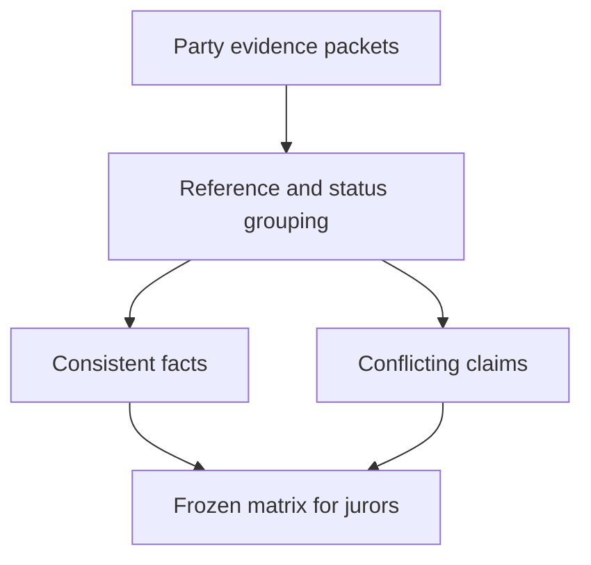

# Conflicting payment evidence policy

## 1. Metadata

- **Specification ID:** ARB-CONFLICT
- **Version:** 1.0
- **Owner:** p2p-offramp maintainers
- **Status:** Expanded design baseline — implementation and independent review pending
- **Delivery phase:** 6, opt-in only
- **Module:** module_4.4.1_arbiter_payment_verifier
- **Normative language:** MUST is a release gate; SHOULD deviations require recorded rationale.

## 2. Objective

Give jurors a deterministic evidence matrix without turning uncertain observations into automatic truth. This module participates only in new trades using G33's separately deployed opted-in escrow. It has no authority over already funded basic escrows. Basic manual release/refund and the core-only build MUST remain usable with this module absent. No specification statement is evidence of a deployed or audited tribunal.

## 3. Architecture and data contracts



The chain is authoritative for case stage, reservations, deadlines and final settlement; relay/indexer/local views are caches. Human/provider statements establish only their explicitly authenticated claims. G33 defines shared policy, G34 defines timing and fallback. All case records are additionally bound to chain, escrow deployment, tribunal deployment and immutable policy hash, whether inline or inherited from the case mapping. `Hex32` is exactly 32 bytes; JSON exports use lowercase 0x-prefixed hex and decimal strings for bigint, reject unknown versions/fields, and never coerce floating amounts.

```typescript
interface EvidenceConflictV1 {
  caseId: Hex32; round: 0 | 1; evidenceRoot: Hex32;
  claims: readonly Hex32[]; issue: "identity" | "amount" | "status" | "timing" | "completeness";
  disposition: "unresolved" | "superseded-source-state" | "invalid-proof";
  reasons: readonly string[];
}
```

## 4. Algorithms and invariants

Juror packet groups records by bound payment reference and recipient rather than summing screenshots. A later authenticated reversed status for the same source/reference is shown alongside an earlier posted status; it does not automatically establish which party caused reversal. Conflicting currencies/recipients are separate claims, never silently merged. Pending and unknown receipts do not count as posted. Authenticated-source evidence outranks an unsupported screenshot only for the exact facts the source authenticated, not for intent or irreversible ownership.

Both parties get the same frozen admissible packet and 24h evidence window. Up to 32 records each and one response per record capped at 4 KiB avoids unlimited rebuttal extension. Report rejection reasons and allow corrected submission before evidenceEnd. A juror chooses buyer, seller or abstain with a bounded reason code referencing frozen evidence root. A lack of adequate evidence supports abstain; no default guilty party is inferred from silence.

Jury policy asks whether the terms-defined fiat delivery obligation is sufficiently supported under the published rail policy. It is a human judgment under disclosed trust assumptions, not a cryptographic proof. Unresolved contradictions follow quorum/appeal/G34; jurors cannot extend deadlines or introduce outside private evidence after commit.

## 5. Interfaces and failure recovery

`buildConflictMatrix(records, terms)` produces deterministically sorted issues; `recordResponse(evidenceId, responseHash)` accepts party-authenticated bounded responses. UNKNOWN_REFERENCE, WINDOW_CLOSED and ROOT_MISMATCH reject. Invalid proof reports do not delete the counterparty response history. Economic actions MUST use chain reconciliation and G12 durable intent journaling before broadcast; unknown transaction state remains pending until reconciled. Retry only the same authorized operation, never manufacture a new case, seed, signature or outcome. Logs exclude secrets and plaintext evidence. Deadline checks use half-open stage intervals, authoritative chain time and G34's immutable hard stop.

## 6. Threat assessment and trust assumptions

Selective source screenshots, fabricated disputes, colluding verifier/jurors and biased rules remain. A deterministic matrix reduces inconsistent presentation, not judgment risk. Jurors must disclose conflicts and cannot privately contact one party; misconduct evidence can inform future registry review but not arbitrary retroactive principal seizure. Anonymous/pseudonymous identities and stake do not eliminate Sybils, collusion or coercion. Fiat source authentication does not establish cash contents or payment irreversibility. These limitations must appear in pre-funding consent alongside the explicit seller-refund fallback, which can leave an honest fiat-paying buyer uncompensated.

## 7. Verification and references

Posted then reversed; two sources disagree; partial payments; amount in different currency; same receipt attached to two trades; both parties silent and evidence host unavailable. Golden packet comparison across clients, malicious render payloads, equal packet roots and fixed deadlines are required.

Required evidence is prospective: unit/boundary/property tests, supported provider/chain integration records, deployment identities, economic simulation and independent security review MUST be recorded before activation. No real-funds release, cryptographic audit, interoperability success or legal approval is claimed here. New policy activation also requires core-only regression proving this module cannot acquire basic escrow rights.

Primary project authorities: [roadmap](../../../DEVELOPMENT_ROADMAP.md), [system context](../../../00_PLANNING_AND_THREAT_MODELING/feature_0.4_architecture_planning/module_0.4.1_system_boundaries/spec-system-context-contract.md), [G14 extension boundary](../../../00_PLANNING_AND_THREAT_MODELING/feature_0.4_architecture_planning/module_0.4.6_extension_contract/spec-optional-module-interface.md). Arbitration policy and timing: [G33](../../feature_4.7_protocol_integration/module_4.7.1_arbitration_opt_in/spec-arbitration-version-binding.md), [G34](../../feature_4.7_protocol_integration/module_4.7.2_arbitration_liveness/spec-arbitration-outage-and-finality.md).
