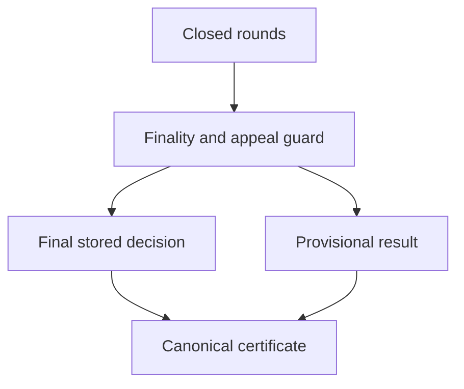

# Jury decision certificate

## 1. Metadata

- **Specification ID:** ARB-CERT
- **Version:** 1.0
- **Owner:** p2p-offramp maintainers
- **Status:** Expanded design baseline — implementation and independent review pending
- **Delivery phase:** 6, opt-in only
- **Module:** module_4.5.1_commit_reveal_voting
- **Normative language:** MUST is a release gate; SHOULD deviations require recorded rationale.

## 2. Objective

Represent a finalized on-chain outcome without inventing a threshold signature scheme. This module participates only in new trades using G33's separately deployed opted-in escrow. It has no authority over already funded basic escrows. Basic manual release/refund and the core-only build MUST remain usable with this module absent. No specification statement is evidence of a deployed or audited tribunal.

## 3. Architecture and data contracts



The chain is authoritative for case stage, reservations, deadlines and final settlement; relay/indexer/local views are caches. Human/provider statements establish only their explicitly authenticated claims. G33 defines shared policy, G34 defines timing and fallback. All case records are additionally bound to chain, escrow deployment, tribunal deployment and immutable policy hash, whether inline or inherited from the case mapping. `Hex32` is exactly 32 bytes; JSON exports use lowercase 0x-prefixed hex and decimal strings for bigint, reject unknown versions/fields, and never coerce floating amounts.

```typescript
interface DecisionCertificateV1 {
  version: 1; chainId: bigint; escrow: string; tribunal: string;
  policyHash: Hex32; tradeId: Hex32; caseId: Hex32; round: 0 | 1;
  evidenceRoot: Hex32; panelRoot: Hex32; tallyHash: Hex32;
  outcome: "buyer" | "seller"; reason: "jury" | "fallback";
  principal: bigint; finalizedAt: bigint; settlementNonce: bigint;
}
```

## 4. Algorithms and invariants

Certificate is a canonical ABI-encoded projection of a terminal decision stored in the opted-in tribunal contract, with keccak256 digest and an emitted event. It is not an off-chain multisignature or a custom aggregate signature. Settlement reads the tribunal's immutable decision mapping on the same chain and verifies digest/full binding; a client-generated JSON or matching event alone grants no authority.

Only finalize under appeal/G34 rules can create it. Store once per case; include winning round if any and fallback reason otherwise. For no conclusive round, use round=0 and zero tally/panel/evidence hashes with explicit fallback reason rather than fabricate a jury record. A failed appeal preserving round0 uses its real roots and tally. Settlement nonce is reserved at trade creation and consumed once; exact principal and predetermined recipients are immutable.

Certificate transport may include a transaction locator for audit, but settlement does not trust RPC receipt contents. Cross-chain execution and threshold-signed bridging are unsupported. A future multisig design requires distinct signer governance/security specification and a new opt-in deployment; it cannot be silently substituted for on-chain tally authority.

## 5. Interfaces and failure recovery

`decision(caseId)`, `decisionDigest(caseId)`, `isFinal(caseId)` are contract reads; `exportCertificate` returns machine-readable recovery data. Reject unsupported version, unfinalized case, mismatched escrow/policy/principal/nonce or unknown tribunal. Economic actions MUST use chain reconciliation and G12 durable intent journaling before broadcast; unknown transaction state remains pending until reconciled. Retry only the same authorized operation, never manufacture a new case, seed, signature or outcome. Logs exclude secrets and plaintext evidence. Deadline checks use half-open stage intervals, authoritative chain time and G34's immutable hard stop.

## 6. Threat assessment and trust assumptions

Fake indexer certificates, signature confusion and reorged events require on-chain canonical reads and finality display. A correct certificate proves the tribunal followed its rules, not fiat truth. Finality can be socially or technically reversed by chain events; display underlying assumptions. Anonymous/pseudonymous identities and stake do not eliminate Sybils, collusion or coercion. Fiat source authentication does not establish cash contents or payment irreversibility. These limitations must appear in pre-funding consent alongside the explicit seller-refund fallback, which can leave an honest fiat-paying buyer uncompensated.

## 7. Verification and references

Forged JSON, real certificate for different escrow/chain/round, provisional tally, old nonce, wrong amount and duplicate execution. Reconstruct digest across Solidity/TypeScript vectors and reorg logs; verify no multisig fallback path exists in baseline.

Required evidence is prospective: unit/boundary/property tests, supported provider/chain integration records, deployment identities, economic simulation and independent security review MUST be recorded before activation. No real-funds release, cryptographic audit, interoperability success or legal approval is claimed here. New policy activation also requires core-only regression proving this module cannot acquire basic escrow rights.

Primary project authorities: [roadmap](../../../DEVELOPMENT_ROADMAP.md), [system context](../../../00_PLANNING_AND_THREAT_MODELING/feature_0.4_architecture_planning/module_0.4.1_system_boundaries/spec-system-context-contract.md), [G14 extension boundary](../../../00_PLANNING_AND_THREAT_MODELING/feature_0.4_architecture_planning/module_0.4.6_extension_contract/spec-optional-module-interface.md). Arbitration policy and timing: [G33](../../feature_4.7_protocol_integration/module_4.7.1_arbitration_opt_in/spec-arbitration-version-binding.md), [G34](../../feature_4.7_protocol_integration/module_4.7.2_arbitration_liveness/spec-arbitration-outage-and-finality.md).

Encoding/signature reference: [EIP-712](https://eips.ethereum.org/EIPS/eip-712); application nonces/deadlines and contract state provide replay prevention. ABI encoding MUST use the [Solidity ABI specification](https://docs.soliditylang.org/en/latest/abi-spec.html) with implementation compiler/toolchain pins and published vectors.
