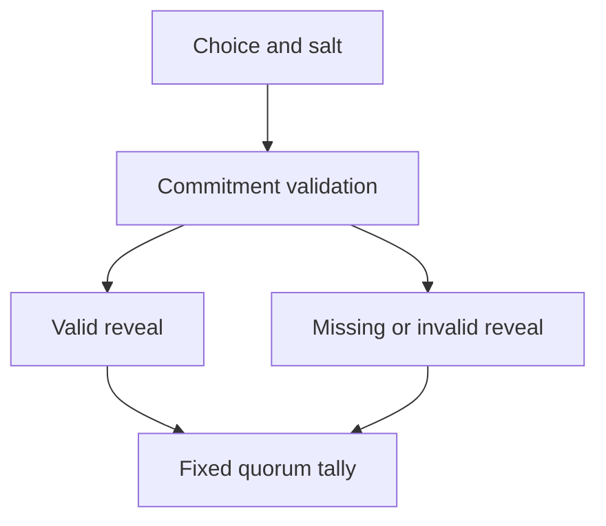

# Jury reveal and tally

## 1. Metadata

- **Specification ID:** ARB-TALLY
- **Version:** 1.0
- **Owner:** p2p-offramp maintainers
- **Status:** Expanded design baseline — implementation and independent review pending
- **Delivery phase:** 6, opt-in only
- **Module:** module_4.5.1_commit_reveal_voting
- **Normative language:** MUST is a release gate; SHOULD deviations require recorded rationale.

## 2. Objective

Count valid equal-seat reveals with explicit quorum and no early-result shortcuts. This module participates only in new trades using G33's separately deployed opted-in escrow. It has no authority over already funded basic escrows. Basic manual release/refund and the core-only build MUST remain usable with this module absent. No specification statement is evidence of a deployed or audited tribunal.

## 3. Architecture and data contracts



The chain is authoritative for case stage, reservations, deadlines and final settlement; relay/indexer/local views are caches. Human/provider statements establish only their explicitly authenticated claims. G33 defines shared policy, G34 defines timing and fallback. All case records are additionally bound to chain, escrow deployment, tribunal deployment and immutable policy hash, whether inline or inherited from the case mapping. `Hex32` is exactly 32 bytes; JSON exports use lowercase 0x-prefixed hex and decimal strings for bigint, reject unknown versions/fields, and never coerce floating amounts.

```typescript
interface TallyV1 {
  caseId: Hex32; round: 0 | 1; panelSize: 5 | 9; evidenceRoot: Hex32;
  seller: number; buyer: number; abstain: number; missing: number;
  quorum: 4 | 6; result: "seller" | "buyer" | "inconclusive";
  closed: boolean;
}
```

## 4. Algorithms and invariants

Reveal accepts choice and 32-byte salt only from its seat during [commitEnd,revealEnd). Recompute exact commitment, require stored evidence root and reject mismatch without consuming the reveal slot. Valid reveal becomes immutable; a duplicate is refused and cannot earn another fee. Choice=2 is an explicit valid abstention, included in participation quorum but not directional support.

After revealEnd anyone closes. Initial panel N=5 requires at least 4 valid reveals and at least 3 buyer or 3 seller votes for a conclusive directional decision. Appeal N=9 requires at least 6 valid reveals and at least 5 directional votes. Thus abstentions may yield an inconclusive result even with participation quorum; missing votes do not lower thresholds. Do not choose an arbitrary direction on tie. No early finalization based on current majority or all already-revealed votes; fixed window avoids front-running remaining participants.

Record complete counts, panel/evidence root and reason code. Initial result remains provisional during appeal window; round 1 result replaces it only if conclusive. Failure is handled by G34, with fees for valid reveal and objective missing-reveal bond treatment under penalty spec. Tally arithmetic is on chain; indexer result is informational.

## 5. Interfaces and failure recovery

`revealVote(caseId, round, choice, salt)`, `closeRound(caseId, round)`, `readTally`. INVALID_PREIMAGE, INVALID_CHOICE, TOO_EARLY, WINDOW_CLOSED, ALREADY_REVEALED. Bound all work to at most nine seats and never make outbound calls during close. Economic actions MUST use chain reconciliation and G12 durable intent journaling before broadcast; unknown transaction state remains pending until reconciled. Retry only the same authorized operation, never manufacture a new case, seed, signature or outcome. Logs exclude secrets and plaintext evidence. Deadline checks use half-open stage intervals, authoritative chain time and G34's immutable hard stop.

## 6. Threat assessment and trust assumptions

Last revealer can withhold and cause quorum failure; deposits do not eliminate bribery or ensure factual correctness. Equal-seat thresholds resist minority participation but cannot overcome a captured panel. Public reveals expose voting behavior and may enable coercion. Anonymous/pseudonymous identities and stake do not eliminate Sybils, collusion or coercion. Fiat source authentication does not establish cash contents or payment irreversibility. These limitations must appear in pre-funding consent alongside the explicit seller-refund fallback, which can leave an honest fiat-paying buyer uncompensated.

## 7. Verification and references

Enumerate all count partitions for N=5 and 9; assert exact quorum/direction thresholds and abstention behavior. Test invalid then valid reveal, reveals at boundaries, all missing, decisive-but-low-quorum and order permutations. Property: same valid reveals produce same closed tally independent of caller order.

Required evidence is prospective: unit/boundary/property tests, supported provider/chain integration records, deployment identities, economic simulation and independent security review MUST be recorded before activation. No real-funds release, cryptographic audit, interoperability success or legal approval is claimed here. New policy activation also requires core-only regression proving this module cannot acquire basic escrow rights.

Primary project authorities: [roadmap](../../../DEVELOPMENT_ROADMAP.md), [system context](../../../00_PLANNING_AND_THREAT_MODELING/feature_0.4_architecture_planning/module_0.4.1_system_boundaries/spec-system-context-contract.md), [G14 extension boundary](../../../00_PLANNING_AND_THREAT_MODELING/feature_0.4_architecture_planning/module_0.4.6_extension_contract/spec-optional-module-interface.md). Arbitration policy and timing: [G33](../../feature_4.7_protocol_integration/module_4.7.1_arbitration_opt_in/spec-arbitration-version-binding.md), [G34](../../feature_4.7_protocol_integration/module_4.7.2_arbitration_liveness/spec-arbitration-outage-and-finality.md).
