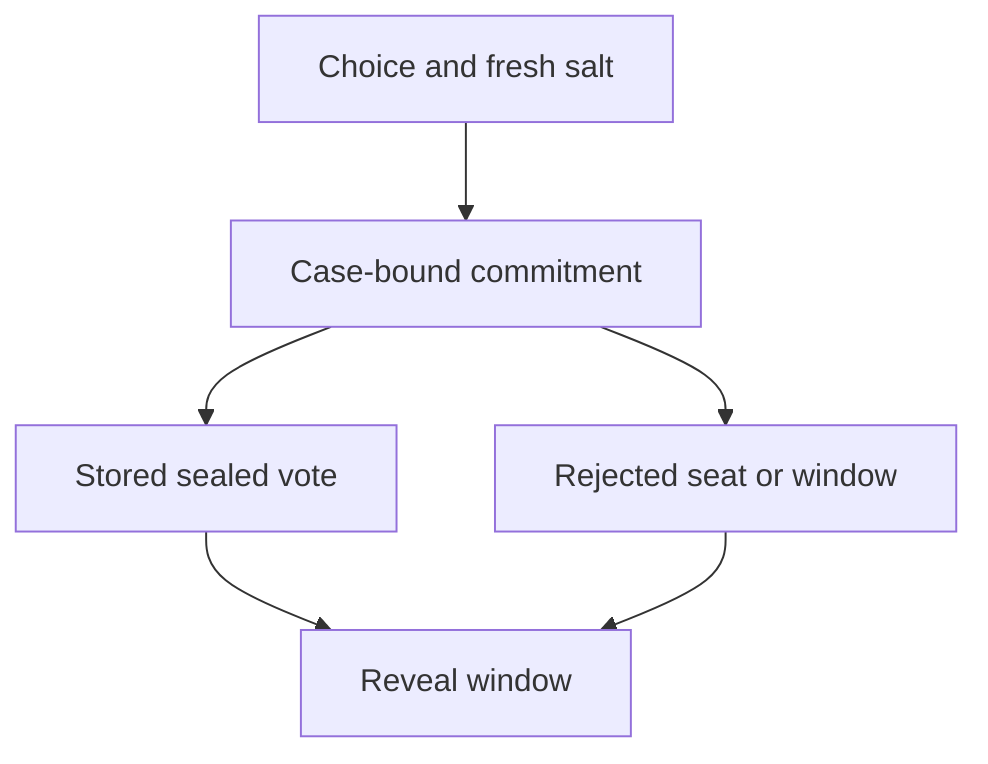

# Jury vote commitment

## 1. Metadata

- **Specification ID:** ARB-COMMIT
- **Version:** 1.0
- **Owner:** p2p-offramp maintainers
- **Status:** Expanded design baseline — implementation and independent review pending
- **Delivery phase:** 6, opt-in only
- **Module:** module_4.5.1_commit_reveal_voting
- **Normative language:** MUST is a release gate; SHOULD deviations require recorded rationale.

## 2. Objective

Bind each sealed vote to one seat, round, evidence packet and deployment. This module participates only in new trades using G33's separately deployed opted-in escrow. It has no authority over already funded basic escrows. Basic manual release/refund and the core-only build MUST remain usable with this module absent. No specification statement is evidence of a deployed or audited tribunal.

## 3. Architecture and data contracts



The chain is authoritative for case stage, reservations, deadlines and final settlement; relay/indexer/local views are caches. Human/provider statements establish only their explicitly authenticated claims. G33 defines shared policy, G34 defines timing and fallback. All case records are additionally bound to chain, escrow deployment, tribunal deployment and immutable policy hash, whether inline or inherited from the case mapping. `Hex32` is exactly 32 bytes; JSON exports use lowercase 0x-prefixed hex and decimal strings for bigint, reject unknown versions/fields, and never coerce floating amounts.

```typescript
interface VoteCommitmentV1 {
  chainId: bigint; tribunal: string; policyHash: Hex32; caseId: Hex32;
  round: 0 | 1; jurorId: Hex32; evidenceRoot: Hex32;
  commitment: Hex32;
}
type Choice = 0 | 1 | 2; // seller, buyer, abstain
```

## 4. Algorithms and invariants

A juror chooses a 32-byte fresh CSPRNG salt and computes keccak256(abi.encode(VOTE_TYPEHASH, chainId, tribunal, policyHash, caseId, round, jurorId, evidenceRoot, choice, salt)). All fields are fixed-width EVM ABI encodings; VOTE_TYPEHASH is keccak256 of the exact ASCII string `Vote(uint256 chainId,address tribunal,bytes32 policyHash,bytes32 caseId,uint8 round,bytes32 jurorId,bytes32 evidenceRoot,uint8 choice,bytes32 salt)`; implementation vectors MUST publish every intermediate byte string and hash. abi.encodePacked, string concatenation, variable choice encodings and hash-of-display-label are prohibited. Salt is generated independently for every vote, encrypted locally and exportable in a juror recovery package; never logged.

Only the seated voting address may submit its one commitment during [commitStart,commitEnd). Commit replacement is disallowed. Evidence root and panel are frozen before commitStart; reveal cannot begin until commitEnd regardless of early commit count. An optional relayer signature uses EIP-712 with this full domain, case/round nonce and expiry plus contract-side consumed nonce; signature encoding alone is not replay protection. Direct transaction submission is the initial baseline.

Persist the sealed vote and transaction intent before wallet broadcast. On restart reconcile chain commitment before retry. Lost salt is unrecoverable nonreveal and does not justify deadline extension or administrator reveal.

## 5. Interfaces and failure recovery

`commitVote(caseId, round, commitment)`, `readCommitment(caseId, round, jurorId)`. NOT_SEATED, ALREADY_COMMITTED, WRONG_PHASE, WRONG_ROOT refuse. No callback or externally supplied juror ID can impersonate msg.sender mapping. Economic actions MUST use chain reconciliation and G12 durable intent journaling before broadcast; unknown transaction state remains pending until reconciled. Retry only the same authorized operation, never manufacture a new case, seed, signature or outcome. Logs exclude secrets and plaintext evidence. Deadline checks use half-open stage intervals, authoritative chain time and G34's immutable hard stop.

## 6. Threat assessment and trust assumptions

Copied commitments do not help another juror because jurorId is inside preimage. Weak salt enables enumeration of three choices. Commit/reveal hides votes temporarily but does not prevent bribery, coerced salt disclosure, collusion or last-revealer strategy. Anonymous/pseudonymous identities and stake do not eliminate Sybils, collusion or coercion. Fiat source authentication does not establish cash contents or payment irreversibility. These limitations must appear in pre-funding consent alongside the explicit seller-refund fallback, which can leave an honest fiat-paying buyer uncompensated.

## 7. Verification and references

Publish byte-exact multi-language vectors, salt randomness failure, copy-to-other-seat, alternate ABI encoding, cross-chain/round/case replay, root change, duplicate commit and crash before/after broadcast. Ensure no plaintext choice/salt leaks in analytics or error output.

Required evidence is prospective: unit/boundary/property tests, supported provider/chain integration records, deployment identities, economic simulation and independent security review MUST be recorded before activation. No real-funds release, cryptographic audit, interoperability success or legal approval is claimed here. New policy activation also requires core-only regression proving this module cannot acquire basic escrow rights.

Primary project authorities: [roadmap](../../../DEVELOPMENT_ROADMAP.md), [system context](../../../00_PLANNING_AND_THREAT_MODELING/feature_0.4_architecture_planning/module_0.4.1_system_boundaries/spec-system-context-contract.md), [G14 extension boundary](../../../00_PLANNING_AND_THREAT_MODELING/feature_0.4_architecture_planning/module_0.4.6_extension_contract/spec-optional-module-interface.md). Arbitration policy and timing: [G33](../../feature_4.7_protocol_integration/module_4.7.1_arbitration_opt_in/spec-arbitration-version-binding.md), [G34](../../feature_4.7_protocol_integration/module_4.7.2_arbitration_liveness/spec-arbitration-outage-and-finality.md).

Encoding/signature reference: [EIP-712](https://eips.ethereum.org/EIPS/eip-712); application nonces/deadlines and contract state provide replay prevention. ABI encoding MUST use the [Solidity ABI specification](https://docs.soliditylang.org/en/latest/abi-spec.html) with implementation compiler/toolchain pins and published vectors.
