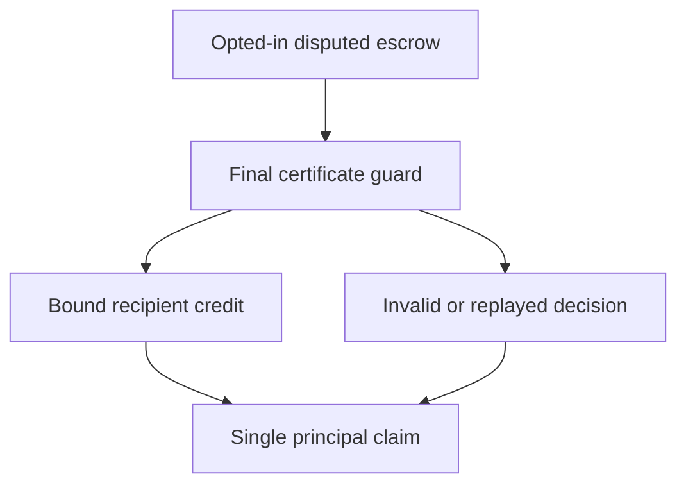

# Adjudicated release interface

## 1. Metadata

- **Specification ID:** ARB-EXEC
- **Version:** 1.0
- **Owner:** p2p-offramp maintainers
- **Status:** Expanded design baseline — implementation and independent review pending
- **Delivery phase:** 6, opt-in only
- **Module:** module_4.6.1_escrow_enforcement
- **Normative language:** MUST is a release gate; SHOULD deviations require recorded rationale.

## 2. Objective

Execute one authorized opted-in outcome without crossing custody or principal boundaries. This module participates only in new trades using G33's separately deployed opted-in escrow. It has no authority over already funded basic escrows. Basic manual release/refund and the core-only build MUST remain usable with this module absent. No specification statement is evidence of a deployed or audited tribunal.

## 3. Architecture and data contracts



The chain is authoritative for case stage, reservations, deadlines and final settlement; relay/indexer/local views are caches. Human/provider statements establish only their explicitly authenticated claims. G33 defines shared policy, G34 defines timing and fallback. All case records are additionally bound to chain, escrow deployment, tribunal deployment and immutable policy hash, whether inline or inherited from the case mapping. `Hex32` is exactly 32 bytes; JSON exports use lowercase 0x-prefixed hex and decimal strings for bigint, reject unknown versions/fields, and never coerce floating amounts.

```typescript
interface AdjudicatedSettlementV1 {
  tradeId: Hex32; caseId: Hex32; certificateHash: Hex32;
  settlementNonce: bigint; outcome: "buyer" | "seller";
  principalAsset: string; principalAmount: bigint;
  recipient: string;
}
```

## 4. Algorithms and invariants

Caller may be anyone; authority comes solely from the immutable tribunal read and the escrow's disputed state. Verify chain/deployment, terms/policy, case, final result and nonce. Derive recipient from funded buyer/seller address, never a certificate-supplied arbitrary address. Debit exactly the recorded funded principal, not total contract balance; fees and juror stakes live in separate accounting. Partial awards, arbitrary transfer lists, cross-chain payments and courier principal redistribution are unsupported in V1.

Set terminal state and consumed nonce before transfer under reentrancy protection. Prefer claimable-credit settlement: finalize records one buyer/seller credit, and bound recipient withdraws to itself with pull payment. Failed token transfer leaves credit available; never revert tribunal finality or pay the other party instead. If direct asset transfer is used, audited atomic revert semantics must preserve an executable state. Native/token adapters must reject unsupported transfer behavior before funding.

At hardStop any caller may invoke G34 finalization then execution; deterministic fallback is seller credit. A basic escrow exposes no tribunal execution method and accepts no certificate. Disabling UI/provider does not disable raw contract recovery.

## 5. Interfaces and failure recovery

`executeDecision(tradeId)`, `claimPrincipal(tradeId)`, `readSettlement(tradeId)`. WRONG_ESCROW_VERSION, CASE_MISMATCH, DECISION_NOT_FINAL, ALREADY_SETTLED, ASSET_UNSUPPORTED. No admin override, arbitrary delegatecall, callback-selected recipient or operator withdrawal. Economic actions MUST use chain reconciliation and G12 durable intent journaling before broadcast; unknown transaction state remains pending until reconciled. Retry only the same authorized operation, never manufacture a new case, seed, signature or outcome. Logs exclude secrets and plaintext evidence. Deadline checks use half-open stage intervals, authoritative chain time and G34's immutable hard stop.

## 6. Threat assessment and trust assumptions

Reentrancy, asset callback, confused deputy, malicious tribunal registry and donated balance theft require immutable address binding and per-trade liabilities. New deployment needed for changed authority. Recipient private-key loss cannot be fixed by changing funded recipients. Anonymous/pseudonymous identities and stake do not eliminate Sybils, collusion or coercion. Fiat source authentication does not establish cash contents or payment irreversibility. These limitations must appear in pre-funding consent alongside the explicit seller-refund fallback, which can leave an honest fiat-paying buyer uncompensated.

## 7. Verification and references

Basic escrow rejection, real certificate/wrong trade, appeal pending, repeated execute/claim, malicious recipient/token callbacks, forced donations and transfer failure. Fuzz principal conservation and terminal monotonicity; independently audit implementation and demonstrate direct recovery without frontend before enabling funds.

Required evidence is prospective: unit/boundary/property tests, supported provider/chain integration records, deployment identities, economic simulation and independent security review MUST be recorded before activation. No real-funds release, cryptographic audit, interoperability success or legal approval is claimed here. New policy activation also requires core-only regression proving this module cannot acquire basic escrow rights.

Primary project authorities: [roadmap](../../../DEVELOPMENT_ROADMAP.md), [system context](../../../00_PLANNING_AND_THREAT_MODELING/feature_0.4_architecture_planning/module_0.4.1_system_boundaries/spec-system-context-contract.md), [G14 extension boundary](../../../00_PLANNING_AND_THREAT_MODELING/feature_0.4_architecture_planning/module_0.4.6_extension_contract/spec-optional-module-interface.md). Arbitration policy and timing: [G33](../../feature_4.7_protocol_integration/module_4.7.1_arbitration_opt_in/spec-arbitration-version-binding.md), [G34](../../feature_4.7_protocol_integration/module_4.7.2_arbitration_liveness/spec-arbitration-outage-and-finality.md).
