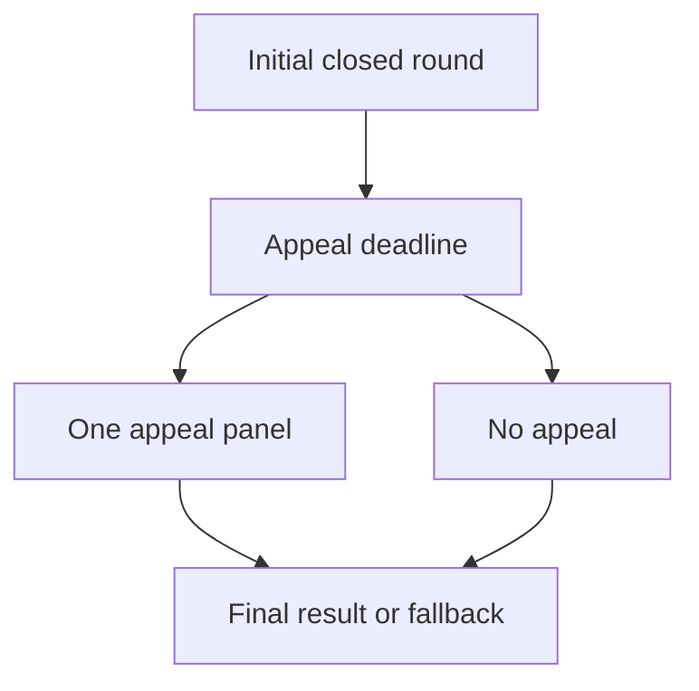

# Appeal and finality state machine

## 1. Metadata

- **Specification ID:** ARB-APPEAL
- **Version:** 1.0
- **Owner:** p2p-offramp maintainers
- **Status:** Expanded design baseline — implementation and independent review pending
- **Delivery phase:** 6, opt-in only
- **Module:** module_4.6.1_escrow_enforcement
- **Normative language:** MUST is a release gate; SHOULD deviations require recorded rationale.

## 2. Objective

Allow one bounded independent re-evaluation while preserving deterministic final authorization. This module participates only in new trades using G33's separately deployed opted-in escrow. It has no authority over already funded basic escrows. Basic manual release/refund and the core-only build MUST remain usable with this module absent. No specification statement is evidence of a deployed or audited tribunal.

## 3. Architecture and data contracts



The chain is authoritative for case stage, reservations, deadlines and final settlement; relay/indexer/local views are caches. Human/provider statements establish only their explicitly authenticated claims. G33 defines shared policy, G34 defines timing and fallback. All case records are additionally bound to chain, escrow deployment, tribunal deployment and immutable policy hash, whether inline or inherited from the case mapping. `Hex32` is exactly 32 bytes; JSON exports use lowercase 0x-prefixed hex and decimal strings for bigint, reject unknown versions/fields, and never coerce floating amounts.

```typescript
interface AppealV1 {
  caseId: Hex32; initialRound: 0; appealRound: 1;
  initialResult: "buyer" | "seller" | "inconclusive";
  appealEnd: bigint; requestedBy?: string; requested: boolean;
  appealResult?: "buyer" | "seller" | "inconclusive";
  state: "provisional" | "appealed" | "final";
}
```

## 4. Algorithms and invariants

Either bound trader may request one appeal of a conclusive or inconclusive initial result during [initialRevealEnd,appealEnd), even if a delayed caller has not closed the initial round; request first permissionlessly closes that round. A valid request uses the fully prefunded round1 reserve and requires no top-up or new fee quote. Two simultaneous requests produce one appeal, not two panels or double charges. Jurors, observers and governance cannot open an appeal.

Panel size grows from 5 to 9 for a broader second evaluation, excluding all first-round seated jurors; this is a design parameter, not a quantified security guarantee. Appeal evidence includes original frozen packet plus bounded new submissions during its scheduled evidence window. Round1 uses the G34 fixed schedule from appealEnd and cannot itself be appealed.

If no appeal was requested, after appealEnd initial directional result finalizes; initial inconclusive result falls back to seller. If appeal result is conclusive it replaces initial result; if appeal is inconclusive/unavailable preserve conclusive initial result or seller fallback. At hardStop use G34. Once final, no challenge, governance vote, off-chain settlement or evidence update reopens principal authority.

## 5. Interfaces and failure recovery

`requestAppeal(caseId)`, `closeAppealWindow(caseId)`, `finalizeCase(caseId)`. NOT_PARTY, APPEAL_ALREADY_OPEN, WINDOW_CLOSED, INSUFFICIENT_BOUND_RESERVE and FINAL refuse. All state survives frontend/relay loss through chain reads. Economic actions MUST use chain reconciliation and G12 durable intent journaling before broadcast; unknown transaction state remains pending until reconciled. Retry only the same authorized operation, never manufacture a new case, seed, signature or outcome. Logs exclude secrets and plaintext evidence. Deadline checks use half-open stage intervals, authoritative chain time and G34's immutable hard stop.

## 6. Threat assessment and trust assumptions

Repeated appeals can grief locks, hence exactly one and immutable hardStop. Appeal panel may remain correlated despite exclusions; a wealthy party can bribe both rounds. Preserving first decision on failed appeal favors liveness over guaranteed re-evaluation and must be disclosed before funding. Anonymous/pseudonymous identities and stake do not eliminate Sybils, collusion or coercion. Fiat source authentication does not establish cash contents or payment irreversibility. These limitations must appear in pre-funding consent alongside the explicit seller-refund fallback, which can leave an honest fiat-paying buyer uncompensated.

## 7. Verification and references

Both traders appeal same block, outsider request, boundary requests, first-round delayed close, small remaining pool, appeal unavailable, initial/appeal opposite directions, both inconclusive and late evidence. Model-check only one terminal decision and maximum two panels across every transition.

Required evidence is prospective: unit/boundary/property tests, supported provider/chain integration records, deployment identities, economic simulation and independent security review MUST be recorded before activation. No real-funds release, cryptographic audit, interoperability success or legal approval is claimed here. New policy activation also requires core-only regression proving this module cannot acquire basic escrow rights.

Primary project authorities: [roadmap](../../../DEVELOPMENT_ROADMAP.md), [system context](../../../00_PLANNING_AND_THREAT_MODELING/feature_0.4_architecture_planning/module_0.4.1_system_boundaries/spec-system-context-contract.md), [G14 extension boundary](../../../00_PLANNING_AND_THREAT_MODELING/feature_0.4_architecture_planning/module_0.4.6_extension_contract/spec-optional-module-interface.md). Arbitration policy and timing: [G33](../../feature_4.7_protocol_integration/module_4.7.1_arbitration_opt_in/spec-arbitration-version-binding.md), [G34](../../feature_4.7_protocol_integration/module_4.7.2_arbitration_liveness/spec-arbitration-outage-and-finality.md).
