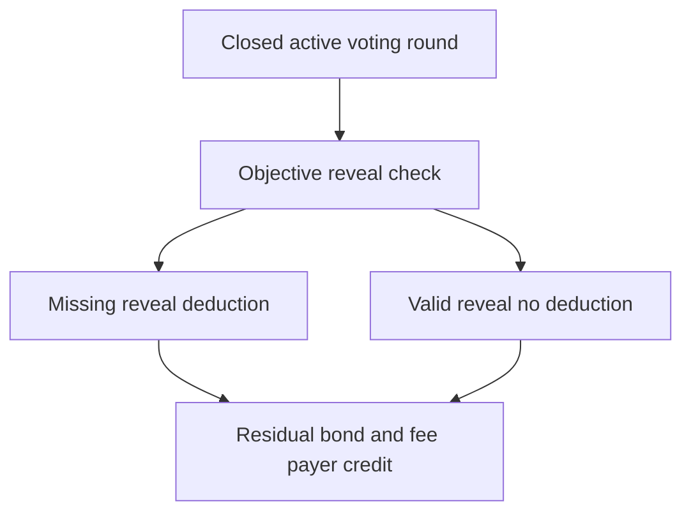

# Penalty execution accounting

## 1. Metadata

- **Specification ID:** ARB-PENALTY
- **Version:** 1.0
- **Owner:** p2p-offramp maintainers
- **Status:** Expanded design baseline — implementation and independent review pending
- **Delivery phase:** 6, opt-in only
- **Module:** module_4.6.1_escrow_enforcement
- **Normative language:** MUST is a release gate; SHOULD deviations require recorded rationale.

## 2. Objective

Apply objective bounded bond deductions without conflating disagreement with dishonesty. This module participates only in new trades using G33's separately deployed opted-in escrow. It has no authority over already funded basic escrows. Basic manual release/refund and the core-only build MUST remain usable with this module absent. No specification statement is evidence of a deployed or audited tribunal.

## 3. Architecture and data contracts



The chain is authoritative for case stage, reservations, deadlines and final settlement; relay/indexer/local views are caches. Human/provider statements establish only their explicitly authenticated claims. G33 defines shared policy, G34 defines timing and fallback. All case records are additionally bound to chain, escrow deployment, tribunal deployment and immutable policy hash, whether inline or inherited from the case mapping. `Hex32` is exactly 32 bytes; JSON exports use lowercase 0x-prefixed hex and decimal strings for bigint, reject unknown versions/fields, and never coerce floating amounts.

```typescript
interface PenaltyV1 {
  caseId: Hex32; round: 0 | 1; jurorId: Hex32;
  reservedBond: bigint; basis: "accepted-no-reveal";
  deduction: bigint; creditedToFeePayer: bigint; applied: boolean;
}
```

## 4. Algorithms and invariants

Only objective accepted-seat failure to produce any valid timely reveal incurs a V1 penalty: 10% of that seat's reserved bond, rounded down in token base units. A mismatched reveal that is later corrected on time is not penalized. Valid abstain or minority vote receives no deduction; reversed appeal outcome does not slash initial jurors. No subjective bribery/courier blame penalty is executable by this module.

At round close calculate once, deduct solely from that case's reserved bond and credit the original fee payer. A nonseated candidate has no duty to reveal and no penalty. A round that never entered commit because randomness/panel/evidence policy failed imposes no reveal penalty. If commit/reveal ran but quorum failed, individual nonreveal remains objective. Provider-wide outages can still penalize honest offline jurors; this disclosed risk is why penalty is capped and modest, not proof of fault.

Apply fee credits and penalties in separate ledgers; never offset principal or another case's collateral. Deduction=min(floor(bond/10),reservedRemaining); any inconsistent reservation is an accounting fault that blocks new cases and emits a redacted diagnostic, not a claim on unrelated funds. No negative balances, debt creation or collection from external wallet. After deterministic application release residual bond. HardStop+24h permits permissionless bounded reconciliation for every unsettled seat.

## 5. Interfaces and failure recovery

`computePenalty(caseId, round, jurorId)`, `applyPenalty`, `claimResidualBond`. Idempotent application and pull credits prevent duplicate slashing/reentrancy. UNKNOWN_SEAT, ROUND_NOT_CLOSED, RESERVATION_INCONSISTENT refuse; no external recipient call occurs during accounting. Economic actions MUST use chain reconciliation and G12 durable intent journaling before broadcast; unknown transaction state remains pending until reconciled. Retry only the same authorized operation, never manufacture a new case, seed, signature or outcome. Logs exclude secrets and plaintext evidence. Deadline checks use half-open stage intervals, authoritative chain time and G34's immutable hard stop.

## 6. Threat assessment and trust assumptions

Majority slashing would reward collusion, so absent. Griefing via provider/censorship outage remains; jurors price that availability risk. Governance cannot retroactively change rates or invent misconduct grounds. Token volatility may make 10% ineffective; economic review must evaluate it without claiming bribery resistance. Anonymous/pseudonymous identities and stake do not eliminate Sybils, collusion or coercion. Fiat source authentication does not establish cash contents or payment irreversibility. These limitations must appear in pre-funding consent alongside the explicit seller-refund fallback, which can leave an honest fiat-paying buyer uncompensated.

## 7. Verification and references

Valid minority/abstain, missing commit, bad reveal, corrected reveal, nonseated accepted candidate, failed panel and both rounds. Fuzz exact deductions, rounding dust, duplicate application, insufficient ledger and concurrent withdrawal. Conservation and independent accounting/security review remain deployment gates.

Required evidence is prospective: unit/boundary/property tests, supported provider/chain integration records, deployment identities, economic simulation and independent security review MUST be recorded before activation. No real-funds release, cryptographic audit, interoperability success or legal approval is claimed here. New policy activation also requires core-only regression proving this module cannot acquire basic escrow rights.

Primary project authorities: [roadmap](../../../DEVELOPMENT_ROADMAP.md), [system context](../../../00_PLANNING_AND_THREAT_MODELING/feature_0.4_architecture_planning/module_0.4.1_system_boundaries/spec-system-context-contract.md), [G14 extension boundary](../../../00_PLANNING_AND_THREAT_MODELING/feature_0.4_architecture_planning/module_0.4.6_extension_contract/spec-optional-module-interface.md). Arbitration policy and timing: [G33](../../feature_4.7_protocol_integration/module_4.7.1_arbitration_opt_in/spec-arbitration-version-binding.md), [G34](../../feature_4.7_protocol_integration/module_4.7.2_arbitration_liveness/spec-arbitration-outage-and-finality.md).
