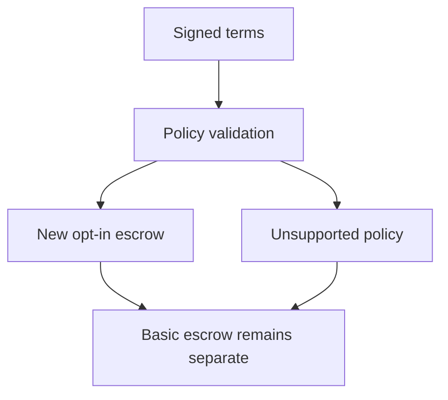

# Arbitration version binding

## 1. Metadata

- **Specification ID:** G33
- **Version:** 1.0
- **Owner:** p2p-offramp maintainers
- **Status:** Expanded design baseline — implementation and independent review pending
- **Delivery phase:** 6, opt-in only
- **Module:** module_4.7.1_arbitration_opt_in
- **Normative language:** MUST is a release gate; SHOULD deviations require recorded rationale.

## 2. Objective

Bind a separately deployed tribunal escrow to bilateral consent before funding. This module participates only in new trades using G33's separately deployed opted-in escrow. It has no authority over already funded basic escrows. Basic manual release/refund and the core-only build MUST remain usable with this module absent. No specification statement is evidence of a deployed or audited tribunal.

## 3. Architecture and data contracts



The chain is authoritative for case stage, reservations, deadlines and final settlement; relay/indexer/local views are caches. Human/provider statements establish only their explicitly authenticated claims. G33 defines shared policy, G34 defines timing and fallback. All case records are additionally bound to chain, escrow deployment, tribunal deployment and immutable policy hash, whether inline or inherited from the case mapping. `Hex32` is exactly 32 bytes; JSON exports use lowercase 0x-prefixed hex and decimal strings for bigint, reject unknown versions/fields, and never coerce floating amounts.

```typescript
interface ArbitrationTermsV1 {
  version: 1; chainId: string; escrowDeployment: string; tribunalDeployment: string;
  policyHash: Hex32; termsHash: Hex32; asset: string; principal: bigint;
  buyer: string; seller: string; tradeId: Hex32; disputeBefore: bigint;
  maxLockSeconds: 1209600; fallback: "refund-seller";
  panelSizes: readonly [5, 9]; feePerSeat: bigint; bondPerSeat: bigint;
  feeReserve: bigint; governanceDisclosureHash: Hex32;
}
```

## 4. Algorithms and invariants

Both parties MUST sign the same canonical terms hash before funding; chain ID, deployment, policy and recipient addresses are binding. The deployed factory MUST allow only reviewed immutable policy implementations. Initial policy is EVM-only; Solana arbitration is unsupported until a separate program, account constraints and parity suite are approved. Basic Solana/EVM trades remain available.

The opted-in escrow allows seller release before dispute opening and before the undisputed expiry, permissionless seller refund at undisputed expiry, or one dispute opened by either party strictly before disputeBefore. Dispute opening atomically disables ordinary release/refund and records openedAt and hardStop=openedAt+14 days. disputeBefore MUST equal the original escrow expiry; exact equality permits refund, not opening. Once disputed, only final tribunal outcome or hard-stop fallback settles. No operator can swap policies, change recipients or extend hardStop. Cooperative early cancellation after dispute opening is deferred to avoid conflicting settlement authority.

Reject trades lacking enough prefunded fees for both rounds (14 seats), randomness requests and configured bounded execution reserve. Fee token and principal token are separately accounted. Monetary parameters are explicit integer base-unit quotes in terms, not floating USD estimates. Quotes expire before funding. Policy changes require a new deployment and new bilateral terms; governance may disable new creation but cannot alter pending case rights.

## 5. Interfaces and failure recovery

`validateTerms(terms, signatures)`, `fund(termsHash)`, `openDispute(tradeId, evidenceRoot)` and `readPolicy(deployment)`; errors POLICY_MISMATCH, INSUFFICIENT_RESERVE, DISPUTE_CLOSED, UNSUPPORTED_CHAIN. Core intent proposals still use G12 wallet generation/journaling; loading UI code confers no custody authority. Economic actions MUST use chain reconciliation and G12 durable intent journaling before broadcast; unknown transaction state remains pending until reconciled. Retry only the same authorized operation, never manufacture a new case, seed, signature or outcome. Logs exclude secrets and plaintext evidence. Deadline checks use half-open stage intervals, authoritative chain time and G34's immutable hard stop.

## 6. Threat assessment and trust assumptions

A governance key or proxy upgrade could defeat opt-in guarantees. Initial tribunal/escrow custody code MUST be immutable; any retained provider-registry or pause power is disclosed and cannot mutate a funded policy. Signatures establish consent, not truthful fiat payment. Seller-refund fallback deliberately leaves buyer payment-loss risk. Anonymous/pseudonymous identities and stake do not eliminate Sybils, collusion or coercion. Fiat source authentication does not establish cash contents or payment irreversibility. These limitations must appear in pre-funding consent alongside the explicit seller-refund fallback, which can leave an honest fiat-paying buyer uncompensated.

## 7. Verification and references

Fund a basic trade then load arbitration: every tribunal call fails. Test changed chain, deployment, policy, fees, signature, exact expiry, unsupported Solana and absent extension. Property: each funded trade retains identical recipients, authority and hardStop across new policy releases.

Required evidence is prospective: unit/boundary/property tests, supported provider/chain integration records, deployment identities, economic simulation and independent security review MUST be recorded before activation. No real-funds release, cryptographic audit, interoperability success or legal approval is claimed here. New policy activation also requires core-only regression proving this module cannot acquire basic escrow rights.

Primary project authorities: [roadmap](../../../DEVELOPMENT_ROADMAP.md), [system context](../../../00_PLANNING_AND_THREAT_MODELING/feature_0.4_architecture_planning/module_0.4.1_system_boundaries/spec-system-context-contract.md), [G14 extension boundary](../../../00_PLANNING_AND_THREAT_MODELING/feature_0.4_architecture_planning/module_0.4.6_extension_contract/spec-optional-module-interface.md). Arbitration policy and timing: [G33](../../feature_4.7_protocol_integration/module_4.7.1_arbitration_opt_in/spec-arbitration-version-binding.md), [G34](../../feature_4.7_protocol_integration/module_4.7.2_arbitration_liveness/spec-arbitration-outage-and-finality.md).

Encoding/signature reference: [EIP-712](https://eips.ethereum.org/EIPS/eip-712); application nonces/deadlines and contract state provide replay prevention. ABI encoding MUST use the [Solidity ABI specification](https://docs.soliditylang.org/en/latest/abi-spec.html) with implementation compiler/toolchain pins and published vectors.
