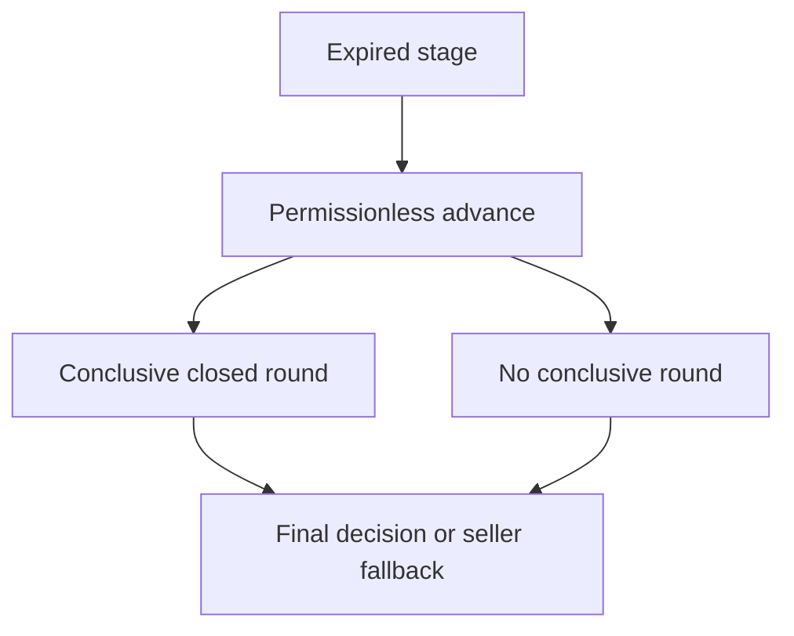

# Arbitration outage and finality

## 1. Metadata

- **Specification ID:** G34
- **Version:** 1.0
- **Owner:** p2p-offramp maintainers
- **Status:** Expanded design baseline — implementation and independent review pending
- **Delivery phase:** 6, opt-in only
- **Module:** module_4.7.2_arbitration_liveness
- **Normative language:** MUST is a release gate; SHOULD deviations require recorded rationale.

## 2. Objective

Guarantee a bounded permissionless exit when a dispute service or panel fails. This module participates only in new trades using G33's separately deployed opted-in escrow. It has no authority over already funded basic escrows. Basic manual release/refund and the core-only build MUST remain usable with this module absent. No specification statement is evidence of a deployed or audited tribunal.

## 3. Architecture and data contracts



The chain is authoritative for case stage, reservations, deadlines and final settlement; relay/indexer/local views are caches. Human/provider statements establish only their explicitly authenticated claims. G33 defines shared policy, G34 defines timing and fallback. All case records are additionally bound to chain, escrow deployment, tribunal deployment and immutable policy hash, whether inline or inherited from the case mapping. `Hex32` is exactly 32 bytes; JSON exports use lowercase 0x-prefixed hex and decimal strings for bigint, reject unknown versions/fields, and never coerce floating amounts.

```typescript
interface CaseClockV1 {
  openedAt: bigint; hardStop: bigint; round: 0 | 1;
  randomnessEnd: bigint; acceptanceEnd: bigint; evidenceEnd: bigint;
  commitEnd: bigint; revealEnd: bigint; appealEnd: bigint;
  phase: "randomness" | "acceptance" | "evidence" | "commit" | "reveal" | "appeal" | "final";
}
```

## 4. Algorithms and invariants

All durations are seconds against the authoritative chain clock. Initial round has at most 12h randomness, 24h acceptance, 24h evidence, 24h commit, 24h reveal, then 24h appeal; appeal round repeats the first five stages without another appeal. Total scheduled maximum is 10 days, leaving 4 days for permissionless processing before the immutable 14-day hard stop. Stage deadlines are computed at round creation, never reset by late callers; the appeal round begins at the fixed first-round appealEnd even when funded earlier. No process may push any deadline beyond hardStop.

After randomness timeout, insufficient accepted panel, unavailable evidence required by policy, or reveal quorum failure, that round becomes inconclusive without redrawing. An initial inconclusive round may be appealed within its existing appeal window. An unsuccessful/unavailable appeal preserves a conclusive initial decision; if neither round is conclusive, use refund-seller. At hardStop, an already final decision remains executable; otherwise anyone finalizes the last conclusive closed-round decision, or refund-seller if none. A partially revealed round is never counted early.

Timeout transitions and finalization are permissionless and idempotent. A halted chain cannot provide wall-clock liveness; bound applies to chain-time eligibility, with inclusion dependent on chain progress, fees and uncensored callers. Keepers improve availability but are not authority. Restart reads chain state, resumes permitted actions and never blindly resends journaled transactions.

## 5. Interfaces and failure recovery

`advance(caseId)` closes every expired stage with bounded constant work; `finalize(caseId)` writes one terminal result; `recover(caseId)` builds direct-contract recovery data. OUTCOME_NOT_FINAL disables settlement, CHAIN_UNAVAILABLE preserves uncertainty, HARD_STOP prevents new rounds. Late randomness is recorded/ignored without reopening. Economic actions MUST use chain reconciliation and G12 durable intent journaling before broadcast; unknown transaction state remains pending until reconciled. Retry only the same authorized operation, never manufacture a new case, seed, signature or outcome. Logs exclude secrets and plaintext evidence. Deadline checks use half-open stage intervals, authoritative chain time and G34's immutable hard stop.

## 6. Threat assessment and trust assumptions

An adversary may withhold evidence, abstain or censor transactions until fallback, disadvantaging a fiat-paying buyer. This deterministic liveness policy is not fair adjudication. Governance cannot extend time after funding. Timestamp skew and reorgs require chain-specific confirmation policy; offline client clocks cannot authorize settlement. Anonymous/pseudonymous identities and stake do not eliminate Sybils, collusion or coercion. Fiat source authentication does not establish cash contents or payment irreversibility. These limitations must appear in pre-funding consent alongside the explicit seller-refund fallback, which can leave an honest fiat-paying buyer uncompensated.

## 7. Verification and references

Simulate all services offline, no accepted jurors, one nonrevealer, total nonreveal, late VRF and both appeals. Exercise every boundary at t-1/t/t+1 and delayed advance. Property: finite transitions, at most two rounds, no deadline extension, one payout; model halted-chain limitation explicitly.

Required evidence is prospective: unit/boundary/property tests, supported provider/chain integration records, deployment identities, economic simulation and independent security review MUST be recorded before activation. No real-funds release, cryptographic audit, interoperability success or legal approval is claimed here. New policy activation also requires core-only regression proving this module cannot acquire basic escrow rights.

Primary project authorities: [roadmap](../../../DEVELOPMENT_ROADMAP.md), [system context](../../../00_PLANNING_AND_THREAT_MODELING/feature_0.4_architecture_planning/module_0.4.1_system_boundaries/spec-system-context-contract.md), [G14 extension boundary](../../../00_PLANNING_AND_THREAT_MODELING/feature_0.4_architecture_planning/module_0.4.6_extension_contract/spec-optional-module-interface.md). Arbitration policy and timing: [G33](../../feature_4.7_protocol_integration/module_4.7.1_arbitration_opt_in/spec-arbitration-version-binding.md), [G34](../../feature_4.7_protocol_integration/module_4.7.2_arbitration_liveness/spec-arbitration-outage-and-finality.md).
