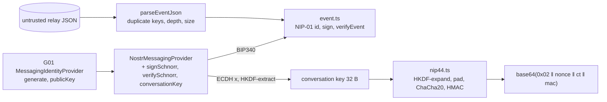

# Nip44 messaging adapter

## 1. Metadata

- **Specification ID:** PRIV-NIP44-MESSAGING-ADAPTER
- **Version:** 2.0 (Iteration 3; reflects `packages/nostr-crypto` NIP-01/NIP-44 core)
- **Owner:** p2p-offramp maintainers
- **Status:** Expanded design baseline — package-level implementation present (test-only, not wired into the app); independent review pending
- **Section:** 05_ADVANCED_PRIVACY_INFRASTRUCTURE
- **Feature:** feature_5.3_encrypted_messaging
- **Module:** module_5.3.1_message_adapters
- **Delivery:** Core messaging/policy/display where consumed by Phase 2; other privacy extensions are opt-in Phase 3 or later, subject to the roadmap.
- **Normative language:** MUST is a release gate; SHOULD deviations require a recorded reason.
- **Implementation:** payload encryption [nip44.ts](../../../packages/nostr-crypto/src/nip44.ts), cipher [chacha20.ts](../../../packages/nostr-crypto/src/chacha20.ts), helpers [bytes.ts](../../../packages/nostr-crypto/src/bytes.ts), NIP-01 events [event.ts](../../../packages/nostr-crypto/src/event.ts), messaging-key provider [provider.ts](../../../packages/nostr-crypto/src/provider.ts) over the G01 [identity facade](../../../packages/identity/index.ts). The package has no facade, is not bundled, and `apps/web/**` and the runtime/Worker do not call it yet. The NIP-17/59 layer that uses it is specified in [spec-nip17-trade-chat](../module_5.3.2_private_chat/spec-nip17-trade-chat.md).

## 2. Objective and boundary

Define evaluated NIP-44 encryption and compatible Nostr event handling. Specify key handling and inherited metadata exposure without assuming forward secrecy.

The system authority contract governs this module: external wallets authorize spending; deployed escrow and reconciled chain observations establish custody state; relay and local data are untrusted claims. This specification creates no operator release path, automatic bank payment or authority over an already funded trade. Missing optional infrastructure MUST preserve basic release/refund and encrypted recovery paths.

Boundaries of this iteration:

- **In scope:** NIP-01 event serialization, id hashing, BIP340 signing and verification, and strict parsing of untrusted events. NIP-44 version 2 payloads with plaintexts of 1..65535 bytes.
- **Not implemented:** NIP-04 (no code path; kind 4 is rejected everywhere). The later NIP-44 amendment that adds a 6-byte extended length prefix for plaintexts of 65536 bytes or more (such payloads are rejected). Relay I/O. NIP-07 browser-extension signers. Persistence.
- Errors are a fixed `NostrCryptoError` code set, a subset of the G13 codes ([G13](../../../00_PLANNING_AND_THREAT_MODELING/feature_0.4_architecture_planning/module_0.4.5_failure_contract/spec-typed-errors-and-retries.md)). The NIP-17 layer maps them to `CoreResult`.

## 3. Architecture and data contracts



```typescript
interface NostrMessagingProvider extends MessagingIdentityProvider { // id = 'noble-curves-bip340-2.4.0'
  signSchnorr(message32: Uint8Array, secretKey: Uint8Array): Promise<Uint8Array>;      // fresh 32-byte aux rand
  verifySchnorr(sig64: Uint8Array, message32: Uint8Array, xOnlyPub32: Uint8Array): Promise<boolean>; // never throws
  conversationKey(secretKey: Uint8Array, peerXOnlyHex: string): Promise<Uint8Array>;  // caller wipes
}
interface NostrEvent { id: string /*64 lc hex*/; pubkey: string /*64 lc hex*/; created_at: number /*0..2^32-1*/;
  kind: number /*0..65535, never 4*/; tags: readonly (readonly string[])[]; content: string; sig: string /*128 lc hex*/; }
type UnsignedEvent = Omit<NostrEvent, "sig">;                 // NIP-59 rumor
interface EventLimits { maxContentBytes; maxTags; maxTagItems; maxTagItemBytes; maxJsonBytes; allowedKinds?: number[] }
// DEFAULT_EVENT_LIMITS = { 131072, 64, 8, 1024, 262144 }
type NostrCryptoErrorCode = "INVALID_INPUT" | "UNSUPPORTED_VERSION" | "UNSUPPORTED_PROVIDER" | "UNAUTHORIZED" | "LIMIT_EXCEEDED" | "INTEGRITY_FAILURE";
```

Keys: the secret key is the G01 messaging identity (or a one-time gift-wrap key). It is never the G02 DEK or an external spending key. Public keys are BIP340 x-only, 64 lowercase hex. A key is accepted only if `x < p` and `x` lifts to a curve point (even y). Secret keys must be scalars in `[1, n−1]`.

The pinned dependencies are `@noble/curves` 2.4.0 (BIP340, ECDH) and `@noble/hashes` 2.4.0 (SHA-256, HKDF, HMAC). WebCrypto provides `getRandomValues` only. Neither dependency provides ChaCha20, and WebCrypto has none, so ChaCha20 is a project-owned implementation of RFC 8439 (`project-chacha20-rfc8439`). The G06 inventory ([security/crypto-inventory.json](../../../security/crypto-inventory.json)) records this:

| Inventory id | Capability | State | Review |
|---|---|---|---|
| noble-curves-2.4.0-nostr | nostr-messaging-test-only | test-enabled | pending |
| noble-hashes-2.4.0-nostr | nostr-messaging-test-only | test-enabled | pending |
| project-chacha20-rfc8439 (vendored, `sha256:` source pin) | nostr-chacha20-project-owned-candidate | candidate | pending; the vendored runtime has no approval path |

Because NIP-44 depends on the candidate cipher, the adapter as a whole is unevaluated, whatever the state of the noble entries.

Runtime validation MUST reject unknown versions/properties, unsafe integers, duplicate identities and oversized inputs before expensive work. Network, deployment, trade and account generation are explicit bindings where economic state is involved. Immutable results and defensive copies prevent consumers mutating validated state. Protocol-specific limits override broader application limits.

## 4. Algorithms, transitions and invariants

**NIP-01.** `id = sha256(utf8(JSON.stringify([0, pubkey, created_at, kind, tags, content])))`. JSON.stringify output equals the NIP-01 escaping rules only when no string contains a control character other than `\b \t \n \f \r`, and no lone surrogate. Strings containing either are rejected, so for every accepted event the serialization is exactly the NIP-01 one. `signEvent` derives the author key from the secret, hashes, signs, and verifies its own signature before returning. `verifyEvent(untrusted)` runs these steps in order:

1. Require a plain object with exactly the 7 keys. Accessors, prototypes and extra or missing keys are rejected.
2. Check lowercase hex lengths, a safe integer `created_at`, and a `kind` in 0..65535. Kind 4 fails with `UNSUPPORTED_VERSION`, and `allowedKinds` is enforced.
3. Check bounds: tag count, items per tag, item bytes, and content bytes. Each tag must be a non-empty array of strings.
4. Recompute the id, which must equal the claimed id.
5. Verify the BIP340 signature.

Signature work happens only after every bound check passes. `parseUnsignedEvent` applies the same rules to a 6-key rumor; a `sig` key is rejected. `parseEventJson` is a bounded RFC 8259 parser. It rejects duplicate keys (including escaped duplicates), `__proto__`, nesting deeper than 4, more than 4096 nodes, trailing data, and input over `maxJsonBytes`.

**NIP-44 v2**, implemented as the normative construction:

1. `conversation_key = HKDF-extract(SHA-256, IKM = x(a·B), salt = "nip44-v2")`. The x coordinate is unhashed and 32 bytes.
2. Generate a 32-byte CSPRNG nonce. The `nonce` argument of `encrypt` exists only to replay vectors.
3. `HKDF-expand(conversation_key, info = nonce, L = 76)` gives `chacha_key[0:32]`, `chacha_nonce[32:44]` and `hmac_key[44:76]`.
4. Pad as `u16be(len) ‖ plaintext ‖ zeros` to `calc_padded_len(len)`: 32 bytes minimum, then powers of two, then chunks of `next_power/8`. `len` must be in 1..65535, otherwise `LIMIT_EXCEEDED`. Lone surrogates are rejected rather than replaced.
5. Encrypt with ChaCha20 (RFC 8439) from block counter 0.
6. `mac = HMAC-SHA256(hmac_key, nonce ‖ ciphertext)`.
7. Output canonical base64 with padding of `0x02 ‖ nonce ‖ ciphertext ‖ mac`.

**Decryption** returns plaintext only after every check passes:

1. An empty payload or a leading `#` is `UNSUPPORTED_VERSION`.
2. A payload outside 132..87472 characters (or a lower caller cap) is `INTEGRITY_FAILURE`. This check runs before base64 decoding.
3. Base64 decoding is strict: no whitespace, no URL alphabet, and no non-canonical trailing bits.
4. A decoded length outside 99..65603 bytes is rejected. A version byte other than 2 is `UNSUPPORTED_VERSION`.
5. The MAC is compared over all 32 bytes in constant time, before any decryption.
6. The ciphertext is decrypted.
7. Unpadding requires a non-zero u16 length (zero is the unsupported extended-prefix marker), `len(padded) = 2 + calc_padded_len(len)`, all-zero padding, and fatal UTF-8 decoding.

Every failure after the version check is one class, `INTEGRITY_FAILURE`: size, base64, MAC, padding and UTF-8 errors are indistinguishable to the caller. Message keys, the shared point, padded buffers and MAC buffers are zeroed in `finally` blocks.

Asynchronous jobs carry a generation and AbortSignal at the NIP-17 layer. Revoked generations MUST NOT publish late plaintext. Existing signed/funded terms cannot be renegotiated by changing a local preference.

## 5. Interfaces, errors and recovery

```typescript
getConversationKey(secretKey: Uint8Array, publicKeyHex: string): Uint8Array;
getMessageKeys(conversationKey: Uint8Array, nonce: Uint8Array): { chachaKey; chachaNonce; hmacKey };
calcPaddedLength(length: number): number;                 // 1..2^32-1, pseudocode-exact
encrypt(plaintext: string, conversationKey: Uint8Array, nonce?: Uint8Array /* vectors only */): string;
decrypt(payload: string, conversationKey: Uint8Array, options?: { maxPayloadChars?: number }): string;
signEvent(template, secretKey, provider, limits?): Promise<NostrEvent>;
verifyEvent(untrusted: unknown, provider, limits?): Promise<NostrEvent>;
createUnsignedEvent(pubkey, template, limits?): UnsignedEvent; parseUnsignedEvent(untrusted, limits?): UnsignedEvent;
parseEventJson(text: unknown, maxBytes?, maxDepth?): unknown;
createLocalNobleNostrProvider(): NostrMessagingProvider;   // local test provider; not release-enabled
```

The spec's earlier `encryptV2(recipientKey, plaintext, signerHandle)` form became a provider-plus-conversation-key form: the caller asks the provider for `conversationKey`, uses it, and wipes it. A provider without `conversationKey` is `UNSUPPORTED_PROVIDER` at the NIP-17 layer. Nothing ever requests a wallet transaction signature as a substitute.

Error mapping: a malformed key, event or argument is `INVALID_INPUT`. A size or count over a bound is `LIMIT_EXCEEDED`. Kind 4, a leading `#`, or a version byte other than 2 is `UNSUPPORTED_VERSION`. A bad id, signature, MAC, padding, base64 or UTF-8 value is `INTEGRITY_FAILURE`. A CSPRNG that is unavailable is `UNSUPPORTED_PROVIDER`. Every error has the fixed message `Nostr cryptographic operation failed.` and carries no input, key or plaintext. No unbounded retry, secret-bearing diagnostics, destructive reset or silent downgrade is permitted.

## 6. Threat assessment and privacy limits

NIP-44 protects content under its assumptions, not relay IP/timing or sender authenticity alone. Reused entropy, unauthenticated outer events and active origin compromise defeat expectations.

| Attack | Mitigation in this implementation |
|---|---|
| MAC forgery or timing oracle | HMAC-SHA256 over nonce ‖ ciphertext. The compare runs the full 32 bytes in constant time, before decryption. A single error class follows the version check. |
| Malleable or alternative encodings | Strict canonical base64. Exact padding-length and zero-padding checks. Fatal UTF-8 decoding, including surrogate encodings. |
| Invalid-curve or twist points | Lift with `x < p` and an on-curve check. The official twist-order vectors (orders 3, 13, 3319) and all-ff key are rejected. |
| Out-of-range secret keys | Scalars must be in `[1, n−1]` (vectors `0`, `n`, `> n`). |
| Event id ambiguity | Rejected characters force serialization identical to NIP-01. The id is recomputed, never trusted. |
| JSON smuggling | Duplicate keys, `__proto__`, accessors, sparse arrays and extra keys are rejected. |
| Resource exhaustion | Size and count bounds run before base64 decoding, hashing or signature work. |
| NIP-04 downgrade | Kind 4 is rejected by every parser and builder. No NIP-04 code exists. |
| Nonce reuse | CSPRNG nonce by default. The `nonce` parameter is documented as vectors-only. |
| Bug in the project-owned cipher | RFC 8439 vector, byte-for-byte agreement with OpenSSL ChaCha20 at block boundaries, and all official NIP-44 vectors. Source hash pinned in the inventory. Independent review still required. |

Residual limits: this design has no forward secrecy and no post-compromise security. Zeroization is best effort: `@noble/curves` uses bigints internally, and JavaScript strings (plaintext, hex keys) cannot be wiped. Constant-time behavior is not guaranteed by the JIT. Signatures use noble's BIP340 implementation with fresh auxiliary randomness. Active origin compromise, malicious extensions and a compromised OS can read unlocked state; capability wrappers are not a same-origin JavaScript sandbox. Transport encryption, payload encryption and chain privacy are independent properties. G02 remains the exact v1 storage authority: no alternative KDF, AAD, record kind or session token is introduced here. G03 alone governs authenticated fresh-key restore. No physical erasure, global anonymity or provider availability guarantee is made.

## 7. Verification, references and release gates

Recorded evidence (`npm test`):

- [nip44.test.mjs](../../../packages/nostr-crypto/test/nip44.test.mjs) checks the SHA-256 of the official vector file ([fixture](../../../packages/nostr-crypto/test/fixtures/nip44.vectors.json), [provenance and license note](../../../packages/nostr-crypto/test/fixtures/NIP44-VECTORS-PROVENANCE.md); `269ed0f69e4c192512cc779e78c555090cebc7c785b609e338a62afc3ce25040`, the checksum NIP-44 publishes). It then runs every vector: 104 valid (get_conversation_key 35, get_message_keys 32, calc_padded_len 24, encrypt_decrypt 10 in both directions, long messages 3) and 24 invalid (encrypt lengths 4, conversation keys 8, decrypt 12). It also covers:
  - the 65535-byte row of the NIP-44 extended-length table;
  - RFC 8439 2.4.2 and OpenSSL ChaCha20 agreement at seven lengths from 0 to 65538, including 64-byte block boundaries;
  - random round trips against an independent node:crypto decryptor;
  - authenticated-but-malformed padding, the extended prefix, invalid UTF-8 and non-canonical base64;
  - the inventory pins.
- [event.test.mjs](../../../packages/nostr-crypto/test/event.test.mjs) covers G01 interface compatibility, the 15 official BIP340 rows with 32-byte messages through the provider (verify, plus sign for rows with a secret), a hand-written canonical serialization, more than 20 hostile event shapes, rumors, and the strict JSON parser.
- [crypto-inventory.test.mjs](../../../packages/security/test/crypto-inventory.test.mjs) expects 8 pending reviews plus the two ChaCha20 candidate findings.

Still required and **not** claimed:

- interoperability with two independent clients over real relays;
- browser and device matrix;
- named G06 review of the ChaCha20 source and the noble usage;
- license review of the vector file;
- support for the extended-length amendment;
- NIP-07 or remote signer providers;
- app/Worker integration;
- lock-during-decryption and late-plaintext fault injection at the app layer.

For each supported profile record source/dependency commit, integrity digest, protocol revision, deployment/network IDs, fixture provenance, browser/provider matrix and named review. Where no concrete profile is approved the implementation MUST return unsupported, not emulate success. Unit fixtures alone do not establish browser routing, wallet support or custody safety. Acceptance requires positive interoperability and negative boundary cases, cancellation/reload fault injection, redacted logging checks, and a core-only build with advanced packages absent completing basic trading recovery. Independent review and applicable roadmap milestone gates remain pending.

- [DEVELOPMENT_ROADMAP](../../../DEVELOPMENT_ROADMAP.md).
- [spec-system-context-contract](../../../00_PLANNING_AND_THREAT_MODELING/feature_0.4_architecture_planning/module_0.4.1_system_boundaries/spec-system-context-contract.md).
- [spec-optional-module-interface](../../../00_PLANNING_AND_THREAT_MODELING/feature_0.4_architecture_planning/module_0.4.6_extension_contract/spec-optional-module-interface.md).
- [spec-cryptographic-dependency-policy](../../../00_PLANNING_AND_THREAT_MODELING/feature_0.9_security_assurance/module_0.9.1_dependency_provenance/spec-cryptographic-dependency-policy.md).
- [spec-indexeddb-encrypted-records](../../feature_5.7_local_data_isolation/module_5.7.2_indexeddb_vault/spec-indexeddb-encrypted-records.md).
- [spec-transport-policy-enforcement](../../feature_5.1_network_privacy/module_5.1.2_transport_policy/spec-transport-policy-enforcement.md).
- [Primary protocol reference](https://github.com/nostr-protocol/nips/blob/master/44.md), [NIP-01](https://github.com/nostr-protocol/nips/blob/master/01.md), [BIP340](https://github.com/bitcoin/bips/blob/master/bip-0340.mediawiki), [RFC 8439](https://www.rfc-editor.org/rfc/rfc8439), [RFC 5869](https://www.rfc-editor.org/rfc/rfc5869).
