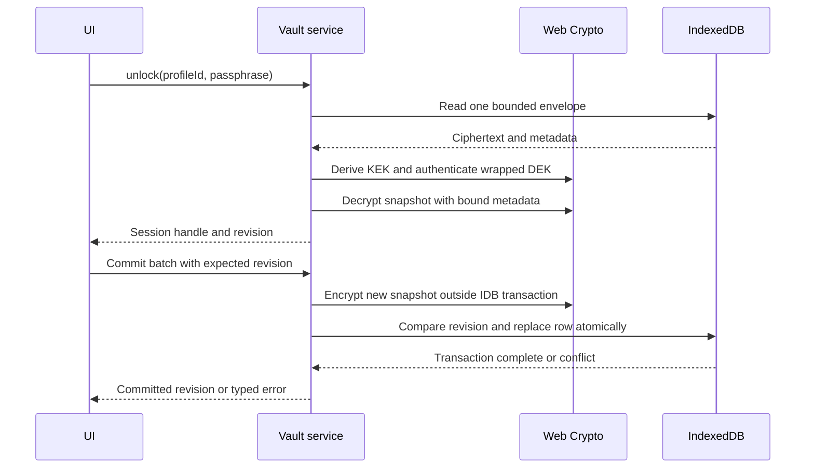

# Encrypted IndexedDB Vault

## 1. Title and system metadata

| Field | Value |
|---|---|
| Specification | G02 |
| Module | module_5.7.2_indexeddb_vault |
| Feature | feature_5.7_local_data_isolation |
| Subsystem | 05_ADVANCED_PRIVACY_INFRASTRUCTURE |
| Owner | p2p-offramp maintainers; security reviewer owns cryptographic acceptance |
| Version | 1.0 proposed interface and format |
| Last updated | 2026-10-21 |
| Delivery | Phase 0, before storing private trade data |
| Status | Detailed engineering specification; implementation and independent review pending |

## 2. Overview and objective

Store private application records in an authenticated encrypted IndexedDB vault. Prevent an offline reader of browser storage from reading record contents without the passphrase, and reject modified ciphertext before parsing private data.

Version 1 deliberately encrypts one bounded snapshot per profile rather than one independent ciphertext per business record. Records are a typed collection inside that snapshot. This avoids partial-record migration and cross-record consistency problems during the MVP; the cost is rewriting at most 8 MiB per update. Large attachments, maps, bank transcripts, and bulk chat archives do not belong in this vault. A later sharded format requires a distinct reviewed version.

The vault stores messaging key material only where required by the selected signer model, preferences, encrypted chat records, and transaction recovery references. It MUST NOT store wallet spending seeds/private keys, bank login credentials, or unbounded prover witnesses. A connected external signer may eliminate local messaging-secret storage.

Threat coverage is confidentiality at rest and detection of unauthenticated modification. It does not prevent a malicious active origin from reading unlocked data, a wallet extension from disclosing data, browser eviction, deletion, rollback to a complete authentic historical vault, or compromise of the passphrase. The offline passphrase-guessing risk remains material. No physical secure-deletion guarantee is made.

## 3. Architecture, data flow, and data contracts

Use the fixed IndexedDB database name `p2p-offramp-vault`, database version 1, and object store `vaults` with key path `profileId`. A profile is one row. No plaintext business indexes are created. Profile IDs are 16 random bytes encoded as 32 lowercase hexadecimal characters and are not derived from wallet addresses.

The envelope below contains a password-wrapped data-encryption key (DEK) and an encrypted snapshot. Public metadata reveals profile count, format, revision, KDF parameters, and approximate snapshot size. Labels, counterparties, timestamps, record types, and record IDs remain inside the encrypted snapshot. Bounds are validated before any KDF or decryption.



### Complete version 1 types

The TypeScript declarations specify the wire/storage shape; runtime validation is mandatory. Strings use strict canonical unpadded base64url or lowercase hex where stated. Implementations MUST reject unknown properties at every object level and MUST not coerce values.

```typescript
export type ProfileId = string; // exactly 32 lowercase hex characters
export type RecordId = string;  // exactly 32 lowercase hex characters
export type SessionId = string; // opaque 32 random-byte base64url token
export type B64u = string; // unpadded canonical base64url

export interface WrappedKeyV1 {
  kdf: "PBKDF2-SHA256";
  iterations: 600000;
  salt: B64u; // 32 decoded bytes
  cipher: "AES-256-GCM";
  nonce: B64u; // 12 decoded bytes
  ciphertext: B64u; // 32-byte DEK plus 16-byte tag: 48 decoded bytes
}

export interface SnapshotCipherV1 {
  nonce: B64u; // 12 decoded bytes
  ciphertext: B64u; // encrypted padded snapshot followed by 16-byte tag
}

export interface VaultEnvelopeV1 {
  format: "p2p-offramp-vault";
  version: 1;
  profileId: ProfileId;
  keyId: string; // 16 random bytes as 32 lowercase hex characters
  revision: number; // safe integer, 0..1_048_575
  wrappedKey: WrappedKeyV1;
  snapshot: SnapshotCipherV1;
}

export type RecordKind = "identity" | "preference" | "trade" | "chat" | "journal";
export interface PrivateRecordV1 {
  id: RecordId;
  kind: RecordKind;
  schemaVersion: number; // integer 1..65535, consumer validates its own schema
  payload: B64u; // 0..262144 decoded bytes; opaque to storage
}

export interface PrivateSnapshotV1 {
  format: "p2p-offramp-private-records";
  version: 1;
  profileId: ProfileId;
  keyId: string;
  revision: number;
  records: PrivateRecordV1[]; // at most 10000, unique IDs, sorted by ID
}

export type Mutation =
  | { op: "put"; record: PrivateRecordV1 }
  | { op: "delete"; id: RecordId };

export interface VaultSession {
  sessionId: SessionId;
  profileId: ProfileId;
  revision: number;
}

export type VaultErrorCode =
  | "UNSUPPORTED_ENVIRONMENT" | "UNSUPPORTED_VERSION"
  | "INVALID_INPUT" | "NOT_FOUND" | "ALREADY_EXISTS"
  | "AUTHENTICATION_FAILED" | "LOCKED" | "CONFLICT"
  | "LIMIT_EXCEEDED" | "REKEY_REQUIRED"
  | "QUOTA_EXCEEDED" | "STORAGE_UNAVAILABLE" | "CANCELLED";

export interface VaultError {
  code: VaultErrorCode;
  retryable: boolean;
  message: string; // fixed application text; no supplied private content
}

export type Result<T> =
  | { ok: true; value: T }
  | { ok: false; error: VaultError };

export interface VaultService {
  create(passphrase: string, signal?: AbortSignal): Promise<Result<VaultSession>>;
  unlock(profileId: ProfileId, passphrase: string,
    signal?: AbortSignal): Promise<Result<VaultSession>>;
  read(sessionId: SessionId, id: RecordId): Promise<Result<PrivateRecordV1 | null>>;
  list(sessionId: SessionId, kind?: RecordKind): Promise<Result<PrivateRecordV1[]>>;
  commit(sessionId: SessionId, expectedRevision: number,
    mutations: readonly Mutation[], signal?: AbortSignal): Promise<Result<number>>;
  lock(sessionId: SessionId): void;
  lockAll(): void;
  exportEncrypted(profileId: ProfileId): Promise<Result<VaultEnvelopeV1>>;
}
```

### Validation and serialization

`profileId`, `keyId`, and record IDs match `^[0-9a-f]{32}$`. Base64url matches `^[A-Za-z0-9_-]*$`, has no padding, decodes within bounds, and MUST re-encode identically; this rejects ambiguous trailing bits. Numbers are finite safe integers with the bounds above. Reject duplicate IDs, unknown kinds, malformed JSON, extra fields, and unsupported versions. A zero-length payload is allowed at storage level but may be rejected by its consumer.

Serialize the private snapshot as UTF-8 JSON with the property order shown in the type definitions, no optional properties, and records sorted lexicographically by ID. No user text is interpolated into metadata encodings. Consumers serialize their own payload bytes and validate them after read. The storage service returns defensive copies, never mutable aliases into the cached snapshot.

Let `J` be those JSON bytes and `L = len(J)`. Require `L <= 8_388_604` and encode plaintext as `u32be(L) || J || zeroPadding`, padded to a multiple of 4096 bytes with total length at most 8_388_608. After authentication, check the length prefix, maximum bound, zero padding, UTF-8 validity, and exact snapshot schema. Padding reduces length granularity; it does not conceal growth or update timing. Ciphertext decoded size MUST be a multiple of 4096 plus 16 and between 4112 and 8_388_624 bytes.

## 4. Cryptographic and algorithmic specification

### Key derivation and encryption

All randomness comes from `crypto.getRandomValues`. Creation generates independent random DEK (32 bytes), KDF salt (32 bytes), profile ID (16 bytes), key ID (16 bytes), wrapping nonce (12 bytes), and snapshot nonce (12 bytes).

Reject passphrases containing unpaired UTF-16 surrogates. Encode the exact entered string as UTF-8 with no trimming, case conversion, or Unicode normalization. Creation and unlocking accept 12..1024 UTF-8 bytes; the UI encourages a password-manager-generated secret or strong multiword passphrase and never describes length alone as entropy. Rate-limit UI attempts for usability and resource protection, while explicitly acknowledging this does not stop offline guessing.

The v1 interoperable browser profile is:

`KEK = PBKDF2-HMAC-SHA256(UTF8(passphrase), salt, 600000, 32 bytes)`

`wrappedDEK = AES-256-GCM(KEK, wrapNonce, rawDEK, AAD_wrap, tagLength=128)`

`snapshotCiphertext = AES-256-GCM(DEK, snapshotNonce, paddedSnapshot, AAD_snapshot, tagLength=128)`

This is a project design choice favoring browser-native Web Crypto for the initial profile, not a claim that PBKDF2 is memory-hard or the strongest password KDF. Argon2id would require an independently reviewed, versioned profile and implementation. Never silently lower the iteration count on a slow device. Reject other KDF names/counts before doing expensive work; a new profile requires a format migration.

Define `E(array) = UTF8(JSON.stringify(array))` over the ordered arrays below; entries are ASCII literals, canonical encoded IDs/salt, and bounded integers:

```text
AAD_wrap = E(["p2p-offramp", "vault-key", 1, profileId, keyId,
              "PBKDF2-SHA256", 600000, salt])
AAD_snapshot = E(["p2p-offramp", "vault-snapshot", 1,
                  profileId, keyId, revision])
```

Encryption uses Web Crypto `AES-GCM`, 96-bit IVs and 128-bit tags. The API ciphertext representation is ciphertext followed by authentication tag. Salt is not reused for a newly created vault. Each new snapshot encryption MUST use an independently random nonce; never derive it solely from revision, because imported backups can roll revisions backward.

For at most `q = 2^20` independent snapshot nonces under one DEK, the birthday upper bound is `q(q-1)/2^97 < 2^-57`. This bound assumes a functioning CSPRNG and limits cumulative writes, not cryptographic anti-rollback protection. Initial creation uses revision 0; committing from revision 1_048_575 returns `REKEY_REQUIRED` before encryption. Rekeying requires an authenticated export/import workflow that generates a fresh DEK/key ID, re-encrypts, and resets revision; copying an old envelope does not qualify as rekeying. Restored data is read-only until imported under a fresh key to avoid untracked write-budget reuse. That workflow is specified in G03; v1 direct overwrite/import is not exposed by this service.

Unwrap the DEK only after validating envelope bounds. Import the unwrapped raw bytes as a non-extractable AES-GCM `CryptoKey` with encrypt/decrypt usage, then overwrite reachable temporary byte arrays where possible. Creation generates raw random DEK bytes, encrypts them under KEK, imports them, and drops raw references. Never persist a plaintext `CryptoKey` or password. This does not make JavaScript memory reliably zeroizable. No Poseidon, secp256k1, ZK circuit, or on-chain contract is needed for this component.

### Atomic update algorithm

1. Serialize calls within one session; reject batches over 256 mutations or duplicate mutation IDs. Require an unlocked session and matching `expectedRevision`.
2. Read the latest envelope in a short read-only transaction. Check profile/key/revision match the cached authenticated snapshot. If they differ, return `CONFLICT` and require a fresh unlock; do not overwrite changes from another tab.
3. Apply mutations to a copy, increment revision once, validate all limits, encode and encrypt with a fresh nonce outside an IndexedDB write transaction. Deleting a nonexistent record is an idempotent mutation; an empty batch returns the current revision without a write.
4. Open one read-write transaction for `vaults`, reread the row, compare key ID and revision to the originally read row, then replace the entire envelope while preserving the unchanged wrapped-key object. Abort on mismatch. IndexedDB serialization of overlapping read-write transactions supplies atomic compare-and-swap across tabs.
5. Publish the new cached snapshot/revision and success only on transaction completion, never on an individual request's success. Abort/error leaves the old committed envelope intact. A quota failure returns `QUOTA_EXCEEDED` and keeps the old cached revision.

Do not await Web Crypto inside an open IndexedDB transaction: it may become inactive before the asynchronous operation finishes. Database upgrades and `versionchange` events close the connection and invalidate sessions. Unsupported future DB versions return `UNSUPPORTED_VERSION`; never delete a database as automatic recovery.

## 5. API behavior and lifecycle

`create` validates the passphrase, generates an empty encrypted snapshot at revision 0, and uses `add`, not `put`, so a random-ID collision cannot overwrite data. Return `ALREADY_EXISTS` on collision. Creation succeeds only after transaction completion and returns one unlocked session.

`unlock` bounds-checks, derives KEK, unwraps DEK, decrypts and validates the snapshot, checks all duplicated profile/key/revision fields, then creates a random session token. Wrong passwords, tag failures, and invalid decrypted content return the same `AUTHENTICATION_FAILED` public error without exposing a parsing oracle. Unsupported public format and invalid outer bounds are rejected before derivation. Never return partial plaintext.

`read` and `list` operate on authenticated cached data and return copies; they do not assert that the cache is the newest version. `commit` is the synchronization point. Another tab's modification produces `CONFLICT`, not silent merge. A UI using a cached trade record MUST reconcile actual escrow state with the chain before any economic action.

`lock` marks a session unusable immediately, increments its in-memory generation token, and drops cached plaintext/key references. Every asynchronous operation checks that token before publishing plaintext or starting a write transaction. If a write transaction is already active, attempt abort; if it already committed, data remains encrypted and the promise resolves with the committed revision. `lockAll` also fires on page hide; idle lock occurs after five minutes without trusted keyboard/pointer activity. Read/list polling MUST NOT reset that idle timer. These controls apply per document; browser-wide coordinated locking may signal other tabs but cannot guarantee they obey.

Cancellation before a write transaction returns `CANCELLED`; during an active transaction, request abort and wait for the terminal outcome. If commit wins, return the committed revision, not a false cancellation. An uncertain storage failure requires rereading/unlocking to discover the persisted revision before retrying. Web Crypto operations may finish after cancellation; their outputs are discarded if the session generation changed.

`exportEncrypted` returns an immutable copy of the current bounded envelope and contains no plaintext. Authentication and safe fresh-key restore belong to G03. Passphrase changes are not in-place operations in v1: use authenticated fresh-key migration. The service exposes no API to delete an entire vault during routine error recovery.

`UNSUPPORTED_ENVIRONMENT` covers missing secure context, Web Crypto, or IndexedDB. `NOT_FOUND` requires explicit user action; do not silently create an empty replacement. `LIMIT_EXCEEDED` requests archive/export before retry. `REKEY_REQUIRED` requests a fresh-key migration. `CONFLICT` requires reload/unlock; `LOCKED` requires unlock. Authentication/format/input errors are non-retryable without changed input. Storage availability and quota errors may be retried after user remediation, never in an unbounded loop. Diagnostic messages are fixed strings and do not include profile contents, passphrases, payload bytes, or external errors containing secrets.

## 6. Privacy and security considerations

| Attack or failure | Required mitigation and remaining limit |
|---|---|
| Offline database theft | Password-wrapped random DEK and authenticated snapshot; weak passphrases still permit guessing |
| Ciphertext/header substitution | GCM authentication binds profile, key, and revision; decrypted duplicate metadata must match |
| Historical snapshot replay | Current authenticated revision prevents ordinary accidental mixing; complete authentic vault rollback cannot be detected without an external trusted freshness anchor |
| Nonce reuse after restore | Random nonces, finite write budget, fresh-key restore; no counter-only nonce design |
| Malicious origin/XSS/dependency | CSP, inert rendering, reviewed dependencies, and minimal secret lifetime; active origin compromise defeats unlocked confidentiality |
| Concurrent tabs | Read-write transactional revision compare-and-swap; conflicts force reload rather than overwriting |
| Malformed envelope DoS | Strict encoded/decoded bounds and exact KDF parameters before derivation; one unlock attempt at a time per document |
| Quota, eviction, device loss | Fail without destructive reset and require encrypted backup; persistence permission is not a durability guarantee |
| Metadata leakage | Opaque IDs, encrypted record metadata, 4096-byte padding; profile count, size buckets, and activity remain observable |
| Changed IPFS origin | Explicit backup/restore; never assume IndexedDB crosses gateway/CID origin boundaries |
| Wallet or chain-state confusion | Spending keys remain external; vault records are recovery hints, not chain authority |

Two applications on the same compromised origin are not isolated by this module. Origin deployment policy is a separate prerequisite. Browser developer tools, crash dumps, OS compromise, screenshots, and hostile extensions are outside the at-rest guarantee.

## 7. Testing and verification requirements

### Unit and interoperability cases

1. Run PBKDF2-HMAC-SHA256 and AES-GCM vectors from independently verified fixtures, including empty plaintext for primitive tests and a 128-bit tag. Compare browser output with an independent implementation, using injected deterministic randomness only in tests.
2. Round-trip an empty vault, all five record kinds, maximum payload, maximum snapshot size, Unicode passphrases, and canonical base64url. Verify unpaired surrogate and out-of-range inputs reject.
3. Flip each public bound metadata field and representative ciphertext/tag bits. Require rejection without plaintext. Wrong password and authenticated-content parsing failure share the same external error code.
4. Substitute profile/key/revision across envelopes and reject; replay a complete authentic historical envelope and verify the documented limitation rather than asserting anti-rollback protection.
5. Exercise duplicate record IDs, duplicate mutations, unknown properties, illegal kinds, unsafe numbers, nonzero padding, and malformed UTF-8.
6. Verify revision cap: last allowed commit succeeds; next returns `REKEY_REQUIRED` without creating ciphertext or modifying storage.

### Concurrency and fault cases

Run two real browser tabs committing from the same revision: exactly one succeeds and one conflicts. Inject failure before encryption, after encryption, before write, during request processing, on abort, and after transaction completion. Restart the page and assert that either the complete old or complete new authenticated envelope exists, never a partially updated row. Run quota denial, storage disabled, database upgrade blocking, versionchange, and origin-change restore scenarios.

Lock/cancel during KDF, decryption, encryption, and commit. No plaintext result may escape a revoked session. If a transaction committed before locking, its durable revision must be discoverable on unlock. Do not assert immediate physical erasure of buffers.

### Fuzz and load parameters

Use 10,000 generated malformed-envelope cases per deterministic seed and 100,000 bounded random mutation sequences in scheduled testing. Generate 0..256 mutations per batch, 0..10,000 records, and payload boundaries at 0, 1, 262143, 262144, and 262145 decoded bytes. Exercise snapshot lengths around each 4096-byte boundary and the 8 MiB ceiling. Oversized/KDF-invalid envelopes must be rejected before a KDF spy records a call.

Measure unlock latency and peak memory on each supported desktop/mobile browser using the fixed KDF profile; publish p50/p95 results with device identifiers and runtime versions before enabling that browser. Resource failures must leave the old vault usable and return a typed error. Do not weaken the KDF to meet a performance target. ZK proof verification tests are not applicable because this module emits no ZK proof.

Acceptance requires successful interoperability, real IndexedDB concurrency tests, corruption/failure cases, and a recorded security review of the concrete implementation. Passing this specification's tests is evidence for these properties, not proof that the entire application is secure.

## Primary references and dependencies

- [Web Cryptography API Recommendation](https://www.w3.org/TR/2017/REC-WebCryptoAPI-20170126/): browser primitive operations; v1 uses established AES-GCM/PBKDF2 operations.
- [IndexedDB specification](https://www.w3.org/TR/IndexedDB/): transaction and origin storage behavior; current publication status must be checked when pinning browser support.
- [RFC 8018](https://www.rfc-editor.org/rfc/rfc8018): PBKDF2 construction.
- [OWASP password storage guidance](https://cheatsheetseries.owasp.org/cheatsheets/Password_Storage_Cheat_Sheet.html): password-KDF tradeoffs; this project uses an explicit browser-native initial profile.
- [G01 client key lifecycle](../../../05_ADVANCED_PRIVACY_INFRASTRUCTURE/feature_5.11_key_management/module_5.11.1_key_lifecycle/spec-client-key-lifecycle.md).
- [G03 encrypted backup/recovery](spec-encrypted-backup-recovery.md).
- [Development roadmap](../../../DEVELOPMENT_ROADMAP.md).
