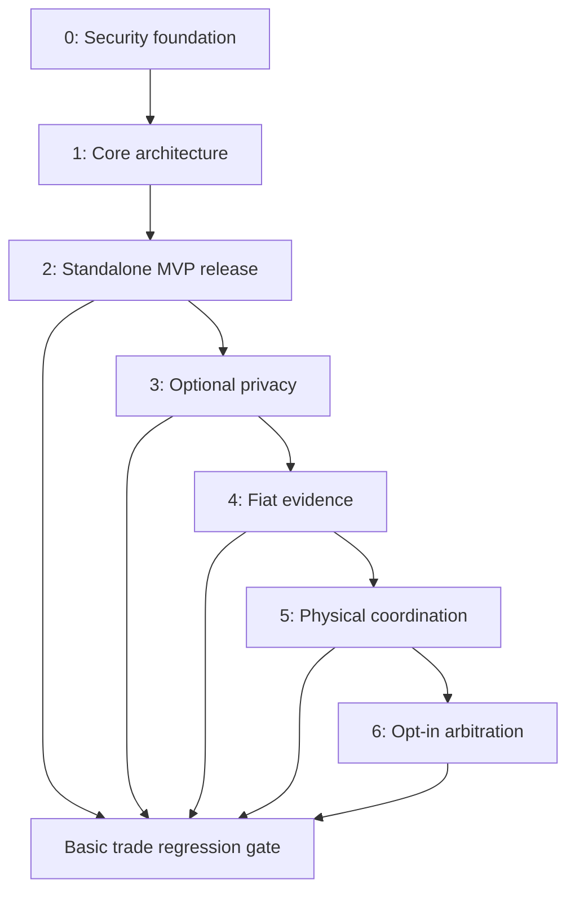

# Development Roadmap

**Repository:** djshellshoxxx/p2p-offramp  
**Version:** 0.1 — proposed execution baseline  
**Owner:** Project maintainers; security reviewer signs security gates  
**Baseline reviewed:** dcc732d83accd44518257a2d7d5c90346bdc4f21

## Current specification pass

See [development status](docs/DEVELOPMENT_STATUS.md) and the [full readiness inventory](docs/SPEC_READINESS.md). All 171 technical documents now have expanded seven-section design baselines; the catalog and supplemental plan are tracked separately. Actual implementations, pinned profiles/deployments and independent review remain pending. The inventory checker is not semantic approval. This roadmap remains the authoritative milestone order when supplemental plans use different phase labels.

## Delivery contract

**Normative user requirement (2026-10-24):** the app MUST remain client-side. App logic and user-controlled keys/private local data run in the browser; core MUST NOT require an app-owned server, centralized user-account database or server-held user secrets. Static hosting/build tools are distinct from runtime services. External blockchains, user-chosen RPC endpoints and peer/relay infrastructure remain dependencies of online trading, not a claim of infrastructure-free operation. See `docs/adr/ADR-CLIENT-SIDE-2026-10-24.md`. Any conflicting future requirement must be reconciled with the user before implementation.

The repository now contains expanded design specifications and an initial tested schema/crypto foundation, not a completed application. Every milestone below is planned until its evidence is recorded. This roadmap adds missing integration requirements; it does not certify the existing placeholders as implementation-ready.

Build security foundations first, then a static application with a complete basic trading loop. Phase 2 is a release boundary: a user can discover an offer, agree terms, fund escrow, communicate privately, coordinate a manual payment, and receive a release or timeout refund without any Phase 3–6 package or service. It needs functioning wallets, RPC endpoints, Nostr relays, and a blockchain; standalone does not mean offline or free of external infrastructure.

Use React + TypeScript + Vite for the initial static client. Next.js static export remains an alternative requiring an architecture decision, not a second frontend to maintain. Use external wallets for spending authority. Implement EVM and Solana adapters separately; SPL support means supported Solana token programs and assets, not cross-chain transfers. Begin with EVM internally, then require Solana parity to call the full requested Phase 2 scope complete.

### Decisions that preserve an honest MVP

1. **Manual settlement:** the crypto seller funds escrow; the crypto buyer pays fiat; only the seller confirms receipt and releases crypto to the bound buyer before expiry. At expiry, the crypto refunds to the seller. A dishonest seller can withhold release after receiving fiat. The application must explain this risk before payment and must not advertise trustless fiat settlement or payment protection. Early use is a cooperative/manual trading product. A stronger adversarial settlement guarantee requires a separately specified mechanism.
2. **No hidden Phase 6 dependency:** basic escrows have no juror, oracle, or privileged operator release path. No late-installed module gains authority over already funded trades.
3. **Nostr privacy:** use NIP-44 payload encryption with NIP-17/59 private messages. NIP-04 is deprecated and is disabled for new conversations. Public order discovery necessarily reveals some advertisement metadata; detailed terms are encrypted to a counterparty, or the order is invite-only. An encrypted offer with a publicly available decryption key is not confidential.
4. **Ephemeral means bounded client use:** order expiry and deletion requests do not guarantee removal from relays, observers, or backups. Fully ephemeral delivery also cannot promise reliable offline discovery. Choose event semantics explicitly and revalidate every offer before funding.
5. **Transport honesty:** Phase 0 specifies and tests the proxy boundary. Ordinary Phase 2 mode may use direct connections with explicit visibility indicators. Strict private mode is enabled only where routing can actually be enforced; unknown wallet-extension routing cannot be labeled protected. A native Tor/I2P implementation is not a mandatory MVP dependency.
6. **Versioned opt-in:** proof verification, stealth recipients, courier settlement, and arbitration apply only to new trades whose terms bind those capabilities. Old clients and old escrows retain compatible exits.

## Phase graph and milestone ledger

The ordering is the delivery sequence. Later modules depend technically on the core extension contract and their own dependencies, not on the runtime availability of every previous optional module. Evidence work can proceed independently once its prerequisite definitions are stable.

| Phase | Milestone | Required exit artifact | Status |
|---|---|---|---|
| 0 | M0: approved foundation | Reviewed threat model, crypto/vault/transport contracts and test evidence | Planned |
| 1 | M1: recoverable static shell | Reproducible static build and tested adapter/state boundaries | Planned |
| 2 | M2A: EVM vertical slice | Complete EVM test-network trade and recovery paths | Planned |
| 2 | M2B: Solana parity | Independently validated Solana/SPL paths | Planned |
| 2 | M2C: standalone release | Deployable release bundle with all advanced modules absent | Planned |
| 3 | M3: privacy extensions | Opt-in stealth and reputation compatibility evidence | Planned |
| 4 | M4: authenticated fiat evidence | Bounded WASM jobs and reviewed bank/rail policies | Planned |
| 5 | M5: physical coordination | Consent, spoofing, hardware, and custody recovery evidence | Planned |
| 6 | M6: dispute extension | Audited tribunal version with bounded finality | Planned |

## Phase 0 — Cryptographic foundations and threat mitigations

**Entry:** baseline scaffold available; no business logic is authorized by an unreviewed crypto design. **New requirements:** G01–G06 in the missing-spec index.

Execute in this order:

1. Expand Section 00 network, physical, Sybil, and transaction-ordering threat models; identify what each actor can observe or control. Define privacy claims and retained data before picking implementations.
2. Approve G06 dependency provenance and known-answer-vector policy. Choose established primitives and pin implementations; defer advanced circuit implementation until the phases that consume them.
3. Specify and implement G01 key separation. External wallets hold spending keys; messaging and storage have distinct purposes and lifecycle boundaries.
4. Implement G02 encrypted IndexedDB persistence, then G03 export/recovery. Test authenticated data corruption, lock behavior, origin change, and loss scenarios before saving any real private data.
5. Implement G04 rendering/CSP boundaries and G05 transport policy with direct, private, unsupported, and unknown states. Exercise fail-closed behavior using controlled transports.
6. Review existing stealth derivation and proof-input specifications for future domain compatibility, without making unavailable ZK providers a foundation release blocker.

**M0 deployment checklist:**

- [ ] Primitive vectors, tamper rejection, and key lifecycle cases pass on the supported browser matrix.
- [ ] No wallet private keys or plaintext secrets enter persistent app logs or builds.
- [ ] Encrypted backup restores into a new origin; data-loss limitations are visible.
- [ ] Strict-mode network failure produces no silent direct fallback.
- [ ] Threat assumptions, dependency inventory, and residual risks receive named review.

**Deliverable:** locally testable security modules and approved contracts; no funds-enabled trading UI. A feature may be marked unsupported, but must not advertise an unimplemented privacy property.

## Phase 1 — Core architecture and state management

**Entry:** M0 passed. **New requirements:** G07–G15.

Execute in this order:

1. Create the static shell and package boundaries in G07. Keep domain state machines independent of rendering, chain SDKs, and relay libraries.
2. Implement G08 state authority, G09 migrations, and G13 error semantics. Chain state is authoritative for escrow; relay data is discovery; local statements are not payment proof.
3. Implement G10 wallet capability adapters and G11 validated network/asset/deployment configuration. Use distinct transaction formats and finality settings per chain.
4. Implement G12 transaction journaling with uncertain-broadcast reconciliation, account-change cancellation, replacement/expiry handling, and reorg recovery.
5. Implement G14 extension negotiation. A core-only build must not load proof, map, courier, or tribunal packages.
6. Implement G15 build/publish/update behavior. Generate a signed artifact manifest and use static-host/IPFS smoke tests. Account for IndexedDB isolation across CID origins before calling updates recoverable.

**M1 deployment checklist:**

- [ ] Clean install/build produces the same reviewed asset inputs and a documented digest/CID.
- [ ] No server API or secret environment variable is required by the distributed client.
- [ ] Wallet permission denial and chain/account changes produce actionable states.
- [ ] Crash/reload recovers pending intent state without replaying transactions blindly.
- [ ] Schema upgrade, rejected downgrade, deep-link reload, and changed-origin restore pass.
- [ ] Publish a test shell and verify all configured outbound endpoints; no funds-enabled production configuration yet.

**Deliverable:** static frontend, domain/state library, storage, wallet/RPC adapters, and publishing pipeline. IPFS publication is distribution, not an assurance that gateway-served executable code is authentic to an untrusted browser.

## Phase 2 — Standalone MVP

**Entry:** M1 passed. **New requirements:** G16–G26. **Core existing specs:** Section 01 escrow interfaces/state/timeouts, native/ERC-20/SPL handling, encrypted relay protocol, and Section 05 messaging/security configuration.

### Exact implementation sequence

1. **M2.1 terms:** implement canonical signed trade terms (G16), amount units, revision binding, chain/contract/asset selection, buyer/seller identity binding, and capability snapshot. Start with single-fill fixed-size orders; defer partial fills and market-maker vaults.
2. **M2.2 EVM custody:** implement reviewed basic escrow using G17/G18 and the existing state/interface specs. Include native value and explicitly allowlisted standard ERC-20 tokens. Exclude unsupported rebasing, fee-on-transfer, and callback behavior rather than silently misaccounting.
3. **M2.3 Solana custody:** implement equivalent economic invariants with Solana ownership, signer, account, PDA, token-program, and mint validation. Review Token-2022 extensions individually; unsupported ones remain unavailable. Do not simulate Solana with EVM semantics.
4. **M2.4 Nostr discovery:** implement G19 advertisements, signed revisions, expiry/cancellation, and encrypted term exchange. Use G21 bounded relay subscriptions and failover.
5. **M2.5 private chat:** implement G20 NIP-17/44/59 trade sessions, authentication, deduplication, reconnect, and encrypted local history. No automatic NIP-04 fallback.
6. **M2.6 complete UI:** implement G22 onboarding → backup → wallet → discover/create → accept → fund → verify funding → coordinate payment → seller release → final receipt, plus timeout/refund and every failure branch. Add G23 independent privacy indicators.
7. **M2.7 test and release:** execute G24 matrix; finish G25 reproducible deployment/rollback and G26 incident recovery. Remove advanced packages and repeat the complete core flow before signing M2C.

### Basic escrow policy

| State | Allowed action | Authority | Result |
|---|---|---|---|
| Unfunded | Fund agreed terms | Seller | Funded escrow with immutable participants, amount, asset, and deadline |
| Funded, chain time before deadline | Release | Seller | Crypto paid to bound buyer; terminal release |
| Funded, chain time at/after deadline | Execute refund | Any caller may trigger | Crypto paid only to seller; terminal refund |
| Released or refunded | Any repeat settlement | None | Reject; no second payout |

Payment chat, a buyer's assertion, a local timer, or a UI click cannot independently prove fiat delivery. Funding finality and deadline buffers must be checked before instructions to pay. Seller release and timeout refund have disjoint on-chain guards; actual transaction inclusion determines which valid action wins. Avoid payment near expiry. An uncooperative seller remains an explicit economic risk of this basic protocol.

### Independently deployable release checklist

- [ ] Both EVM and Solana advertised support pass their separate wallet/asset/contract matrix; an EVM-only preview is labeled M2A, not the full M2C scope.
- [ ] Two fresh clients complete release and no-payment timeout/refund flows without zkTLS, reputation, stealth, maps, couriers, or juries.
- [ ] Direct contract/program recovery works when the primary frontend or relay disappears.
- [ ] Transaction conservation, authorization, reentrancy/account-substitution defenses, race boundaries, and token accounting have automated evidence and independent review.
- [ ] All enabled custody paths have zero unresolved critical/high security findings; lower findings have explicit disposition and owner.
- [ ] Release bundle contains source commit, build instructions, lockfiles, dependency inventory, ABIs/IDLs, network IDs, contract/program identities, asset allowlist, finality policy, RPC/relay configuration, static CID, and recovery instructions.
- [ ] Contract source/build identity is verified; upgrade authority and any operational authority are disclosed. No unspecified admin override exists.
- [ ] Static artifact is pinned redundantly and tested on a clean browser with rejected permissions, stale data, and alternate endpoints.
- [ ] User instructions accurately state manual payment risk, public on-chain metadata, routing status, expiry limitations, and local backup responsibilities.
- [ ] Deployment jurisdiction/role assessment and operational support ownership are recorded before enabling real funds; test-network release remains independently usable for evaluation.

**M2C artifact:** versioned deployable client plus separately deployable custody contracts/programs and complete runbook. Mainnet enablement is a distinct reviewed configuration promotion, not an automatic side effect of producing docs or a test deployment. Later phases never block continued deployment of this core release.

## Phase 3 — Privacy enhancements

**Entry:** M2C passed. **New requirements:** G27–G28. **Existing scope:** EIP-5564 generation/scanning/spending, group membership, score provenance, revocation, and nullifiers.

1. Implement G27 trade-bound stealth recipients on supported EVM schemes; test invalid keys, announcement scanning, reorgs, viewing/spending separation, and gas-linkage disclosure.
2. Implement G28 reputation verification with maintained evaluated providers and explicit issuer/root/nullifier policy. Membership is not a trust score unless the credential issuance process supplies authenticated score semantics.
3. Negotiate each capability independently; a trade requiring proof rejects an unavailable verifier, while a basic trade stays usable.
4. Publish an extension version and run core-only regression tests before activation.

**M3 checklist:**

- [ ] Recipient substitution and cross-chain/scheme proof replay fail.
- [ ] Stale roots, double nullifiers, and revoked credentials have deterministic outcomes.
- [ ] No claim that stealth addresses conceal amounts, timing, gas funding, or all linkability.
- [ ] Old funded trades retain their recipients and settlement rules; disabling extensions preserves exits.

Shielded pools and CoinJoin have separate protocol/custody reviews and are optional follow-on work, not required to declare the requested stealth/reputation milestone complete.

## Phase 4 — Advanced fiat verification

**Entry:** core extension contract stable and M3 delivered in the planned sequence. **New requirements:** G29–G30. **Existing scope:** TLS provider interface, browser WASM bridge, source authentication, witness schema, statement, and replay prevention.

1. Evaluate a concrete TLSNotary or Reclaim version, bank endpoint, and supported browser using recorded trust assumptions; build a provider adapter rather than mixing incompatible proof models.
2. Implement G29 bounded worker jobs and credential isolation, then integrate authenticated receipts with the shared verifier.
3. Implement G30 advisory evidence first. Bind amount, currency, recipient, trade, source, and freshness; reject replays and ambiguous states.
4. Consider autonomous release only in a new audited policy/contract version for explicitly evaluated payment rails. A proof of bank page contents does not establish irreversibility or absence of future chargebacks.

**M4 checklist:**

- [ ] Authentic, malformed, stale, wrong-recipient, duplicate, and tampered proof fixtures pass expected outcomes.
- [ ] Worker termination, memory exhaustion, provider failure, and bank-format changes preserve recovery UI.
- [ ] Bank credentials and witnesses do not reach logs, public artifacts, or unrelated relays.
- [ ] Basic manual trades run with proof services absent; no silent change of funded escrow policy.
- [ ] Supported source/rail matrix and proof-verifier version are published with the extension.

## Phase 5 — Physical and geographic coordination

**Entry:** extension isolation and relevant evidence interfaces stable. **New requirements:** G31–G32. **Existing scope:** all Section 02 and Section 03 modules.

1. Implement G31 consent lifecycle, coarse geohashes, disclosure budgeting, private map retrieval, and signed location directory moderation.
2. Add WebRTC signaling only with explicit ICE policy; enable direct proximity networking only where its address exposure is acceptable. A coordinate-distance proof does not validate GPS truth or physical presence.
3. Implement three-party custody, courier assignment, seed commitments, locker commands, staking, and handoff receipts as separately testable adapters.
4. Apply G32 failure rules before hardware trials. Without Phase 6, support cooperative settlement and already agreed deterministic timeout paths only; do not promise unbiased resolution of contested cash contents or courier wrongdoing.
5. Trial supported hardware with fault injection and manual recovery; publish the supported device/firmware matrix.

**M5 checklist:**

- [ ] Permission denial/revocation stops collection and never disables basic trading.
- [ ] Spoofed coordinates, repeated queries, ICE leakage, and malicious directory entries are tested.
- [ ] Lost package, swapped seal, unavailable courier, stale handoff, power loss, and jammed locker have defined outcomes.
- [ ] Seeds and acknowledgments are not presented as proof of cash denomination or authenticity.
- [ ] Adversarial courier/slashing modes remain disabled until their adjudication dependency is actually available.

## Phase 6 — Decentralized dispute resolution

**Entry:** basic settlement remains operational; evidence and three-party requirements are stable. **New requirements:** G33–G34. **Existing scope:** all Section 04 selection, incentives, evidence, voting, execution, and appeal modules.

1. Finalize threat/economic models for juror Sybils, borrowed stake, bribery, randomness withholding, and conflicts of interest.
2. Implement selection, acceptance/replacement, scoped evidence access, commit/reveal, tally, certificate, appeals, and penalty accounting in that order.
3. Implement G34 maximum round/time bounds and precommitted fallback for unavailable VRF, evidence, or juror quorum. No coordinator is assumed always online.
4. Deploy an independently audited arbitration-enabled escrow version and bind G33 terms before new funding. Existing basic escrows acquire no tribunal authority.
5. Run adversarial simulations and constrained pilots before expanding supported trades or collateral limits.

**M6 checklist:**

- [ ] Non-reveal, conflicting evidence, corrupt jurors, VRF outage, and appeal exhaustion terminate under specified rules.
- [ ] Decision certificates cannot replay across trade, round, chain, or contract.
- [ ] Deductions conserve funds and respect available collateral and authorization limits.
- [ ] Evidence access is minimized; decrypted evidence cannot be claimed retractable.
- [ ] An unavailable tribunal does not break basic orders or settlement of existing non-arbitrated escrows.

## Cross-phase release rules

Every phase produces a versioned artifact, dependency manifest, test evidence, change-impact review, rollback procedure, and updated capability matrix. A newly enabled extension reruns the Phase 2 core-only matrix. Do not mutate existing contract semantics through a frontend feature flag. When contracts require a new version, preserve the old client/ABI/IDL recovery path and prohibit migration of funded positions without explicit protocol support.

Security gates apply to what is actually enabled: unresolved research in a disabled proof provider does not block basic escrow, while an unresolved authorization defect in enabled escrow does. Tests measure specific properties; they do not prove that the whole product is bug-free or anonymous.

The base scaffold also includes market-maker vaults, Waku, XMTP, shielded pools, CoinJoin, decoy profiles, duress actions, and emergency sweep. These remain separately scoped optional backlog items. They require their own complete specifications and acceptance gates before enablement and must not be accidentally included in the MVP dependency graph.

## Iteration 3 document standard

Each implementation-targeted specification contains: (1) title and metadata, (2) objective, (3) architecture/data flow with a scoped Mermaid diagram and concrete contracts, (4) exact applicable algorithms or primitives, (5) complete interfaces, (6) specific attacks and mitigations, and (7) unit/edge/fuzz/interoperability verification requirements. Use explicit applicability statements for components with no ZK circuit or smart contract; never invent cryptographic constraints to fill a heading.

The catalog now contains 171 technical specifications expanded to that format, plus the navigation catalog and supplemental planning document. The structural expansion check passes; actual provider/dependency/deployment pins, executable module evidence and independent reviews remain separate implementation/enablement gates. None is represented as reviewed production implementation.

## Missing specification files index

The following files were absent from the reviewed baseline and have now been created. IDs are stable cross-references; phase is the earliest required delivery gate. Each file now includes an expanded design contract; G02 fixes the core storage format. The index records originally missing files and does not imply that implementations or acceptance evidence already exist.

| ID | Phase | Specification path | Brief outline |
|---|---|---|---|
| G01 | 0 | [05_ADVANCED_PRIVACY_INFRASTRUCTURE/feature_5.11_key_management/module_5.11.1_key_lifecycle/spec-client-key-lifecycle.md](05_ADVANCED_PRIVACY_INFRASTRUCTURE/feature_5.11_key_management/module_5.11.1_key_lifecycle/spec-client-key-lifecycle.md) | Define generation, separation, locking, and destruction of client identity keys. Keep wallet spending authority separate from messaging and storage authority. |
| G02 | 0 | [05_ADVANCED_PRIVACY_INFRASTRUCTURE/feature_5.7_local_data_isolation/module_5.7.2_indexeddb_vault/spec-indexeddb-encrypted-records.md](05_ADVANCED_PRIVACY_INFRASTRUCTURE/feature_5.7_local_data_isolation/module_5.7.2_indexeddb_vault/spec-indexeddb-encrypted-records.md) | Define an authenticated encrypted record format for IndexedDB persistence. Bind ciphertext to its schema, profile, and record identifier. |
| G03 | 0 | [05_ADVANCED_PRIVACY_INFRASTRUCTURE/feature_5.7_local_data_isolation/module_5.7.2_indexeddb_vault/spec-encrypted-backup-recovery.md](05_ADVANCED_PRIVACY_INFRASTRUCTURE/feature_5.7_local_data_isolation/module_5.7.2_indexeddb_vault/spec-encrypted-backup-recovery.md) | Define portable encrypted vault export and restore. Preserve user custody across device loss and content-addressed origin changes. |
| G04 | 0 | [05_ADVANCED_PRIVACY_INFRASTRUCTURE/feature_5.12_browser_security/module_5.12.1_content_boundary/spec-client-content-security-policy.md](05_ADVANCED_PRIVACY_INFRASTRUCTURE/feature_5.12_browser_security/module_5.12.1_content_boundary/spec-client-content-security-policy.md) | Define browser execution and rendering boundaries for the static client. Treat relay messages, wallet responses, maps, and remote configuration as untrusted input. |
| G05 | 0 | [05_ADVANCED_PRIVACY_INFRASTRUCTURE/feature_5.1_network_privacy/module_5.1.2_transport_policy/spec-transport-policy-enforcement.md](05_ADVANCED_PRIVACY_INFRASTRUCTURE/feature_5.1_network_privacy/module_5.1.2_transport_policy/spec-transport-policy-enforcement.md) | Define enforceable routing modes across RPC, relay, map, and proof-provider traffic. Expose unsupported or unverified paths without claiming browser-wide proxy control. |
| G06 | 0 | [00_PLANNING_AND_THREAT_MODELING/feature_0.9_security_assurance/module_0.9.1_dependency_provenance/spec-cryptographic-dependency-policy.md](00_PLANNING_AND_THREAT_MODELING/feature_0.9_security_assurance/module_0.9.1_dependency_provenance/spec-cryptographic-dependency-policy.md) | Define selection and update gates for cryptographic dependencies. Record provenance and security review evidence before business logic depends on them. |
| G07 | 1 | [00_PLANNING_AND_THREAT_MODELING/feature_0.4_architecture_planning/module_0.4.3_frontend_shell/spec-static-frontend-architecture.md](00_PLANNING_AND_THREAT_MODELING/feature_0.4_architecture_planning/module_0.4.3_frontend_shell/spec-static-frontend-architecture.md) | Define a React, TypeScript, and Vite client as the initial static frontend. Separate presentation from domain logic and replaceable infrastructure adapters. |
| G08 | 1 | [00_PLANNING_AND_THREAT_MODELING/feature_0.4_architecture_planning/module_0.4.4_state_management/spec-client-state-authority.md](00_PLANNING_AND_THREAT_MODELING/feature_0.4_architecture_planning/module_0.4.4_state_management/spec-client-state-authority.md) | Define canonical, cached, and transient client state. Prevent optimistic UI changes from being mistaken for finalized escrow outcomes. |
| G09 | 1 | [00_PLANNING_AND_THREAT_MODELING/feature_0.4_architecture_planning/module_0.4.4_state_management/spec-storage-schema-migrations.md](00_PLANNING_AND_THREAT_MODELING/feature_0.4_architecture_planning/module_0.4.4_state_management/spec-storage-schema-migrations.md) | Define versioned vault migrations and compatibility checks. Preserve existing trades when application versions or origins change. |
| G10 | 1 | [01_P2P_SHIELDED_OFFRAMP_ENGINE/feature_1.6_wallet_connectivity/module_1.6.1_provider_boundary/spec-wallet-provider-interface.md](01_P2P_SHIELDED_OFFRAMP_ENGINE/feature_1.6_wallet_connectivity/module_1.6.1_provider_boundary/spec-wallet-provider-interface.md) | Define chain-neutral wallet capabilities with separate EVM and Solana adapters. Keep permission requests and account changes explicit. |
| G11 | 1 | [01_P2P_SHIELDED_OFFRAMP_ENGINE/feature_1.6_wallet_connectivity/module_1.6.2_rpc_registry/spec-chain-network-registry.md](01_P2P_SHIELDED_OFFRAMP_ENGINE/feature_1.6_wallet_connectivity/module_1.6.2_rpc_registry/spec-chain-network-registry.md) | Define signed release configuration for supported networks, assets, and contracts. Prevent malicious configuration from redirecting transactions. |
| G12 | 1 | [01_P2P_SHIELDED_OFFRAMP_ENGINE/feature_1.7_transaction_recovery/module_1.7.1_transaction_journal/spec-transaction-lifecycle-journal.md](01_P2P_SHIELDED_OFFRAMP_ENGINE/feature_1.7_transaction_recovery/module_1.7.1_transaction_journal/spec-transaction-lifecycle-journal.md) | Define durable intent tracking from preparation through finality. Recover interrupted transactions without duplicate economic actions. |
| G13 | 1 | [00_PLANNING_AND_THREAT_MODELING/feature_0.4_architecture_planning/module_0.4.5_failure_contract/spec-typed-errors-and-retries.md](00_PLANNING_AND_THREAT_MODELING/feature_0.4_architecture_planning/module_0.4.5_failure_contract/spec-typed-errors-and-retries.md) | Define errors and retry policies shared by adapters and UI. Preserve actionable recovery without disclosing secrets. |
| G14 | 1 | [00_PLANNING_AND_THREAT_MODELING/feature_0.4_architecture_planning/module_0.4.6_extension_contract/spec-optional-module-interface.md](00_PLANNING_AND_THREAT_MODELING/feature_0.4_architecture_planning/module_0.4.6_extension_contract/spec-optional-module-interface.md) | Define versioned extension capabilities for later phases. Keep the Phase 2 trading loop independent of advanced services. |
| G15 | 1 | [00_PLANNING_AND_THREAT_MODELING/feature_0.3_system_integration/module_0.3.3_release_distribution/spec-ipfs-origin-and-update-policy.md](00_PLANNING_AND_THREAT_MODELING/feature_0.3_system_integration/module_0.3.3_release_distribution/spec-ipfs-origin-and-update-policy.md) | Define verified static artifact publication and client update discovery. Preserve custody and local state across IPFS origins. |
| G16 | 2 | [01_P2P_SHIELDED_OFFRAMP_ENGINE/feature_1.8_trade_coordination/module_1.8.1_trade_terms/spec-signed-trade-terms.md](01_P2P_SHIELDED_OFFRAMP_ENGINE/feature_1.8_trade_coordination/module_1.8.1_trade_terms/spec-signed-trade-terms.md) | Define a canonical agreement between a crypto seller and a crypto buyer. Bind order acceptance to escrow parameters and enabled capabilities. |
| G17 | 2 | [01_P2P_SHIELDED_OFFRAMP_ENGINE/feature_1.1_multichain_escrow/module_1.1.3_basic_settlement/spec-manual-settlement-risk-policy.md](01_P2P_SHIELDED_OFFRAMP_ENGINE/feature_1.1_multichain_escrow/module_1.1.3_basic_settlement/spec-manual-settlement-risk-policy.md) | Define the Phase 2 settlement model without fiat proofs or a jury. State precisely which party authorizes release and who receives timeout refunds. |
| G18 | 2 | [01_P2P_SHIELDED_OFFRAMP_ENGINE/feature_1.1_multichain_escrow/module_1.1.3_basic_settlement/spec-escrow-deadline-preflight.md](01_P2P_SHIELDED_OFFRAMP_ENGINE/feature_1.1_multichain_escrow/module_1.1.3_basic_settlement/spec-escrow-deadline-preflight.md) | Define whether sufficient time remains to start or continue manual settlement. Prevent client clocks from acting as settlement authority. |
| G19 | 2 | [01_P2P_SHIELDED_OFFRAMP_ENGINE/feature_1.4_order_discovery/module_1.4.2_discovery_policy/spec-orderbook-visibility-and-expiry.md](01_P2P_SHIELDED_OFFRAMP_ENGINE/feature_1.4_order_discovery/module_1.4.2_discovery_policy/spec-orderbook-visibility-and-expiry.md) | Define the distinction between discoverable order advertisements and encrypted trade details. Specify application expiry without promising relay deletion. |
| G20 | 2 | [05_ADVANCED_PRIVACY_INFRASTRUCTURE/feature_5.3_encrypted_messaging/module_5.3.2_private_chat/spec-nip17-trade-chat.md](05_ADVANCED_PRIVACY_INFRASTRUCTURE/feature_5.3_encrypted_messaging/module_5.3.2_private_chat/spec-nip17-trade-chat.md) | Define trade-bound private messaging using NIP-17, NIP-44, and NIP-59. Keep legacy NIP-04 disabled for new conversations. |
| G21 | 2 | [01_P2P_SHIELDED_OFFRAMP_ENGINE/feature_1.4_order_discovery/module_1.4.3_relay_resilience/spec-relay-failover-and-abuse-limits.md](01_P2P_SHIELDED_OFFRAMP_ENGINE/feature_1.4_order_discovery/module_1.4.3_relay_resilience/spec-relay-failover-and-abuse-limits.md) | Define relay selection, reconnect behavior, and bounded resource use. Keep malicious relay input from exhausting the client or changing trade authority. |
| G22 | 2 | [01_P2P_SHIELDED_OFFRAMP_ENGINE/feature_1.9_trade_interface/module_1.9.1_trade_journey/spec-mvp-trade-user-journey.md](01_P2P_SHIELDED_OFFRAMP_ENGINE/feature_1.9_trade_interface/module_1.9.1_trade_journey/spec-mvp-trade-user-journey.md) | Define the complete user flow from setup to release or refund. Make manual settlement assumptions and recovery actions visible. |
| G23 | 2 | [05_ADVANCED_PRIVACY_INFRASTRUCTURE/feature_5.10_security_modes/module_5.10.2_privacy_indicators/spec-ui-privacy-status-indicators.md](05_ADVANCED_PRIVACY_INFRASTRUCTURE/feature_5.10_security_modes/module_5.10.2_privacy_indicators/spec-ui-privacy-status-indicators.md) | Define privacy and verification status shown during each trade. Display observed capability state without implying guarantees from configuration alone. |
| G24 | 2 | [00_PLANNING_AND_THREAT_MODELING/feature_0.10_quality_assurance/module_0.10.1_mvp_validation/spec-mvp-end-to-end-test-matrix.md](00_PLANNING_AND_THREAT_MODELING/feature_0.10_quality_assurance/module_0.10.1_mvp_validation/spec-mvp-end-to-end-test-matrix.md) | Define release evidence for the independently usable Phase 2 application. Exercise real adapter boundaries as well as deterministic fault injection. |
| G25 | 2 | [00_PLANNING_AND_THREAT_MODELING/feature_0.3_system_integration/module_0.3.4_deployment_runbook/spec-mvp-deployment-and-rollback.md](00_PLANNING_AND_THREAT_MODELING/feature_0.3_system_integration/module_0.3.4_deployment_runbook/spec-mvp-deployment-and-rollback.md) | Define reproducible deployment of contracts, static frontend, and endpoint configuration. Provide rollback and independent fund-recovery procedures. |
| G26 | 2 | [00_PLANNING_AND_THREAT_MODELING/feature_0.11_operations/module_0.11.1_privacy_operations/spec-incident-response-and-redacted-diagnostics.md](00_PLANNING_AND_THREAT_MODELING/feature_0.11_operations/module_0.11.1_privacy_operations/spec-incident-response-and-redacted-diagnostics.md) | Define operational triage without collecting private trade content by default. Preserve a path to recover existing funds during outages or vulnerabilities. |
| G27 | 3 | [05_ADVANCED_PRIVACY_INFRASTRUCTURE/feature_5.2_financial_privacy/module_5.2.2_stealth_trade_binding/spec-stealth-recipient-trade-binding.md](05_ADVANCED_PRIVACY_INFRASTRUCTURE/feature_5.2_financial_privacy/module_5.2.2_stealth_trade_binding/spec-stealth-recipient-trade-binding.md) | Define how a stealth recipient is authenticated within signed trade terms. Preserve address-scheme isolation while exposing gas and withdrawal linkability. |
| G28 | 3 | [01_P2P_SHIELDED_OFFRAMP_ENGINE/feature_1.3_zk_reputation/module_1.3.3_reputation_portability/spec-reputation-proof-consumption.md](01_P2P_SHIELDED_OFFRAMP_ENGINE/feature_1.3_zk_reputation/module_1.3.3_reputation_portability/spec-reputation-proof-consumption.md) | Define how optional reputation claims affect order eligibility. Keep group membership distinct from verified trustworthiness. |
| G29 | 4 | [01_P2P_SHIELDED_OFFRAMP_ENGINE/feature_1.2_zktls_fiat_verification/module_1.2.3_proof_jobs/spec-proof-job-resource-budget.md](01_P2P_SHIELDED_OFFRAMP_ENGINE/feature_1.2_zktls_fiat_verification/module_1.2.3_proof_jobs/spec-proof-job-resource-budget.md) | Define cancellation, worker isolation, and resource budgets for browser proof generation. Prevent proof work from blocking custody or recovery controls. |
| G30 | 4 | [01_P2P_SHIELDED_OFFRAMP_ENGINE/feature_1.2_zktls_fiat_verification/module_1.2.4_evidence_policy/spec-fiat-proof-settlement-policy.md](01_P2P_SHIELDED_OFFRAMP_ENGINE/feature_1.2_zktls_fiat_verification/module_1.2.4_evidence_policy/spec-fiat-proof-settlement-policy.md) | Define whether a verified bank claim is advisory or settlement-authorizing. Separate authenticated receipt content from payment finality. |
| G31 | 5 | [02_SMART_MEETUP_GEOLOCATION_ENGINE/feature_2.7_consent_management/module_2.7.1_location_permissions/spec-location-consent-lifecycle.md](02_SMART_MEETUP_GEOLOCATION_ENGINE/feature_2.7_consent_management/module_2.7.1_location_permissions/spec-location-consent-lifecycle.md) | Define collection, disclosure, expiry, and revocation of meetup location data. Keep physical coordination optional for basic trades. |
| G32 | 5 | [03_CASH_IN_TRANSIT_BLIND_COURIERS/feature_3.7_coordination_recovery/module_3.7.1_custody_timeouts/spec-physical-handoff-failure-policy.md](03_CASH_IN_TRANSIT_BLIND_COURIERS/feature_3.7_coordination_recovery/module_3.7.1_custody_timeouts/spec-physical-handoff-failure-policy.md) | Define recovery for incomplete courier and locker custody transitions. Prevent software acknowledgments from being treated as proof of cash value. |
| G33 | 6 | [04_WEB3_DISPUTE_ARBITERS/feature_4.7_protocol_integration/module_4.7.1_arbitration_opt_in/spec-arbitration-version-binding.md](04_WEB3_DISPUTE_ARBITERS/feature_4.7_protocol_integration/module_4.7.1_arbitration_opt_in/spec-arbitration-version-binding.md) | Define opt-in arbitration contracts and their relationship to basic escrow versions. Prevent later juries from acquiring authority over existing trades. |
| G34 | 6 | [04_WEB3_DISPUTE_ARBITERS/feature_4.7_protocol_integration/module_4.7.2_arbitration_liveness/spec-arbitration-outage-and-finality.md](04_WEB3_DISPUTE_ARBITERS/feature_4.7_protocol_integration/module_4.7.2_arbitration_liveness/spec-arbitration-outage-and-finality.md) | Define bounded recovery when jurors, randomness, or evidence services fail. Preserve deterministic terminal outcomes under the agreed dispute policy. |

## Primary protocol references

- [Nostr NIP registry](https://github.com/nostr-protocol/nips): NIP-04 deprecation status.
- [NIP-17 private messages](https://github.com/nostr-protocol/nips/blob/master/17.md), [NIP-44 payload encryption](https://github.com/nostr-protocol/nips/blob/master/44.md), and [NIP-59 gift wrapping](https://github.com/nostr-protocol/nips/blob/master/59.md): distinct messaging layers.
- [NIP-40 expiry](https://github.com/nostr-protocol/nips/blob/master/40.md): expiry behavior must not be described as guaranteed deletion.
- [Vite static deployment](https://vite.dev/guide/static-deploy.html): build artifact deployment; preview is not a production server.
- [EIP-1193](https://eips.ethereum.org/EIPS/eip-1193): EVM provider lifecycle and errors.

Pin exact implementation versions and reviewed upstream revisions when implementing; these links are reference entry points, not frozen dependency versions.
