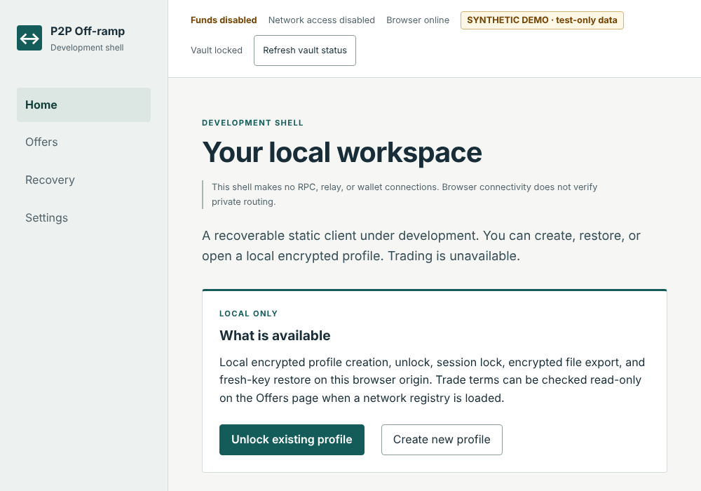
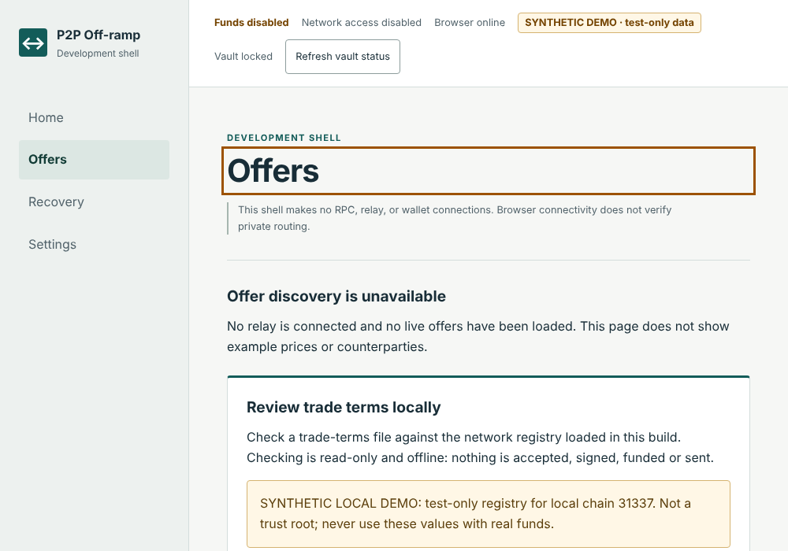
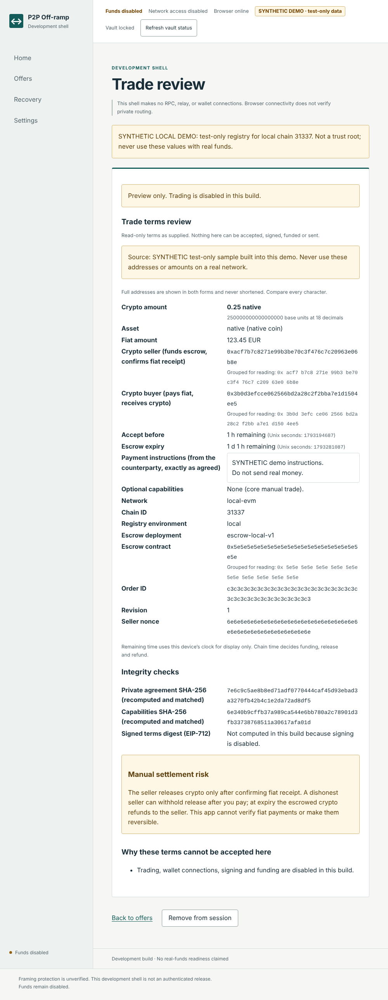

# P2P Off-ramp

New research: [reusable upstream code for unfinished features](docs/research/reuse-2026-11-03/README.md)
(2026-11-03; current gaps, exact source/license evidence and intended integration points).

Current engineering checkpoint: [continuous consolidation handoff](docs/engineering/CONSOLIDATION_HANDOFF.md),
[machine-readable state](docs/engineering/consolidation-state.json), and
[source-backed feature matrix](docs/engineering/FEATURE_MATRIX.md). The inventory covers 192 branches at
`main@5c5a84e`; seven retained source branches are combined on `codex/max-consolidation-20261119`.
The handoff distinguishes verified source, staging integration, hosted qualification and remaining release work.
Start with the **[User Guide](docs/wiki-source/User-Guide.md)** or **[Developer Guide](docs/wiki-source/Developer-Guide.md)**.
The [November 18 reconciliation](docs/consolidation/2026-11-18-documentation-reconciliation.md),
[earlier consolidation report](docs/execution/CONSOLIDATION-RESULT-2026-11-18.md) and
[task ledger](tasks/todo.md) preserve historical checkpoints. Their older draft/merge statements are not current status.

Experimental **software artwork** exploring client-side, noncustodial peer-to-peer exchange. The functional descriptions, development status, risks, licensing and acceptance gates below remain applicable.

A noncustodial peer-to-peer off-ramp under active development. The intended core is a static
React/TypeScript/Vite client using external wallets, immutable versioned escrow, relay discovery,
encrypted messaging and encrypted local recovery. Basic manual fiat settlement requires seller
confirmation; the application cannot guarantee that fiat is received or irreversible.

## Current state

The baseline `main@5c5a84ef6300330700c8b0ca54d074ac113f08be` already includes encrypted profiles and
fresh-key recovery, signed EVM terms and bilateral peer acceptance, native/ERC-20 escrow, isolated localnet
buyer/seller browser workflows, exact-token approval and settlement recovery, same-terms resumption,
independent native Nostr relay interoperability tests, and the Solana native client with durable recovery.
These are source capabilities with explicit acceptance scopes, not proof of production release readiness.

The current staging source also combines bounded file review, relay-readiness publication, QR grouping/parser
repairs, public QR image/camera review, funded Solana browser exits, and documentation/lab tooling.
QR and Solana form labels have been corrected, and the combined build checks preserve separate public-decoder,
EVM and Solana runtime boundaries. Exact source parents, test results and unresolved hosted checks are recorded
in the [consolidation handoff](docs/engineering/CONSOLIDATION_HANDOFF.md).

The ordinary static application provides encrypted local workspace and offline review. Native EVM and Solana
trading compositions remain explicit isolated localnet profiles. Approved live trust/bootstrap, production
wallet/device qualification and an authorized deployment remain separate. `ReleaseEnabled=0`; no real-funds
readiness is claimed. No mandatory application-owned backend exists; the
[client-side requirement](docs/adr/ADR-CLIENT-SIDE-2026-10-24.md) remains normative.

Solana's staged browser feature recovers already funded native-SOL escrows; it does not complete Solana offer,
negotiation or funding UI parity. QR decoding and fingerprint equality do not authenticate an invite or establish
backup recoverability. Arbitration, proof, location, courier and advanced privacy references remain separate
experimental work. The basic escrow has seller release and timeout refund, without an arbitration authority.

## Future features

The proposed privacy enhancement backlog is documented in [Future privacy architecture and enhancements](docs/future-features/PRIVACY-ENHANCEMENTS.md) (PRIV-001 through PRIV-012). These features are not implemented or required for the core MVP, and do not change existing release or real-funds gates.

## Screenshots

Captured from the synthetic, test-only demo build (`npm run build:demo`), which has no signing or send capability. The separate localnet test profile uses disposable development assets only.







## Local checks

Requires Node 24+ and Python 3.12+ for the spec tool. Dependencies are pinned in package-lock.json; emitted runtime assets retain third-party MIT attribution. Chromium is required for local browser checks, not as an app-owned server.

```sh
npm ci --ignore-scripts
npm run typecheck
npm test
npm run test:specs
npm run check:specs
npm run check:boundaries
npm run test:build-policy
npm run build
npm run build:demo   # synthetic test-only demo artifact; never deploy
npm run test:browser
npm run test:web:browser
```

Optional independent fixture verification requires Python `cryptography`:

```sh
python packages/storage/test/fixtures/verify_vault_fixture.py
```

`npm run test:specs` also runs the independent G16 OpenSSL signature oracle (`scripts/vectors/check_g16_evm_openssl.py`), which imports `cryptography` and fails without it. CI installs the complete hash-pinned development closure; that pin set admits only CPython 3.12 on Linux x86_64 (manylinux) wheels, so use a matching virtual environment locally:

```sh
python3.12 -m venv .venv-oracle
.venv-oracle/bin/python -m pip install --require-hashes --only-binary=:all: -r scripts/tests/requirements-crypto.txt
.venv-oracle/bin/python -m unittest discover -s scripts/tests -v
```

See the [developer and operator guide](docs/OPERATOR.md) for build modes and the terms file format. Start with [development status](docs/DEVELOPMENT_STATUS.md), [roadmap](DEVELOPMENT_ROADMAP.md),
[spec readiness inventory](docs/SPEC_READINESS.md) and [vault implementation plan](docs/superpowers/plans/2026-10-22-vault-foundation.md).

Local continuation: the demo review UI can explicitly save up to eight original terms documents encrypted in an
unlocked profile and revalidate them on load. Reload, cross-tab conflict, lock and fresh-key backup recovery are
covered in emitted-app Chromium checks. Independent-library EIP-712 vectors also check native/ERC-20 terms and
both parties' signatures outside the shipped app. See [delivery coordination](docs/handoffs/DELIVERY-2026-10-30.md).
Trading remains disabled; these checks do not qualify a real-funds release.

The [autonomous local EVM pass](docs/execution/EXECUTION-STATUS.md) adds immutable test escrow,
read-only chain/receipt validation, explicit journaled execution, bounded signed discovery/transport,
and a real two-party loopback-chain recovery test. Run `npm ci --ignore-scripts --prefix packages/escrow-evm`
on Linux x64, then `npm run test:escrow` and `npm run test:local-evm`. These modules remain excluded from
the shipped app. The [full code audit](docs/execution/CODE-AUDIT-2026-10-30.md) records nine resolved
findings, verification and remaining human-input/later-integration gates.

