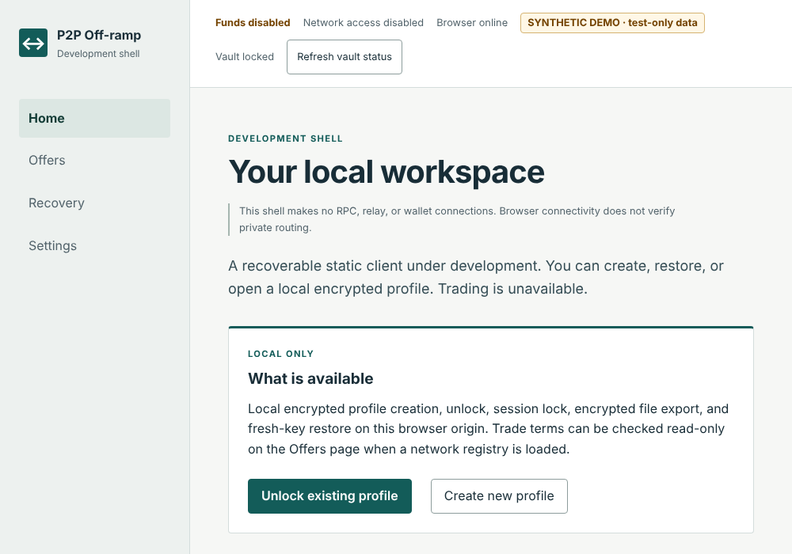
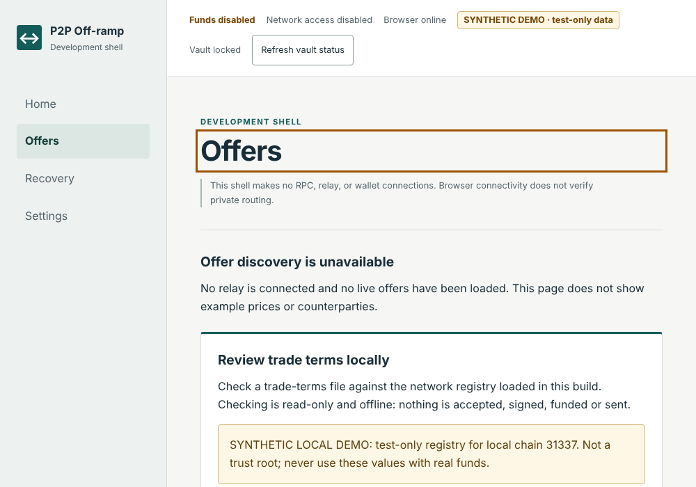
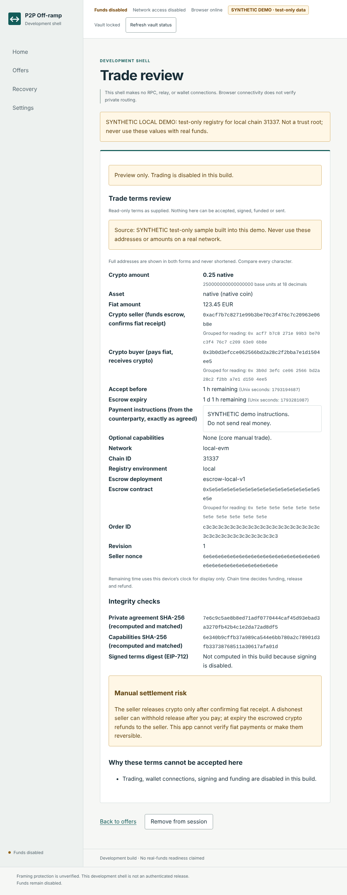

# P2P Off-ramp

Current combined-source status and audit: [consolidation report](docs/execution/CONSOLIDATED-AUDIT-2026-10-30.md). All published compatible work is integrated; historical local-only reports below are superseded.


Experimental **software artwork** exploring client-side, noncustodial peer-to-peer exchange. The functional descriptions, development status, risks, licensing and acceptance gates below remain applicable.

A noncustodial peer-to-peer off-ramp under active development. The intended core is a static
React/TypeScript/Vite client using external wallets, immutable versioned escrow, relay discovery,
encrypted messaging and encrypted local recovery. Basic manual fiat settlement requires seller
confirmation; the application cannot guarantee that fiat is received or irreversible.

## Current state

The catalog contains 173 documents: 171 expanded technical design baselines, a navigation catalog
and supplemental plan. Provider/artifact pins, implementations and security/interoperability evidence
are tracked separately. Optional proof, location, courier and arbitration capabilities remain gated.

Implemented foundations include bounded encrypted IndexedDB/CAS persistence, fresh-key backup recovery, local messaging-identity lifecycle, authority/error/retry policies, a conservative encrypted intent journal and discovery-only wallet boundary. A static React/Vite shell now exposes locked startup, known-profile unlock/lock/status and explicit unchecked ciphertext export through a native Worker. No mandatory app-owned backend exists; the [client-side requirement](docs/adr/ADR-CLIENT-SIDE-2026-10-24.md) is normative. Create/restore/inventory UI is implemented. The Offers page can check a local G16 EVM trade-terms file offline against a loaded registry and open a read-only review (exact amounts, full addresses, deadlines, settlement risk); the default build has no approved registry, so this works only in the explicitly labelled synthetic `demo` build. Signed registry/release trust, wallet signing/submission, native escrow/relay integration and the trading loop remain incomplete. ReleaseEnabled stays zero. No real-funds readiness is claimed.

## Screenshots

Captured from the synthetic, test-only demo build (`npm run build:demo`); trading and funds are disabled in every build.







## Local checks

Requires Node 24+ and Python 3.12+ for the spec tool. Dependencies are pinned in package-lock.json; emitted runtime assets retain third-party MIT attribution. Chromium is required for local browser checks, not as an app-owned server.

```sh
npm ci --ignore-scripts
npm run typecheck
npm test
npm run test:specs
npm run check:specs
npm run check:boundaries
npm run test:build-policy
npm run build
npm run build:demo   # synthetic test-only demo artifact; never deploy
npm run test:browser
npm run test:web:browser
```

Optional independent fixture verification requires Python `cryptography`:

```sh
python packages/storage/test/fixtures/verify_vault_fixture.py
```

See the [developer and operator guide](docs/OPERATOR.md) for build modes and the terms file format. Start with [development status](docs/DEVELOPMENT_STATUS.md), [roadmap](DEVELOPMENT_ROADMAP.md),
[spec readiness inventory](docs/SPEC_READINESS.md) and [vault implementation plan](docs/superpowers/plans/2026-10-22-vault-foundation.md).

Local continuation: the demo review UI can explicitly save up to eight original terms documents encrypted in an
unlocked profile and revalidate them on load. Reload, cross-tab conflict, lock and fresh-key backup recovery are
covered in emitted-app Chromium checks. Independent-library EIP-712 vectors also check native/ERC-20 terms and
both parties' signatures outside the shipped app. See [delivery coordination](docs/handoffs/DELIVERY-2026-10-30.md).
Trading remains disabled; these checks do not qualify a real-funds release.

The [autonomous local EVM pass](docs/execution/EXECUTION-STATUS.md) adds immutable test escrow,
read-only chain/receipt validation, explicit journaled execution, bounded signed discovery/transport,
and a real two-party loopback-chain recovery test. Run `npm ci --ignore-scripts --prefix packages/escrow-evm`
on Linux x64, then `npm run test:escrow` and `npm run test:local-evm`. These modules remain excluded from
the shipped app. The [full code audit](docs/execution/CODE-AUDIT-2026-10-30.md) records nine resolved
findings, verification and remaining human-input/later-integration gates.
