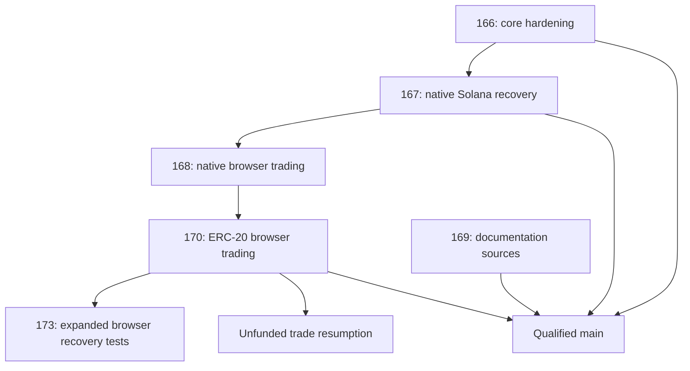
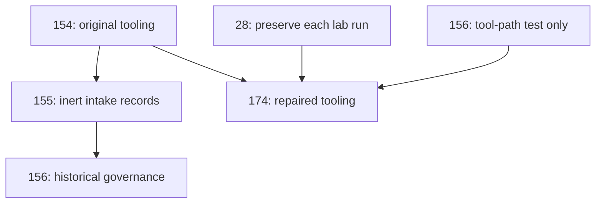

# Integration dependency graph

Checkpoint: November 18, 2026 (America/Los_Angeles). Current product baseline is
[`91ee6991d4527bba0e76b048a76e65ed7693c5a1`](https://github.com/djshellshoxxx/p2p-offramp/commit/91ee6991d4527bba0e76b048a76e65ed7693c5a1).
This graph describes source dependencies, not automatic permission to merge.

## Qualified product stack

The source dependency order was preserved. #166 and #167 were merged independently
after exact-head qualification. #170 already contained the original #168 head and
the two browser repairs, so it was merged directly onto that qualified main. This
avoided an unnecessary separate parent merge while preserving its product source.
The repaired #168 head was closed only after a merge-tree comparison proved that
adding it to main changes no bytes. Its branch remains available.

| Dependency | Exact evidence |
| --- | --- |
| #166 → #167 | `9bc9aa83d740891a01522b7398f5fd3e4049b3e8` is an ancestor of `c277a9383f1712d70e94807a376dc8fc3f5c43e1` |
| #167 → original #168 → #170 | `c277a938…`, `a0be1b656b977d0356768817d99d8aeb42c7bcba` and `189f7b1ddfc1b53be7da84cc2a24c9a745d43585` preserve that source chain |
| Repaired #168 → #170 equivalence | Merging repaired parent `823f5d3b8a26e5be8d8a5a65fc5b74766cc04c10` into #170 produces unchanged tree `b36afa9f15185da0abd300d4debde344cb6b2fde` |
| #170 → current main | Actual merge `91ee699…` has predicted tree `c494301afcf9577175d68f64dda924d6b8fe3c39` |
| #173 → #170 | Browser-only test extension; exact-head CI remains mandatory after each test correction |
| Documentation sources → #169 | #136, #139, #164 and #165 are exact ancestors; all four now report merged |
| Solana sources → #167 | #152, #153, #157 and #158 are exact ancestors; all four now report merged |

## Historical tooling stack

The full #155/#156 stacks remain separate. #174 preserves the complete original
#154 head as a parent, adapts it to current main, ports one narrow historical lab
fix and one tool-path test, and adds a regression-driven bounds repair. It does not
enable optional packages or make historical governance records active authority.
Tier B automated review and fresh hosted checks are required before integration.

## Independent lanes

- #171 and #172 are independent QR fixes. Their required checks pass, but their
  required CodeRabbit/Qodo review has not been observed.
- #138 is an append-only historical audit ledger. Its head changed during this run;
  each changed head needs fresh checks and reinspection.
- #142 contains retirement helpers but its line-membership check cannot establish
  complete content incorporation. No retirement operation was executed.
- #144–148 and #160–163 are optional D7 work. Their presence and historical green
  CI do not make them required MVP dependencies.

See [every branch and exact head](BRANCH-INVENTORY.json), [merge decisions](MERGE-DECISIONS.md)
and [remaining acceptance criteria](REMAINING-WORK.md).
