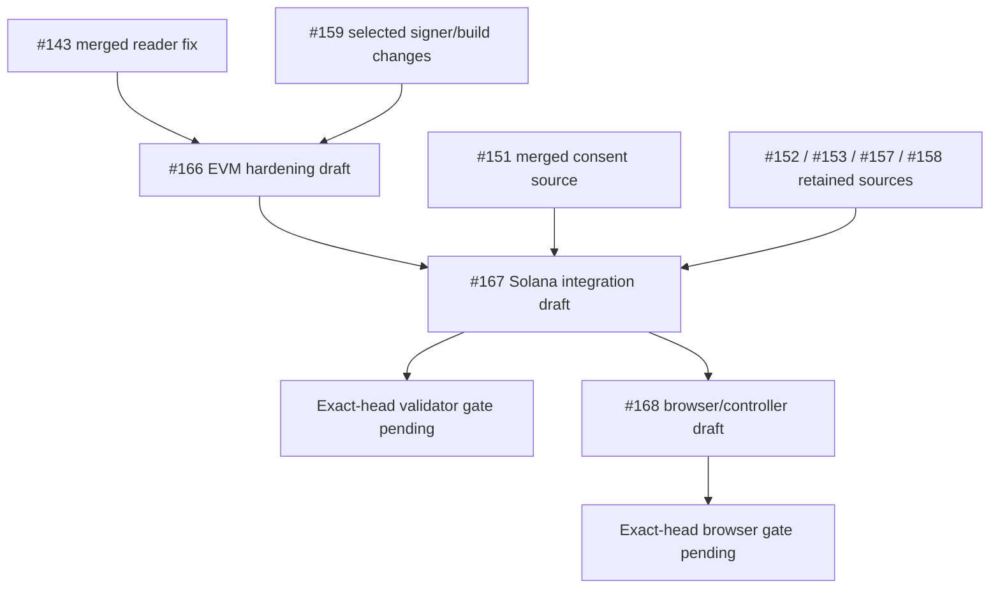

# Consolidation inventory — 2026-11-18

**All 45 initially open PRs are accounted for: four merged, three closed with semantic proof, and 38 still open.** Three new integration drafts bring the refreshed open total to 41. No branches were deleted. Optional architectures and historical sources remain preserved.

The remote refresh ran from **2026-11-18T12:15:06.697Z** through **2026-11-18T12:24:27.372Z**. It records exact source-head checks/statuses, complete changed-file lists, and API-reported mergeability for all 48 PRs in scope. GitHub may report mergeability as unknown while recomputing it; unknown is not a passing gate.

## Evidence and snapshot boundaries

- Initial comparison main: `97ce6a41805ab4d8fc6fccbcfb9dd79463deebd7`. The original 37-row noncore review is retained inside the full inventory; eight separately reviewed core PRs complete the initial 45.
- Documentation branch base: `c123f07f23e335af3ccb6aa525e487eec65ca02e`. Latest confirmed remote main: `f9bc66e70003fe5550d9817c639d80d98a73d04a` after original #143 merged.
- [Full 45-PR inventory and new-draft appendix](CONSOLIDATION-INVENTORY-2026-11-18.json) contains complete head/base SHAs, refs, changed files, dependency edges, review scope, original and refreshed CI/security records, and closure evidence.
- [Complete initial 170-ref coverage](INITIAL-BRANCH-COVERAGE-2026-11-18.json) is copied byte-for-byte from the initial branch inventory: 86 ancestor/equal refs, 44 PR-associated branch refs covering 45 PRs, and 40 nonancestor refs without an open PR. This is historical coverage, not a current remote branch count.

**Review depth varies.** Complete per-file semantic comparisons justify only the three recorded closures. Optional and broad historical branches mostly received scope/path/dependency/CI assessment. Neither a green automated security check nor inclusion in an unmerged draft is a complete security audit or a merge approval. Pending required checks remain pending; local integration results do not overwrite original-head failures or old evidence dates.

## Completed remote dispositions

| PR | Result | Remote merge or semantic evidence |
| --- | --- | --- |
| #141 | Merged artifact-verifier repair | `d6344b66b5537b146b6aad06b542a246c18cc497`; independent mode-confusion reproduction and verifier/build-policy tests retained in the core review. |
| #149 | Merged test-only fresh-key recovery characterization | `f3fb73921c75ec6aa1075ab2ca516e6c5fe3a3dc`; unknown-broadcast null-hash references remain unverified. |
| #151 | Merged native off-chain consent candidate | `2c49117ea14f7f0cae062e955b55116bb5fd48a1`; coordinator's original-PR integration had 1,735 passing tests and byte-identical reviewed consent source. |
| #143 | Merged original EIP-1898 reader repair | `f9bc66e70003fe5550d9817c639d80d98a73d04a`; tested integration `78afa7c01178cc50b5128887be38fa44704ef258` had 1,740 passes and one cast case separately rerun 1/1 with the pinned tool; fetched merge tree equaled tested tree. Downstream #166 repairs remain separate. |
| #38 | Closed as superseded; branch retained | [Full per-file closure proof](https://github.com/djshellshoxxx/p2p-offramp/pull/38#issuecomment-6978067799): 35/42 paths byte-identical, remaining differences preserve behavior or add hardening; internal `HttpFetchPort` facade export intentionally omitted. |
| #39 | Closed as superseded; branch retained | [Full per-file closure proof](https://github.com/djshellshoxxx/p2p-offramp/pull/39#issuecomment-6977275647): 7/11 paths byte-identical; other changes preserve behavior and add verifier-lifetime, safe-handler and failover bounds. |
| #41 | Closed as superseded; branch retained | [Full per-file closure proof](https://github.com/djshellshoxxx/p2p-offramp/pull/41#issuecomment-6977276654): 36/40 paths byte-identical; remaining differences are type equivalence, stronger visible-warning checks, labels and immutable locale enumeration. |

## Every initially open PR

The table uses unique 12-character head prefixes for readability; the linked JSON retains full exact SHAs and full base refs/SHAs for every row. File counts describe each PR's complete changed-file list against its reported target, so stacked cumulative counts must not be added as independent work. “Mergeable” is GitHub's mechanical result, not security or CI qualification. Every table entry's Snyk state is the exact-head status observed during this refresh.

| PR and title | Head prefix | Files | Exact-head checks and security status | Remote state / Git mergeability | Disposition |
| --- | --- | ---: | --- | --- | --- |
| [#26](https://github.com/djshellshoxxx/p2p-offramp/pull/26) Complete local recovery and trade workflows with whole-source audit | `94554ecf9854` | 617 | 3 fail, 15 pass, 1 skip; Snyk success | open; mergeable unknown | PARTIALLY EXTRACT |
| [#28](https://github.com/djshellshoxxx/p2p-offramp/pull/28) Fix PR #26 browser, cancellation, relay and HTTP defects | `b89a87a3f7dd` | 74 | 14 pass; Snyk success | draft; mergeable yes | PARTIALLY EXTRACT |
| [#35](https://github.com/djshellshoxxx/p2p-offramp/pull/35) Fix PR #31 journey findings F01, F03 and F06 (parked pending D9) | `4c5d01c639d0` | 9 | 15 pass, 1 skip; Snyk success | draft; mergeable yes | PARTIALLY EXTRACT |
| [#37](https://github.com/djshellshoxxx/p2p-offramp/pull/37) Split PR #26 (1/12): gate tooling, signature oracle, Sepolia and formal EVM checks | `81a295d5cd39` | 20 | 9 pass; Snyk success | open; mergeable unknown | PARTIALLY EXTRACT |
| [#38](https://github.com/djshellshoxxx/p2p-offramp/pull/38) Split PR #26 (2/12): core schemas, domain, transport, storage and identity | `71a56d10405b` | 42 | 8 cancel, 1 skip, 7 pass; Snyk success | closed, retained branch | CLOSED AS SUPERSEDED |
| [#39](https://github.com/djshellshoxxx/p2p-offramp/pull/39) Split PR #26 (3/12): relay and messaging bounds with per-subscription dedupe | `404dc3daa8b1` | 11 | 1 skip, 7 pass, 7 cancel; Snyk success | closed, retained branch | CLOSED AS SUPERSEDED |
| [#40](https://github.com/djshellshoxxx/p2p-offramp/pull/40) Split PR #26 (4/12): wallet EIP-1271 acceptance and signed asset updates | `7706859d2385` | 19 | 1 skip, 8 pass, 7 cancel; Snyk success | open; mergeable yes | PARTIALLY EXTRACT |
| [#41](https://github.com/djshellshoxxx/p2p-offramp/pull/41) Split PR #26 (5/12): web locale runtime and unwired leaf modules | `dd2a648140e7` | 40 | 1 skip, 7 pass; Snyk success | closed, retained branch | CLOSED AS SUPERSEDED |
| [#42](https://github.com/djshellshoxxx/p2p-offramp/pull/42) Split PR #26 (6/12): personalization, web runtime, UI wiring and browser qualification | `58b3c876ae60` | 56 | 1 skip, 7 pass, 7 cancel; Snyk success | open; mergeable yes | PARTIALLY EXTRACT |
| [#43](https://github.com/djshellshoxxx/p2p-offramp/pull/43) Split PR #26 (7/12): native private-trade journey and retention | `bc549f477f86` | 24 | 8 pass, 1 skip; Snyk success | open; mergeable yes | PARTIALLY EXTRACT |
| [#44](https://github.com/djshellshoxxx/p2p-offramp/pull/44) Split PR #26 (8/12): recovery portal, test lab, docs tooling and distribution | `f8a9aa143012` | 41 | 8 cancel, 1 skip, 7 pass; Snyk success | open; mergeable yes | PARTIALLY EXTRACT |
| [#45](https://github.com/djshellshoxxx/p2p-offramp/pull/45) Split PR #26 (9/12): dependency and candidate intake evaluations | `5a9997485b9d` | 28 | 8 pass, 1 skip; Snyk success | open; mergeable yes | PRESERVE |
| [#46](https://github.com/djshellshoxxx/p2p-offramp/pull/46) Split PR #26 (10/12): optional reference packages (D7 recommends parking) | `0baa3c1ae5a7` | 136 | 1 fail, 1 skip, 7 pass; Snyk success | open; mergeable yes | PRESERVE |
| [#47](https://github.com/djshellshoxxx/p2p-offramp/pull/47) Split PR #26 (11/12): governance records, assurance packet and final CI wiring | `14d7c5e26796` | 36 | 8 pass, 1 skip, 1 cancel; Snyk success | open; mergeable yes | PRESERVE |
| [#48](https://github.com/djshellshoxxx/p2p-offramp/pull/48) Split PR #26 (12/12): execution evidence, review receipts and root docs | `494703e83789` | 190 | 8 pass, 1 skip, 2 cancel; Snyk success | open; mergeable yes | PRESERVE |
| [#56](https://github.com/djshellshoxxx/p2p-offramp/pull/56) Resolve PR #54 review findings, harden agent workflow, record live project state | `a45e932a3715` | 202 | 14 pass; Snyk success | draft; mergeable yes | PARTIALLY EXTRACT |
| [#81](https://github.com/djshellshoxxx/p2p-offramp/pull/81) Integrate #56 Sonar fixes and split-stack extractions #37/#38/#40–#43 | `a45e932a3715` | 149 | 14 pass; Snyk success | draft; mergeable conflict | PARTIALLY EXTRACT |
| [#136](https://github.com/djshellshoxxx/p2p-offramp/pull/136) [Lane B] progress: Lane B progress record and handoff | `014a10a148f8` | 1 | 10 pass; Snyk success | draft; mergeable unknown | REPAIR THEN MERGE |
| [#137](https://github.com/djshellshoxxx/p2p-offramp/pull/137) [Lane B] B3 formal harness: extract the EVM formal/SMT evidence harness (dev-only) | `39096586e116` | 11 | 7 queued, 2 pass; Snyk success | draft; mergeable unknown | PRESERVE |
| [#138](https://github.com/djshellshoxxx/p2p-offramp/pull/138) docs(audit): randomized static compatibility probe review 084 | `412c1b31182c` | 1 | 9 queued; Snyk success | draft; mergeable unknown | PRESERVE |
| [#139](https://github.com/djshellshoxxx/p2p-offramp/pull/139) docs: reconcile November 18 integration status and wiki release gates | `708d937df7e4` | 5 | 9 queued; Snyk success | draft; mergeable unknown | REPAIR THEN MERGE |
| [#141](https://github.com/djshellshoxxx/p2p-offramp/pull/141) [Lane B] B6 artifact verifier: take the scan mode from the command line (D-L4) — Tier C, owner approval | `87af4088a2fd` | 4 | 10 pass; Snyk success | merged | MERGED |
| [#142](https://github.com/djshellshoxxx/p2p-offramp/pull/142) Consolidation run 3: post-#134 retirement script, branching rules, ledger entry | `d8c56d7ddc44` | 8 | 10 pass; Snyk success | draft; mergeable unknown | PRESERVE |
| [#143](https://github.com/djshellshoxxx/p2p-offramp/pull/143) [Lane B] B5 chain-evm: bind state reads to the anchored block hash (EIP-1898, C-L1) | `579b02f37753` | 3 | 10 pass; Snyk success | merged | MERGED |
| [#144](https://github.com/djshellshoxxx/p2p-offramp/pull/144) [Lane B] B2 optional package 1/9: proof-inputs | `0b681ed42330` | 10 | 10 pass; Snyk success | draft; mergeable unknown | PRESERVE |
| [#145](https://github.com/djshellshoxxx/p2p-offramp/pull/145) [Lane B] B2 optional package 2/9: liquidity | `f03ebbfb3951` | 12 | 10 pass; Snyk success | draft; mergeable unknown | PRESERVE |
| [#146](https://github.com/djshellshoxxx/p2p-offramp/pull/146) [Lane B] B2 optional package 3/9: courier | `0190bebd2d52` | 21 | 10 pass; Snyk success | draft; mergeable unknown | PRESERVE |
| [#147](https://github.com/djshellshoxxx/p2p-offramp/pull/147) [Lane B] B2 optional package 4/9: arbitration | `f4840d46c3a5` | 18 | 10 pass; Snyk success | draft; mergeable unknown | PRESERVE |
| [#148](https://github.com/djshellshoxxx/p2p-offramp/pull/148) [Lane B] B2 optional package 5/9: privacy-policy | `7c1f3441fcaa` | 8 | 10 pass; Snyk success | draft; mergeable unknown | PRESERVE |
| [#149](https://github.com/djshellshoxxx/p2p-offramp/pull/149) test(web): preserve unknown-broadcast recovery references after fresh-key restore | `90b9b85715f1` | 1 | 10 pass; Snyk success | merged | MERGED |
| [#151](https://github.com/djshellshoxxx/p2p-offramp/pull/151) [Lane B] B1 Solana 1/3: native off-chain peer acceptance (verify-only candidate) | `236f815e79a8` | 16 | 11 pass; Snyk success | merged | MERGED |
| [#152](https://github.com/djshellshoxxx/p2p-offramp/pull/152) [Lane B] B1 Solana 2/3: reader policies, frozen-vault funded (C-L3), payout plans, margins, CI cache scope | `37f074dd1d65` | 17 | 11 pass; Snyk success | draft; mergeable unknown | REBASE/RETARGET |
| [#153](https://github.com/djshellshoxxx/p2p-offramp/pull/153) [Lane B] B1 test: prove the Solana base64 cap without a wall-clock bound (flake fix) | `b7d06fed31fb` | 1 | 9 pass, 1 fail; Snyk success | draft; mergeable unknown | REBASE/RETARGET |
| [#154](https://github.com/djshellshoxxx/p2p-offramp/pull/154) [Lane B] B4 tooling 1/3: lab, docs consistency tooling, claims register, tool-path | `3591dcbb84ff` | 22 | 11 pass; Snyk success | draft; mergeable unknown | PARTIALLY EXTRACT |
| [#155](https://github.com/djshellshoxxx/p2p-offramp/pull/155) [Lane B] B4 intake 2/3: dependency intake probes and Semaphore v4 reputation evaluation | `9f03e0e014bd` | 49 | 11 pass; Snyk success | draft; mergeable unknown | PRESERVE |
| [#156](https://github.com/djshellshoxxx/p2p-offramp/pull/156) [Lane B] B4 governance 3/3: inert governance records (historical), assurance packet, evidence binding | `7a60893c4c1c` | 84 | 11 pass; Snyk success | draft; mergeable unknown | PRESERVE |
| [#157](https://github.com/djshellshoxxx/p2p-offramp/pull/157) chain-solana: settlement planner, frozen-vault policy and reader hardening | `f1d9dd63a2ac` | 9 | 10 pass; Snyk success | draft; mergeable unknown | REBASE/RETARGET |
| [#158](https://github.com/djshellshoxxx/p2p-offramp/pull/158) [Lane B] B1 Solana 3/3: transaction lifecycle, durable send marker, C-L2 sequencing, portable recovery | `0b0ca2907b37` | 24 | 11 pass; Snyk success | draft; mergeable unknown | REBASE/RETARGET |
| [#159](https://github.com/djshellshoxxx/p2p-offramp/pull/159) G1/G2: D1 peer acceptance in exchange v2, wallet signer, localnet build profile (in progress) | `1d3f59a9474a` | 31 | 8 pass, 2 queued; Snyk success | draft; mergeable unknown | PARTIALLY EXTRACT |
| [#160](https://github.com/djshellshoxxx/p2p-offramp/pull/160) [Lane B] B2 optional package 6/9: privacy-controls | `9cd4b77d2b14` | 14 | 10 pass; Snyk success | draft; mergeable unknown | PRESERVE |
| [#161](https://github.com/djshellshoxxx/p2p-offramp/pull/161) [Lane B] B2 optional package 7/9: stealth | `1d78c89bb628` | 19 | 10 pass; Snyk success | draft; mergeable unknown | PRESERVE |
| [#162](https://github.com/djshellshoxxx/p2p-offramp/pull/162) [Lane B] B2 optional package 8/9: proof-jobs (own optional workflow) | `204a0276f036` | 20 | 11 pass; Snyk success | draft; mergeable unknown | PRESERVE |
| [#163](https://github.com/djshellshoxxx/p2p-offramp/pull/163) [Lane B] B2 optional package 9/9: meetup | `0bbfa8ba38a7` | 36 | 10 pass; Snyk success | draft; mergeable unknown | PRESERVE |
| [#164](https://github.com/djshellshoxxx/p2p-offramp/pull/164) docs: sync docs with current code (2026-11-18) | `436b591a3a75` | 4 | 8 pass, 2 queued; Snyk success | draft; mergeable unknown | REPAIR THEN MERGE |
| [#165](https://github.com/djshellshoxxx/p2p-offramp/pull/165) docs(consolidation): record #135/#140/#150 merges and a Lane A handoff | `1fe5ae00ed21` | 2 | 5 pass, 5 queued; Snyk success | draft; mergeable unknown | REPAIR THEN MERGE |

## New integration drafts

These were not among the initial 45. None is merged. Their queued checks are not qualification.

| PR and title | Head prefix | Files | Exact-head checks and security status | Remote state / Git mergeability | Disposition |
| --- | --- | ---: | --- | --- | --- |
| [#166](https://github.com/djshellshoxxx/p2p-offramp/pull/166) Consolidate EVM canonical reads, signing fences, and isolated localnet build | `0ae7e82baf1b` | 40 | 9 queued; Snyk success | draft; mergeable unknown | REPAIR THEN MERGE |
| [#167](https://github.com/djshellshoxxx/p2p-offramp/pull/167) Consolidate Solana client and recovery with native validator qualification | `abff77440f81` | 93 | 8 queued; Snyk success | draft; mergeable yes | REPAIR THEN MERGE |
| [#168](https://github.com/djshellshoxxx/p2p-offramp/pull/168) Integrate reviewed localnet browser trading, encrypted recovery, and qualification gates | `b981ebed7e1e` | 35 | 8 queued; Snyk success | draft; mergeable yes | REPAIR THEN MERGE |

#166 head is `0ae7e82baf1bab949934b93906676423aaed8af0`. #167's updated head is `abff77440f81a35b9f4eba91b7db2429e8f1f314`, independently verified against its remote branch ref; its complete 93-file list matches the local exact-head merge-base diff. Checks from former #167 head `139c49a37bd6bbd6dbe9c0341a53823694d96ff2` are kept only as a prior observation and are not transferred to the updated head. #167 remains stacked on #166.

The coordinator's production-source gate for the updated Solana work at `cc0b9e24` had 1,901 passes, one cast case separately passing 1/1 with the pinned tool, and passing type/spec/boundary/build-policy/default/demo gates. That is local source-bound evidence, not a completed hosted validator gate at the new draft head.

#168 is stacked on #167 at source checkpoint `b981ebed7e1e0d85f69210df7f444bacc91bf55a`, tree `1d0b2a3ef9a7661bcc04aabbccf18c1186fde5fb`. The coordinator confirmed equivalence with local `9f3ba5de`: 1,922/1,922 tests with zero skips; passing typecheck, 32 specification checks, import boundaries, 50 policy checks, default/demo builds; 12 real controller checks with 12 signatures and four sends/four prior markers; an 11-asset localnet artifact with one Worker. Its real hosted browser/program checks remain queued. The JSON preserves this source checkpoint separately so a later documentation-only publication does not erase what was actually tested.

**Dependency finding retained:** the [Picomatch assessment](PICOMATCH-ADVISORY-ASSESSMENT-2026-11-18.md) records five high-severity development-tool package findings from [GHSA-fc5q-39xc-vjpf / CVE-2026-112366](https://github.com/advisories/GHSA-fc5q-39xc-vjpf), with zero critical findings and no identified compatible published fix as of this date. Bounded direct/Vite reproductions confirm the behavior. The inspected emitted-runtime graphs exclude the affected packages, and the production-only audit is zero; both are scoped observations. **The complete dependency audit remains open.** This inventory reviewed the report and retained raw evidence read-only, without rerunning the scan or declaring a fix. Exact-head Snyk success does not supersede that separate finding. The report's source commit is `164be846fbb2b90df0888ff0e95c6a2aa75be876`, assessed against application source `9f3ba5de1c202ef8b94d875c14cfcbc7af7ef7a0`.

## Dependency graph and retained ownership

The historical split is a proven ancestry chain, not twelve independent merge candidates:

`#37 → #38 → #39 → #40 → #41 → #42 → #43 → #44 → #45 → #46 → #47 → #48`

Closing #38/#39/#41 retained their branch refs, so the old targets remain identifiable. The machine-readable graph includes every initial PR node, every verified ancestry edge, and every current PR-to-PR base relationship. Other key relationships are:

| Relationship | Evidence and consequence |
| --- | --- |
| #154 → #155 → #156 | Exact-head Git ancestry proven; file counts are cumulative. Extract development tooling separately from evaluation/governance records. |
| #56 and #81 | Same source head `a45e932a37153590bc329c1e9012cf18e37fe12c`, different bases and changed-file lists. Review the remaining implementation once; do not call either fully superseded. |
| #28 and #35 | Current #28 head is **not** an ancestor of #35. Taking #35 does not include every later #28 fix. |
| #26/#28/#35/#42/#43/#56/#81 | Historical journey/runtime/recovery overlap; selected browser work does not prove complete supersedence of these broad sources. |
| #152 and #157 | Overlapping Solana reader/policy work reconciled in draft #167; preserve the combined funded-exit and bounded-read behavior. |
| #159 and already-merged #150 | Extract signer/build pieces without overwriting the stronger current exchange implementation. Remaining browser work is separately qualified. |

Graph arrows describe integration/dependency relationships, not permission to merge. The complete JSON distinguishes proven Git ancestry, explicit non-ancestry, shared heads, selective extraction and stacked review bases.

## Remaining disposition rationale

- **Historical core/journey sources:** #26 has 617 changed paths and 469 paths absent from starting main; #56/#81 also retain unmatched work. Keep selective extraction decisions and their full file relationships. A successful new browser path does not erase release/update, privacy, tooling or optional work still present only in those branches.
- **Optional architecture:** preserve #144–#148 and #160–#163, plus the broader optional/evaluation/governance sources. Their current checks are listed above; independent architecture/security qualification and correct composition remain work. This inventory does not de-scope them.
- **Development tooling:** #137 remains a separate formal harness with pending checks; #154–#156 remain an ordered tooling/evaluation/governance stack. Evidence tools do not grant escrow or production-release authority.
- **Documentation:** #139 moved to `708d937df7e4799e4ad212b3293bec923f619940`; the coordinator reviewed four changed documentation files between heads, while the PR still changes five files overall. Its new checks are queued. #136/#164/#165 also need final-state reconciliation; preserve author/source dates on historical claims.
- **Retirement tooling:** #142 is preserved. Its presence is not authorization to execute branch deletion, and no retirement script ran as part of this inventory.
- **Original core sources:** #152/#153/#157/#158 remain open while the repaired combined #167 is a draft. #159 remains a selective-extraction source while #166 and browser work are pending. Re-evaluate original PR disposition only after the resulting integration is qualified and merged; do not close by ancestry alone.

## Reproduction and limitations

The refresh used read-only GitHub PR metadata, complete paginated filename lists, exact-commit check runs and combined statuses. Every check record's `head_sha` was required to match the row's exact current head; all expected file/check counts were verified. The #167 branch ref and local merge-base diff resolved its moving-head observation. Source-file SHA-256 values, observation timestamps, closed-PR proof text and prior snapshots are preserved in the JSON.

No new application tests were run for this documentation task. Existing independently scoped findings and regression evidence are in [the core review](INDEPENDENT-CORE-REVIEW-2026-11-18.md), [the native vault follow-up](INDEPENDENT-NATIVE-VAULT-REVIEW-2026-11-18.md), and [the browser selection follow-up](INDEPENDENT-BROWSER-SELECTION-REVIEW-2026-11-18.md). This inventory does not convert those scoped reviews into a complete audit of every listed PR, and it does not assert current hosted browser/validator qualification for queued integration drafts.
